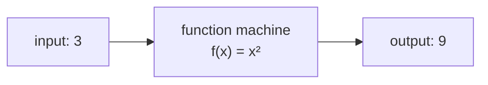
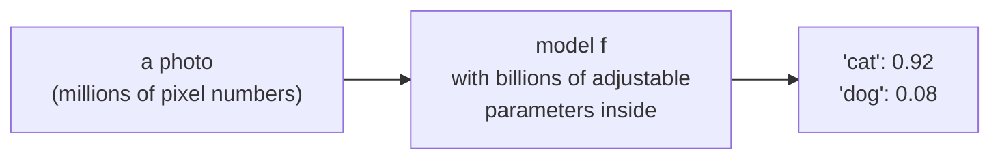
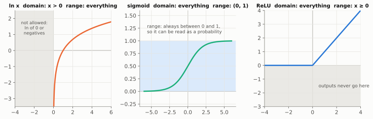
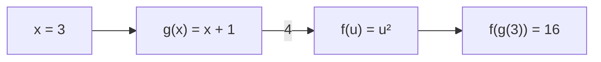
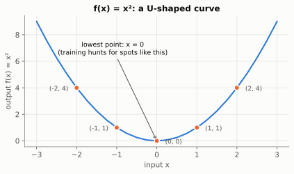
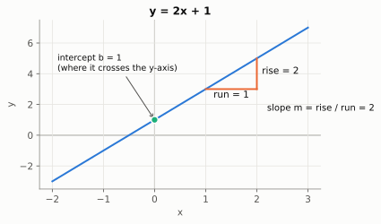
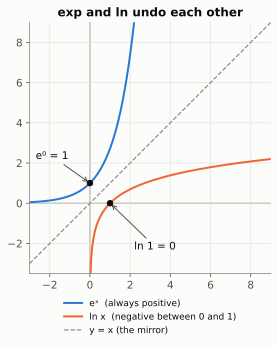
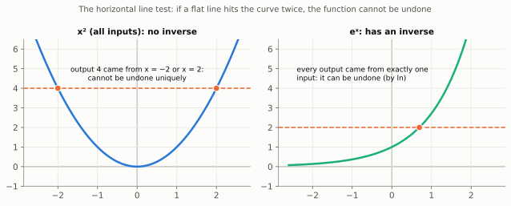

# Chapter 0: The Math Toolkit (Read This First)

> 🧭 **The question.** Here is a formula you will meet in Chapter 5:
>
> `L = (1/n) Σ (ŷᵢ − yᵢ)²`
>
> Right now it might look like noise. By the end of this chapter you will be able to read it aloud like a sentence, and work it out by hand.

*Where this fits in the book:* every later chapter is written in this notation. Think of this chapter as learning the alphabet before reading the story.

**The big idea:** every formula in this book is built from about eight small tools. If you meet them one at a time, none of them is scary. Skim anything you already know, and slow down on anything that feels unfamiliar.

Why start here? Most people who "are bad at math" were not bad at ideas. They lost the thread at one missing piece of notation and never got it back. This chapter fills in those pieces before they can trip you up.

## Variables and formulas

A **variable** is a name for a number that is allowed to change. We usually use short names like `x`, `w` or `b`. A **formula** is a recipe that tells you what to do with those numbers.

Take `y = 3x + 1`. It says: "take x, multiply by 3, add 1, and call the result y." Put in `x = 2` and you get `y = 3 × 2 + 1 = 7`.

> 💡 **Picture it:** a formula is a recipe card. The variables are the ingredients you are allowed to swap; the formula is the method that never changes.

Two habits of mathematical writing to get used to:

- **Multiplication is often invisible.** `3x` means `3 × x`, and `wx` means `w × x`.
- **Order of operations:** brackets first, then powers, then multiplication and division, then addition and subtraction. So `2 + 3 × 4 = 14`, not 20.

Variables and formulas are the words of mathematics. The most important kind of formula is one that takes something in and gives something back.

## Functions: machines with an input and an output

A **function** is a machine: one number goes in, one number comes out, and the same input always gives the same output. We write `f(x)`, read "f of x".



For `f(x) = x²`, feeding in 3 gives `f(3) = 9`, and feeding in -2 gives `f(-2) = 4`.

| Function | Rule in words | f(3) |
| --- | --- | --- |
| `f(x) = 2x + 1` | double it, add one | 7 |
| `f(x) = x²` | square it | 9 |
| `f(x) = max(0, x)` | keep positives, replace negatives with 0 (this is ReLU from Chapter 2) | 3 |

Here is why functions matter so much: **an AI model is just a gigantic function.** Input goes in (a picture, a sentence), output comes out (a label, the next word). The numbers inside the function are its *parameters*, and "training" means adjusting them until the function behaves well.



### Domain and range: what goes in, what comes out

Every machine has rules about what it accepts and what it can produce.

- The **domain** is the set of inputs the function accepts.
- The **range** is the set of outputs it can actually produce.



| Function | Domain (allowed inputs) | Range (possible outputs) | Why it matters in AI |
| --- | --- | --- | --- |
| `x²` | any number | `0` or more | squared errors are never negative (Ch. 5) |
| `√x` | `0` or more | `0` or more | lengths of vectors (Ch. 1) |
| `ln x` | **more than 0** | any number | `ln(0)` is undefined, which is why the spam filter needs smoothing (Ch. 6) |
| `eˣ` | any number | **more than 0** | softmax uses it to turn any score into a positive number (Ch. 8) |
| sigmoid | any number | **between 0 and 1** | its output can be read as a probability (Ch. 9) |
| ReLU | any number | `0` or more | a hidden unit can switch off, but never go negative (Ch. 2) |

Most of the mysterious "why is there a tiny number added here?" moments in AI code are domain problems in disguise. When you see `np.log(p + 1e-9)`, someone is making sure `ln` never receives a 0.

> 💡 **What about "relations"?** Textbooks often start with *relations*, any pairing between two sets, and then define a function as a relation where each input has exactly one output. That is the formal foundation, but you will not need the word in this book. "One input in, exactly one output out" is the part that matters.


A model is one function. But big models are built by snapping smaller functions together, like carriages on a train.

### Composition: machines in a chain

Plug the output of one machine straight into another and you get a **composition**, written `f(g(x))` and read "f of g of x". Work from the inside out: first `g`, then `f`.



> 🤔 **Pause and predict.** With `f(x) = x²` and `g(x) = x + 1`, is `f(g(2))` the same as `g(f(2))`?
>
> <details markdown="1"><summary>Answer</summary>
>
> No. `f(g(2)) = f(3) = 9`, but `g(f(2)) = g(4) = 5`.
>
> </details>

Order matters. `f(g(3)) = (3 + 1)² = 16`, but `g(f(3)) = 3² + 1 = 10`. (Putting on socks then shoes is not the same as shoes then socks.)

This is the single most important idea in Chapter 0 for what comes later:

- **A deep network is a composition.** Layer 3 of layer 2 of layer 1 of the input: `f₃(f₂(f₁(x)))`.
- **The chain rule (Chapter 4) is the rule for differentiating compositions.** Backpropagation is just that rule applied to a very long chain.

<details markdown="1">
<summary>📜 <b>History:</b> who first wrote f(x)?</summary>

The idea of a function grew out of 17th-century studies of curves and motion. The notation `f(x)` was introduced by Leonhard Euler in 1734.

</details>

Machines and formulas are hard to feel in your gut. A picture fixes that.

## Graphs: seeing a function

To draw a function, put the input on the horizontal axis and the output on the vertical axis, and mark a point for each pair. For `f(x) = x²`:

| x | -2 | -1 | 0 | 1 | 2 |
| --- | --- | --- | --- | --- | --- |
| f(x) | 4 | 1 | 0 | 1 | 4 |

Join the dots and you get a U-shaped curve with its lowest point at `x = 0`. Keep that picture: **"find the lowest point of a curve" is the entire goal of training a model**, only in many dimensions instead of one.



A straight line has the form `y = mx + b`. Here `m` is the **slope** (how much y rises for each step of 1 in x) and `b` is the **intercept** (where the line crosses the vertical axis). Remember these names; Chapter 5 learns them from data.



<details markdown="1">
<summary>📜 <b>History:</b> how Descartes joined algebra and geometry</summary>

Drawing an equation as a picture is the great idea of René Descartes, published in 1637. Before him, algebra (equations) and geometry (shapes) were separate subjects. Afterwards, every point became a pair of numbers and every equation became a shape. The `x`/`y` axes are still called **Cartesian coordinates** after him, and this one move is the ancestor of "turn everything into vectors" in Chapter 1.

</details>

Two curves turn up in almost every chapter of this book: the exponential, and its mirror image, the logarithm. Exponents first.

## Exponents: repeated multiplication

`2³` means `2 × 2 × 2 = 8`. The small raised number is the **exponent** (or power). Three rules cover nearly everything you need:

- Multiplying adds exponents: `2³ × 2² = 2⁵ = 32`. (Count the 2s: three, then two more, five in all.) Dividing subtracts them: `2⁵ / 2² = 2³ = 8`.
- A power of zero is 1: `5⁰ = 1`.
- A negative exponent flips: `2⁻¹ = 1/2`, and `2⁻² = 1/4`.

One special number deserves an introduction: **e ≈ 2.718**. The function `eˣ` (written `exp(x)` in code) is the "natural" growth curve: it grows at a rate equal to its own size. You can ignore why for now. Just remember three facts: `e⁰ = 1`, `eˣ` is **always positive**, and it climbs steeply as `x` grows. It will show up in softmax (Chapter 8) and in the sigmoid squash (Chapter 9).

<details markdown="1">
<summary>📜 <b>History:</b> where e comes from, a banking puzzle</summary>

In 1683 Jacob Bernoulli asked a banking question: if 100% yearly interest is paid in ever smaller instalments (monthly, daily, every second), how much does £1 grow to in a year? The answer creeps up towards 2.71828…, a limit rather than infinity. Leonhard Euler named the number `e` in the 1720s and 1730s and showed it is the base for which the curve `eˣ` has a slope equal to its own height.

</details>

Nearly every operation in mathematics has an undo button. For exponents, the undo button is the logarithm.

## Logarithms: undoing an exponent

A **logarithm** answers the question "what power gives me this number?" Since `10³ = 1000`, we say `log₁₀(1000) = 3`. Since `2³ = 8`, `log₂(8) = 3`.

In AI, `log` almost always means the **natural log**, written `ln` or `log`, which asks the same question with base e. Here are the values worth recognising:

| x | 0.01 | 0.1 | 0.5 | 1 | 2 | 10 |
| --- | --- | --- | --- | --- | --- | --- |
| ln(x) | -4.61 | -2.30 | -0.69 | 0 | 0.69 | 2.30 |

> 🤔 **Pause and predict.** Is `ln(0.5)` positive or negative?
>
> <details markdown="1"><summary>Answer</summary>
>
> Negative: about `-0.69`. Any number between 0 and 1 needs a *negative* power of `e` to make it, because `e⁰ = 1` already.
>
> </details>

Three facts to carry forward:

1. `ln(1) = 0`.
2. For any number **between 0 and 1** (like a probability), `ln` is negative. So `-ln(p)` is positive, and it gets bigger the smaller `p` is. This is the heart of Chapter 8.
3. **Logs turn multiplication into addition:** `ln(a × b) = ln(a) + ln(b)`. Computers love this, because adding lots of tiny numbers is safer than multiplying them (Chapter 6 uses it).

The picture to keep: `eˣ` and `ln x` are mirror images across the diagonal line `y = x`, because each one undoes the other.



That "undo" relationship between `eˣ` and `ln x` is worth a closer look, because it has a name and a picture of its own.

### Inverse functions: running a machine backwards

`eˣ` and `ln x` are a pair of **inverse functions**: each undoes the other. `ln(eˣ) = x` and `e^(ln x) = x`. The inverse of `f` is written `f⁻¹`. (This `⁻¹` means "undo", not "1 divided by", an unlucky clash of notation.) Some other pairs:

| Function | Its inverse | Check with 3 |
| --- | --- | --- |
| add 5 | subtract 5 | `3 + 5 = 8`, then `8 - 5 = 3` |
| `2x` | `x / 2` | `6`, then `3` |
| `eˣ` | `ln x` | `e³ ≈ 20.09`, then `ln 20.09 ≈ 3` |
| `x²` (for `x ≥ 0` only) | `√x` | `9`, then `3` |

The graph of an inverse is always the mirror image of the original across the line `y = x`, as in the picture above: swapping inputs and outputs is the same as swapping the axes.

Not every function can be undone. If two different inputs give the same output, you cannot tell which one you started from:



`x²` sends both `-2` and `2` to `4`, so "undo square" is ambiguous. That is why the table restricts it to `x ≥ 0`. ReLU is even worse: it sends *every* negative number to 0. Information that a function throws away can never be recovered. You will see the same idea again in Chapter 2½, where a matrix with determinant 0 squashes space flat and has no inverse.

<details markdown="1">
<summary>📜 <b>History:</b> how logarithms saved astronomers weeks of work</summary>

John Napier published logarithms in 1614 to save astronomers from weeks of hand multiplication. With a table of logs, multiplying two huge numbers became looking up two logs, adding them, and looking the result back up. The slide rule, used by engineers for 350 years until pocket calculators arrived, is two log scales sliding against each other. AI uses the very same trick for the same reason: adding logs is safer than multiplying many small numbers.

</details>

AI formulas rarely deal with one number at a time. They add up thousands or millions. Mathematicians have a compact way to write that.

## Summation: the Σ symbol

The Greek capital sigma, Σ, is shorthand for "add these up." It looks scary and means very little:

$$
\sum_{i=1}^{3} x_i = x_1 + x_2 + x_3
$$

Read it as: "for i from 1 to 3, take x sub i, and add them all." The little `i` is a counter. If `x = [2, 5, 7]`, the sum is `2 + 5 + 7 = 14`.

Two uses you will see constantly:

$$
\text{mean} = \frac{1}{n}\sum_{i=1}^{n} x_i \qquad\qquad a \cdot b = \sum_{i=1}^{n} a_i\, b_i
$$

The first is the average (add up, divide by how many). The second is the dot product from Chapter 1.

> 💡 **Picture Σ as a `for` loop.** `Σᵢ xᵢ` is exactly `total = 0; for x_i in x: total += x_i`. Euler introduced the Σ notation in 1755; programmers reinvented it as the loop.

Σ came with little numbers attached, like `xᵢ`. Those deserve a word of their own.

## Subscripts and indexing

When we write `x₁, x₂, x₃` the small lowered number just says "which one." So `xᵢ` means "the i-th entry of x." One trap: **mathematicians count from 1, Python counts from 0.** The first entry of a list `x` is `x[0]` in code but `x₁` on paper.

You have now met every piece of notation in this book. Time to put them together.

## How to read any formula

Do not read a formula left to right like a sentence. Instead:

1. **Name every symbol.** What is each letter, and is it a single number or a list of numbers?
2. **Say it in words.** Out loud if you can.
3. **Plug in tiny numbers** and check it does what you said.

Practice on the formula for **mean squared error**, the loss used in Chapter 5:

$$
L = \frac{1}{n}\sum_{i=1}^{n} (\hat{y}_i - y_i)^2
$$

Symbols: `yᵢ` is the true answer for example i; `ŷᵢ` ("y hat") is the model's guess; `n` is the number of examples. In words: **"for each example, take guess minus truth, square it, add all those up, divide by how many."** Try two examples with truths `[1, 3]` and guesses `[2, 3]`: the errors are `1` and `0`, squares `1` and `0`, sum `1`, divided by 2 gives `L = 0.5`. A formula is just a recipe you can run by hand.

Reading a formula by hand builds understanding. Running it in code lets you experiment. Every recipe in this book becomes a few lines of numpy.

## Python survival kit

Almost every line of code in this book uses these few numpy moves:

```python
import numpy as np

a = np.array([1.0, 2.0, 3.0])
b = np.array([4.0, 5.0, 6.0])

print(a + b)           # [5. 7. 9.]  element by element
print(a * 2)           # [2. 4. 6.]  scales every entry
print(a * b)           # [ 4. 10. 18.]  multiplies matching entries
print(a @ b)           # 32.0  dot product: 4 + 10 + 18
print(a.sum())         # 6.0
print(a.mean())        # 2.0
print(np.sqrt(a))      # square root of each entry
print(np.exp(a))       # e to the power of each entry
print(np.log(a))       # natural log of each entry
print(a.shape)         # (3,)  a list of 3 numbers
```

Run it, and check each printed line against what you would calculate by hand.

## Back to the question

Remember the formula from the start? `L = (1/n) Σ (ŷᵢ − yᵢ)²`. You can read it now: "for each example, take the model's guess minus the truth, square it, add them all up, and divide by how many." Σ is a loop. The hat on `ŷ` marks the model's guess. The subscript `i` says which example. And because squares are never negative (their range is 0 or more), the total can only be zero when every guess is perfect.

## Check yourself

Try each question on paper before opening the answer.

1. If `f(x) = 2x² - 3`, what is `f(-2)`?
    <details markdown="1"><summary>Answer</summary>`2 × 4 - 3 = 5`.</details>
2. What is `2⁴ / 2²`?
    <details markdown="1"><summary>Answer</summary>subtracting exponents gives `2² = 4`.</details>
3. What are `ln(1)` and `log₂(32)`?
    <details markdown="1"><summary>Answer</summary>`0`, and `5` (since `2⁵ = 32`).</details>
4. Evaluate `Σ i²` for i from 1 to 4.
    <details markdown="1"><summary>Answer</summary>`1 + 4 + 9 + 16 = 30`.</details>
5. With `f(x) = 2x` and `g(x) = x - 1`, what are `f(g(5))` and `g(f(5))`?
    <details markdown="1"><summary>Answer</summary>`f(4) = 8` and `g(10) = 9`. Order matters.</details>
6. Why does `np.log(0)` cause trouble?
    <details markdown="1"><summary>Answer</summary>0 is outside the domain of `ln`, which only accepts positive numbers. numpy returns minus infinity.</details>
7. What is the inverse of `f(x) = 3x + 2`?
    <details markdown="1"><summary>Answer</summary>undo the steps in reverse order: subtract 2, then divide by 3, so `f⁻¹(x) = (x - 2) / 3`. Check: `f(1) = 5` and `f⁻¹(5) = 1`.</details>

## Chapter 0 in one breath

A function is a machine from numbers to numbers, with a domain of allowed inputs and a range of possible outputs. Machines can be chained (composition), and some can be run backwards (inverses), such as exponents and logs. Σ means "add these up." And every formula is a recipe you can run by hand with tiny numbers.

---

**Next:** [Chapter 1: Numbers With Direction](01-vectors.md). You can read the language now. Time for the first real idea: how can a computer tell that two movies are alike, when all it can do is arithmetic?
