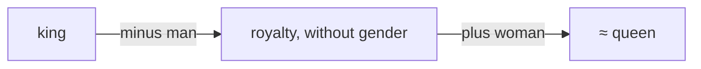

# Chapter 1: Numbers With Direction (Vectors)

**The big idea:** a vector is just a list of numbers. But a list of numbers can be read as an *arrow*, and arrows can be compared, added and scaled. That is why AI is built on them.

## The arrow view

Imagine you are standing in a field. "Walk 3 steps east and 4 steps north" is a vector: `[3, 4]`. Two numbers, one arrow.

How long is that arrow? Draw the right triangle: 3 across, 4 up. Pythagoras gives you `√(3² + 4²) = 5`. So the **length** (or *norm*) of `[3, 4]` is 5.


> 📜 **History.** Pythagoras' theorem was known to Babylonian scribes more than 1,000 years before Pythagoras, and Euclid proved it around 300 BCE. Treating arrows as objects you can add came much later. William Rowan Hamilton (quaternions, 1843) and Hermann Grassmann (1844) started it, and Josiah Willard Gibbs and Oliver Heaviside turned it into the "vector" toolkit physicists use, in the 1880s. Today's AI uses their arrows in thousands of dimensions.

## Length, step by step

In two dimensions the length came from Pythagoras. It extends naturally. Take `[1, 2, 2]` in three dimensions. First walk along the floor: 1 east and 2 north is a diagonal of length `√(1² + 2²) = √5`. Now climb 2 up. That is a second right triangle, with sides `√5` and `2`, so the total length is `√(5 + 4) = √9 = 3`.

Here is the same walk drawn in 3D. The three steps trace edges of a box, and the straight shortcut from start to end cuts through the box. The next picture flattens that shortcut into two right triangles.


The longest side of the first triangle becomes a short side of the second. Every extra dimension adds one more triangle to the chain, which is why the formula keeps the same shape at any size.

The pattern is: square every entry, add them up, take the square root.

$$
\lVert x \rVert = \sqrt{x_1^2 + x_2^2 + \cdots + x_n^2} = \sqrt{\sum_{i=1}^{n} x_i^2}
$$

The double bars `‖x‖` are just the notation for "length of x." The formula works for any number of entries, even 768 or 4,096, where nobody can picture the arrow. That is fine: **we do the geometry in 2D or 3D, where we can see it, and trust the algebra to carry over to any size.**

One more trick. To keep a vector's direction but forget its size, divide by its length. This gives a **unit vector** (length 1). For `[3, 4]`:

`[3, 4] / 5 = [0.6, 0.8]`, and its length is `√(0.36 + 0.64) = 1`. Normalising like this shows up everywhere in AI.

## The data view

Now forget fields. Describe a movie with three numbers: `[how funny, how scary, how long]`, each scored 0 to 10.

- *Scream*: `[4, 8, 6]`
- *Shaun of the Dead*: `[8, 6, 6]`
- *Paddington*: `[9, 0, 5]`

Each movie is now a point in 3D space. Movies with similar vibes sit close together. **This is the single most important trick in AI: turn things into vectors, and similarity becomes geometry.** Words, images, songs and users all get turned into vectors. (They are called *embeddings*, and you will meet them again in Chapter 10.)


Drawing just the funny and scary scores makes the idea visible: similar movies are neighbours, and the gaps between points are what the distance and similarity formulas below will measure.

## Adding and scaling

- **Add** vectors by adding matching positions: `[1, 2] + [3, 4] = [4, 6]`.
- **Scale** a vector by multiplying every entry: `2 × [1, 2] = [2, 4]` (same direction, twice as long).

A famous example from word embeddings: `king - man + woman ≈ queen`. That is just arithmetic on arrows. The arrow from `man` to `woman` points roughly the same way as the arrow from `king` to `queen`, so it behaves like a "make it female" direction you can add to any word.



> 📜 **History.** This example comes from **word2vec** (Tomas Mikolov and colleagues at Google, 2013). It trained word vectors by predicting which words appear near which, and was the first time many people saw that meaning could be turned into geometry. The analogy trick works only roughly, and real embeddings also absorb the biases in their training text, but the core idea, *meaning as direction*, powers every modern language model.


Adding follows one rule: walk along the first arrow, then along the second. (This picture uses a different pair, `[3, 1]` and `[1, 3]`, so the arrows are easier to tell apart; the rule is the same.) Walking them in the other order (dashed) lands on the same spot, which is why `a + b = b + a`. Scaling by 2 keeps the direction and doubles the length; scaling by a negative number flips the arrow around.

**Combining both moves** gives a *linear combination*, such as `2a + 3b`. Every point on the flat plane can be reached as some combination of `[1, 0]` and `[0, 1]`. For example, `[2, 3] = 2×[1, 0] + 3×[0, 1]`. A set of arrows that can build every point like this, with no spare arrows, is called a **basis**. Keep that in mind for Chapter 2: a matrix is fully described by what it does to the basis arrows.

## Distance: how far apart are two points?

If two movies are two points, the distance between them is the length of the arrow from one to the other. Subtract, then take the length.

See how far *Scream* `[4, 8, 6]` is from *Shaun of the Dead* `[8, 6, 6]`: the difference is `[-4, 2, 0]`, so the distance is `√(16 + 4 + 0) = √20 ≈ 4.47`. Against *Paddington* `[9, 0, 5]` the difference is `[-5, 8, 1]` and the distance is `√90 ≈ 9.49`. So *Scream* is much closer to *Shaun* than to *Paddington*, which matches our feeling.

This is called **Euclidean distance**. The dot product gives us a second, different way to compare vectors, covered next.

## The dot product: "how much do you agree?"

Multiply matching entries, then add them up:

`[1, 2, 3] · [4, 5, 6] = 1×4 + 2×5 + 3×6 = 32`

What does it mean? Two arrows pointing the same way give a big positive number. Arrows at right angles give 0. Arrows pointing opposite ways give a negative number. **The dot product measures alignment.**

Because it also grows with length, we usually divide by both lengths to get **cosine similarity**, a score from -1 (opposite) to 1 (identical direction). It is the workhorse of search engines and recommendation systems.

## The dot product, slowly

Here is the formula once more, with the Σ symbol from Chapter 0:

$$
a \cdot b = \sum_{i=1}^{n} a_i\, b_i = a_1 b_1 + a_2 b_2 + \cdots + a_n b_n
$$

The result is **a single number**, not a vector. That surprises many beginners.

The geometric meaning is this beautiful fact:

$$
a \cdot b = \lVert a \rVert \, \lVert b \rVert \cos\theta
$$

where `θ` is the angle between the two arrows. The cosine is a function that equals 1 when the angle is 0°, 0 at 90° and -1 at 180°:

| Angle between arrows | cos θ | Meaning |
| --- | --- | --- |
| 0° | 1 | pointing the same way |
| 45° | 0.71 | broadly similar |
| 90° | 0 | unrelated (perpendicular) |
| 180° | -1 | pointing opposite ways |

Picture a lamp shining straight down onto the line of `a`. The arrow `b` casts a shadow along that line, and the dot product is the length of `a` multiplied by the length of that shadow. In the example below it comes to exactly 9, the same number you get by multiplying matching entries (`3×2 + 1×3`) and adding.


The shadow also explains the sign. If it points the same way as `a`, the dot product is positive; if `b` is at a right angle there is no shadow, so it is zero; if `b` leans backwards the shadow points the other way and the result is negative.


This is exactly why a cosine similarity near 1 means "same direction", near 0 means "unrelated", and near -1 means "opposite".

Rearrange the equation to isolate the cosine and you get **cosine similarity**:

$$
\cos\theta = \frac{a \cdot b}{\lVert a \rVert \, \lVert b \rVert}
$$

Dividing by both lengths removes the effect of size, so only direction counts. This matters: a "loud" vector with big numbers would otherwise win every comparison just by being large.

> 📜 **History.** Search engines used cosine similarity long before neural networks. In the 1960s and 1970s Gerard Salton's SMART system at Cornell represented every document as a vector of word counts and ranked documents by the cosine between the query's vector and theirs. Modern "semantic search" keeps the cosine and swaps the word counts for learned embeddings.

Let us run the recipe by hand for *Scream* `[4, 8, 6]`, whose length is `√116 ≈ 10.77`:

| Compared with | Dot product | Other length | Cosine similarity |
| --- | --- | --- | --- |
| The Conjuring `[1, 10, 7]` | 4+80+42 = 126 | √150 ≈ 12.25 | 126 / (10.77 × 12.25) ≈ **0.96** |
| Shaun of the Dead `[8, 6, 6]` | 32+48+36 = 116 | √136 ≈ 11.66 | 116 / (10.77 × 11.66) ≈ **0.92** |
| Paddington `[9, 0, 5]` | 36+0+30 = 66 | √106 ≈ 10.30 | 66 / (10.77 × 10.30) ≈ **0.60** |

The ranking, *Conjuring* then *Shaun* then *Paddington*, is exactly what the code below will print.

## Why vectors, really?

This little example hides a huge idea. Replace our three hand-picked scores with 768 or 1,536 numbers *learned by a model*, and you have an **embedding**: a vector where closeness means closeness of meaning. Search engines that understand what you mean, recommendation systems, and the "retrieval" step in chatbots that look things up all work like this: embed everything, then rank by cosine similarity. The geometry you just learned is the real thing, only with more dimensions.

## Build it: a movie recommender

```python
import numpy as np

movies = {
    "Scream":            np.array([4, 8, 6]),
    "Shaun of the Dead": np.array([8, 6, 6]),
    "Paddington":        np.array([9, 0, 5]),
    "The Conjuring":     np.array([1, 10, 7]),
}

def cosine(a, b):
    return a @ b / (np.linalg.norm(a) * np.linalg.norm(b))

def most_similar(name):
    target = movies[name]
    scores = {m: cosine(target, v) for m, v in movies.items() if m != name}
    return sorted(scores.items(), key=lambda kv: -kv[1])

print(most_similar("Scream"))
```

Run it. *The Conjuring* should win for *Scream*. Now add your own favourite movie with three scores and see what it recommends.

**Try this:** change *Paddington* to `[0, 9, 5]`. Predict the new ranking before you run it.

## Check yourself

1. What is the length of `[5, 12]`? *Answer: `√(25 + 144) = √169 = 13`.*
2. Compute `[2, -1, 3] · [4, 0, -2]`. *Answer: `8 + 0 - 6 = 2`.*
3. Are `[1, 2]` and `[-4, 2]` at right angles? *Answer: the dot product is `-4 + 4 = 0`, so yes.*
4. Normalise `[0, 5, 0]`. *Answer: `[0, 1, 0]`.*
5. What is the cosine similarity of `[1, 1]` and `[3, 3]`? *Answer: exactly 1, since they point the same way (only the lengths differ).*
6. Write `[5, -2]` as a combination of the basis arrows `[1, 0]` and `[0, 1]`. *Answer: `5×[1, 0] + (-2)×[0, 1]`.*

## Chapter 1 in one breath

A vector is a list of numbers that you can treat as an arrow. The dot product tells you how aligned two arrows are, and that is how AI measures similarity.

---

**Next:** [Chapter 2: Machines That Reshape Space](02-matrices.md): the machines that transform those arrows, and the building block of every neural network layer.
