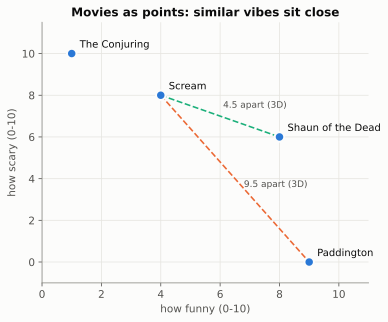
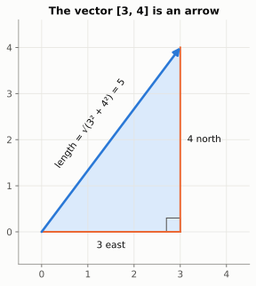
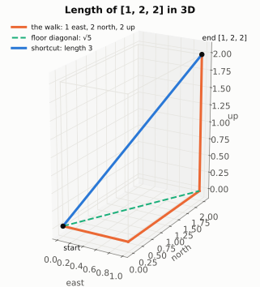
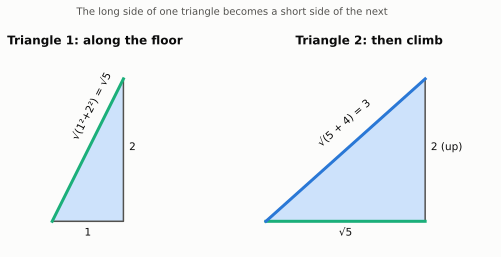
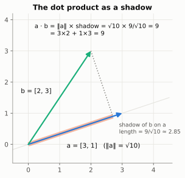
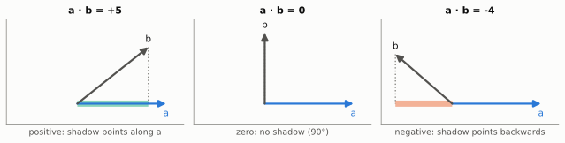
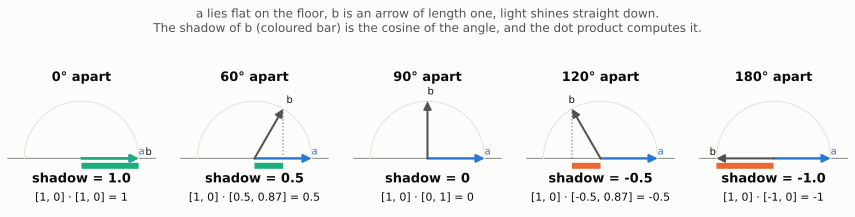
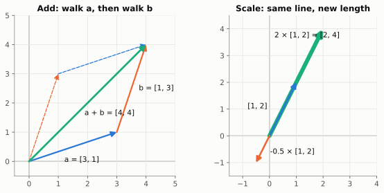
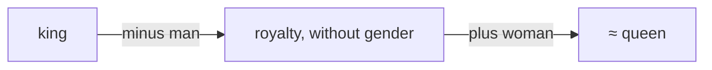

# Chapter 1: Numbers With Direction (Vectors)

> 🧭 **The question.** You just watched *Scream* and loved it. A streaming service has thousands of films. Which one should it suggest next?
>
> A friend would say "something scary, but fun". A computer can't feel "scary" or "fun"; it can only do arithmetic. By the end of this chapter you will have taught it to answer anyway, in about 20 lines of Python, using nothing but arrows.

*Where this fits in the book:* before a machine can finish *"The cat sat on the …"*, it needs a way to turn words into numbers that can be compared. Movies are the warm-up. Words work exactly the same way.

## Step 1: Turn each movie into numbers

A computer can't compare feelings, so give it numbers instead. Describe each movie with three scores from 0 to 10: `[how funny, how scary, how long]`.

| Movie | funny | scary | long |
| --- | --- | --- | --- |
| *Scream* | 4 | 8 | 6 |
| *Shaun of the Dead* | 8 | 6 | 6 |
| *Paddington* | 9 | 0 | 5 |
| *The Conjuring* | 1 | 10 | 7 |

A list of numbers like `[4, 8, 6]` is called a **vector**. Now draw the movies, using just the first two scores so the picture fits on a flat page:



Something nice has happened: movies with a similar feel landed near each other. *Scream* sits much closer to *Shaun of the Dead* than to *Paddington*. **This is the single most important trick in AI: turn things into vectors, and similarity becomes geometry.**

So "what should I watch next?" has become "which point is nearest?". To answer that we need to measure distances, and that means thinking of each vector as an **arrow**.

## Step 2: A list of numbers is an arrow

Imagine standing in a field. "Walk 3 steps east and 4 steps north" is the vector `[3, 4]`: two numbers, one arrow from where you started to where you end up.

How long is that arrow? It is the long side of a right triangle with sides 3 and 4, so Pythagoras gives `√(3² + 4²) = √25 = 5`. The **length** (also called the *norm*) of `[3, 4]` is 5.



> 🤔 **Pause and predict.** What is the length of `[6, 8]`? Try it before opening the answer.
>
> <details markdown="1"><summary>Answer</summary>
>
> `√(36 + 64) = √100 = 10`. It is `[3, 4]` doubled, and the length doubled too.
>
> </details>

<details markdown="1">
<summary>📜 <b>History:</b> where did arrows-as-numbers come from?</summary>

Pythagoras' theorem was known to Babylonian scribes more than 1,000 years before Pythagoras, and Euclid proved it around 300 BCE. Treating arrows as objects you can add came much later. William Rowan Hamilton (quaternions, 1843) and Hermann Grassmann (1844) started it, and Josiah Willard Gibbs and Oliver Heaviside turned it into the "vector" toolkit physicists use, in the 1880s. Today's AI uses their arrows in thousands of dimensions.

</details>

That works on a flat field with two numbers. But our movies have *three* numbers. Does Pythagoras still work in 3D?

## Step 3: Length in any number of dimensions

It does: you just use it twice. Take `[1, 2, 2]`. First walk along the floor, 1 east and 2 north. That is a diagonal of length `√(1² + 2²) = √5`. Then climb 2 up. That is a second right triangle, with sides `√5` and `2`, so the total length is `√(5 + 4) = √9 = 3`.





The long side of the first triangle becomes a short side of the second. Every extra dimension just adds one more triangle to the chain, so the recipe never changes: **square every entry, add them up, take the square root.**

$$
\lVert x \rVert = \sqrt{x_1^2 + x_2^2 + \cdots + x_n^2} = \sqrt{\sum_{i=1}^{n} x_i^2}
$$

The double bars `‖x‖` just mean "length of x". The formula works for 768 or 4,096 entries, where nobody can picture the arrow. That is fine: **we do the geometry in 2D or 3D, where we can see it, and trust the algebra to carry over to any size.**

We can now measure any arrow. And the distance between two movies is simply the length of the arrow from one to the other.

## Step 4: How far apart are two movies?

Subtract one vector from the other, then take the length of the result.

> 🤔 **Pause and predict.** Before reading on: which is closer to *Scream*, *Shaun of the Dead* or *Paddington*? Roughly how many times closer?

- *Scream* `[4, 8, 6]` minus *Shaun* `[8, 6, 6]` is `[-4, 2, 0]`. Distance: `√(16 + 4 + 0) = √20 ≈ 4.47`.
- *Scream* minus *Paddington* `[9, 0, 5]` is `[-5, 8, 1]`. Distance: `√(25 + 64 + 1) = √90 ≈ 9.49`.

*Shaun* is about twice as close, which matches our feeling. This is called **Euclidean distance**, and we nearly have a recommender.

**But distance has a blind spot.** Suppose a second website scores movies from 0 to 20 instead of 0 to 10. There, *Scream* becomes `[8, 16, 12]`: the same film, described the same way, just with bigger numbers. Its distance from our *Scream* is `√(16 + 64 + 36) ≈ 10.77`. That is *farther* than *Paddington*! Distance mixes up "how much" with "what kind".

What we really care about is the **direction** an arrow points in, not its length. We need a way to measure direction.

## Step 5: The dot product measures agreement

Here is the tool. Multiply matching entries, then add them up:

`[1, 2, 3] · [4, 5, 6] = 1×4 + 2×5 + 3×6 = 32`

With the Σ notation from Chapter 0:

$$
a \cdot b = \sum_{i=1}^{n} a_i\, b_i = a_1 b_1 + a_2 b_2 + \cdots + a_n b_n
$$

The result is **a single number**, not a vector. That surprises many beginners. What does the number mean? Picture a lamp shining straight down onto the line of `a`. The arrow `b` casts a shadow along that line, and **the dot product is the length of `a` multiplied by the length of `b`'s shadow.**



In this example the shadow method gives exactly 9, the same number as multiplying matching entries (`3×2 + 1×3 = 9`). The shadow also explains the **sign**:



If `b` leans the same way as `a`, the shadow points along `a` and the dot product is positive. At a right angle there is no shadow, so it is zero. Leaning backwards, the shadow points the other way and it is negative. **The dot product measures how much two arrows agree.**

> 🤔 **Pause and predict.** Are `[1, 2]` and `[-4, 2]` at right angles?
>
> <details markdown="1"><summary>Answer</summary>
>
> Yes. The dot product is `1×(-4) + 2×2 = 0`, so there is no shadow: they are perpendicular.
>
> </details>

There is one problem left. The dot product also grows when the arrows get longer, so a "loud" vector with big numbers would win every comparison, which is the same blind spot as before. The fix is the last step.

## Step 6: Cosine similarity, direction only

We want a score that depends only on which **direction** two arrows point, not on how long they are. Three small ideas get us there.

**Idea 1: make every arrow the same length.**

Imagine two people pointing at the same star. One uses a finger, the other a long walking stick. Their pointers have very different lengths, but they point the *same way*, and that is all we care about. So, to compare only directions, give every arrow the same length. The simplest length to choose is 1.

To do it, divide every number in the vector by the vector's length:

| Arrow | Its length | Divide by the length | Result |
| --- | --- | --- | --- |
| `[3, 4]` | 5 | `[3/5, 4/5]` | `[0.6, 0.8]` |
| `[6, 8]` (twice as long) | 10 | `[6/10, 8/10]` | `[0.6, 0.8]` |
| `[1.5, 2]` (half as long) | 2.5 | `[1.5/2.5, 2/2.5]` | `[0.6, 0.8]` |

All three land on exactly the same arrow, `[0.6, 0.8]`, and its length is `√(0.36 + 0.64) = √1 = 1`. The size has been thrown away and only the direction is left. An arrow of length 1 is called a **unit vector**.


All these arrows of length one end on a circle of radius 1 (a sphere, in 3D). Each spot on that circle is one direction. The loudness problem from Step 4 is now gone: *Scream* scored out of 10, `[4, 8, 6]`, and scored out of 20, `[8, 16, 12]`, both shrink to the same spot, `[0.37, 0.74, 0.56]`.

So comparing two movies now means comparing two spots on the circle, and the only thing left that can differ is the **angle** between them.

**Idea 2: turn the angle into a number, using a shadow.**

Take two arrows of length one, `a` and `b`, starting from the same point. Lay `a` flat along the floor, so `a = [1, 0]`. Shine a light straight down from above, and look at the shadow `b` casts on the floor. **The shadow measures how far `b` reaches in `a`'s direction.**



Read the panels from left to right:

- **Same direction (0°):** `b` lies on top of `a`, so its shadow is the whole arrow: **1**.
- **60° apart:** `b` ends at the point `[0.5, 0.87]`. Its shadow on the floor is its first number: **0.5**. It reaches halfway along `a`'s direction.
- **90° apart:** `b` points straight up. It casts no shadow: **0**. It doesn't reach along `a` at all.
- **120° apart:** `b` leans backwards. Its shadow points the wrong way: **-0.5**.
- **Opposite (180°):** the shadow is the whole arrow, backwards: **-1**.

This shadow length, which always lies between -1 and 1, has a name: it is the **cosine** of the angle between the arrows, written `cos θ`. (If you met cosine at school as "adjacent over hypotenuse", it is the same thing: the shadow is the adjacent side, and the hypotenuse is the arrow, of length 1.)

| Angle between arrows | cos θ (the shadow) | Meaning |
| --- | --- | --- |
| 0° | 1 | pointing the same way |
| 60° | 0.5 | broadly similar |
| 90° | 0 | unrelated (perpendicular) |
| 120° | -0.5 | leaning against each other |
| 180° | -1 | pointing opposite ways |

**Idea 3: the dot product measures the shadow for you.**

Look at the small sums under each panel. The dot product of `a = [1, 0]` with `b = [0.5, 0.87]` is `1 × 0.5 + 0 × 0.87 = 0.5`. That is exactly the shadow. Multiplying by `[1, 0]` simply picks out `b`'s first number, which is how far `b` reaches along the floor.

What if `a` doesn't lie flat on the floor? Then turn the whole picture until it does. Turning moves both arrows together. Their lengths don't change, and neither does the angle between them, so the shadow and the dot product don't change either. (This is the same fact as Step 5's "length of `a` × length of `b`'s shadow"; here `a` has length 1.) So the recipe works for any two arrows, in any number of dimensions:

> **Cosine similarity = shrink both arrows to length 1, then take their dot product.** It tells you how far one direction reaches along the other.

Shrinking means dividing each arrow by its length, so as a single formula:

$$
\cos\theta = \frac{a}{\lVert a \rVert} \cdot \frac{b}{\lVert b \rVert} = \frac{a \cdot b}{\lVert a \rVert \, \lVert b \rVert}
$$

The formula is not magic: it is the three ideas above, written in one line. The bottom of the fraction does the shrinking; the top measures the agreement.

**Check it with real numbers.** Shrink *Scream* `[4, 8, 6]` (length 10.77) and *The Conjuring* `[1, 10, 7]` (length 12.25):

- *Scream* becomes `[0.37, 0.74, 0.56]`.
- *The Conjuring* becomes `[0.08, 0.82, 0.57]`.
- Their dot product is `0.37×0.08 + 0.74×0.82 + 0.56×0.57 = 0.03 + 0.61 + 0.32 ≈ 0.96`.

That is an angle of only about 17° between their "taste arrows": very similar films.

And the blind spot is fixed. *Scream* on the 0 to 20 scale, `[8, 16, 12]`, shrinks to the same unit vector as `[4, 8, 6]`, so their cosine similarity is exactly **1**: identical taste, as it should be.

Here is the recipe for *Scream* against every other movie, done with the one-line formula (the same as shrinking first, with fewer steps):

| Compared with | Dot product | Other length | Cosine similarity |
| --- | --- | --- | --- |
| The Conjuring `[1, 10, 7]` | 4+80+42 = 126 | √150 ≈ 12.25 | 126 / (10.77 × 12.25) ≈ **0.96** |
| Shaun of the Dead `[8, 6, 6]` | 32+48+36 = 116 | √136 ≈ 11.66 | 116 / (10.77 × 11.66) ≈ **0.92** |
| Paddington `[9, 0, 5]` | 36+0+30 = 66 | √106 ≈ 10.30 | 66 / (10.77 × 10.30) ≈ **0.60** |

**The answer to our question:** someone who loved *Scream* should watch *The Conjuring* next, then *Shaun of the Dead*. Not *Paddington*.

<details markdown="1">
<summary>📜 <b>History:</b> search engines used this before AI did</summary>

In the 1960s and 1970s Gerard Salton's SMART system at Cornell represented every document as a vector of word counts and ranked documents by the cosine between the query's vector and theirs. Modern "semantic search" keeps the cosine and swaps the word counts for learned embeddings.

</details>

## Build it: a movie recommender

Everything above, in code:

```python
import numpy as np

movies = {
    "Scream":            np.array([4, 8, 6]),
    "Shaun of the Dead": np.array([8, 6, 6]),
    "Paddington":        np.array([9, 0, 5]),
    "The Conjuring":     np.array([1, 10, 7]),
}

def cosine(a, b):
    return a @ b / (np.linalg.norm(a) * np.linalg.norm(b))

def most_similar(name):
    target = movies[name]
    scores = {m: cosine(target, v) for m, v in movies.items() if m != name}
    return sorted(scores.items(), key=lambda kv: -kv[1])

print(most_similar("Scream"))
```

Run it. *The Conjuring* should win for *Scream*, just as in the table. Then add your own favourite movie with three scores and see what it recommends.

**Try this:** change *Paddington* to `[0, 9, 5]`. Predict the new ranking before you run it.

The recommender handles someone who loved *one* movie. But real viewers love several, and that needs one more move with arrows.

## Step 7: Adding and scaling arrows

Arrows can be combined in two ways:

- **Add** vectors by adding matching positions: `[1, 2] + [3, 4] = [4, 6]`. As a picture: walk along the first arrow, then along the second.
- **Scale** a vector by multiplying every entry: `2 × [1, 2] = [2, 4]`. Same direction, twice as long. A negative number flips it around.



Walking the two arrows in the other order (dashed) lands on the same spot, which is why `a + b = b + a`.

**Back to the movies.** A viewer loved both *Scream* and *Paddington*. Add their vectors to get a "taste profile": `[4, 8, 6] + [9, 0, 5] = [13, 8, 11]`. Now rank the movies they haven't seen by cosine similarity with that profile:

| Candidate | Cosine similarity with `[13, 8, 11]` |
| --- | --- |
| *Shaun of the Dead* | **0.99** |
| *The Conjuring* | 0.74 |

*Shaun of the Dead*, a horror comedy, is almost exactly a blend of a scary film and a funny one. Adding arrows blended two tastes into one.

The same arithmetic works on words. In 2013, Tomas Mikolov and colleagues at Google trained **word2vec**, which gave every word a vector learned from text, and found that `king - man + woman` lands close to `queen`. The arrow from *man* to *woman* points roughly the same way as the arrow from *king* to *queen*: a "make it female" direction you can add to any word.



(The trick only works roughly, and learned vectors also absorb the biases in their training text. But *meaning as direction* is the idea behind every modern language model.)

**Combining both moves** gives a *linear combination*, such as `2a + 3b`. Every point on a flat plane can be built from the two basic arrows `[1, 0]` and `[0, 1]`. For example, `[2, 3] = 2×[1, 0] + 3×[0, 1]`. A set of arrows that can build every point like this, with none to spare, is called a **basis**. Hold on to that idea: it is the key to the next chapter.


## Back to the question

We asked how a computer, which can only do arithmetic, could know what to recommend after *Scream*. The answer:

1. Describe each movie as a vector of numbers.
2. Treat the vectors as arrows.
3. Compare directions with cosine similarity, which ignores size and keeps only taste.

Real systems work exactly like this, only bigger. Instead of three hand-picked scores, a model *learns* 768 or 1,536 numbers for every movie, song, product, sentence or word. These learned vectors are called **embeddings**, and in them closeness means closeness of meaning. Search engines that understand what you mean, recommendation systems, and chatbots that look things up all do the same thing: embed everything, then rank by cosine similarity. The geometry you just learned is the real thing, only with more dimensions.

And for the book's big question: when a language model reads *"The cat sat on the …"*, each of those words has already become an embedding like these.

## Check yourself

Try each question on paper before opening the answer.

1. What is the length of `[5, 12]`?
    <details markdown="1"><summary>Answer</summary>`√(25 + 144) = √169 = 13`.</details>
2. Compute `[2, -1, 3] · [4, 0, -2]`.
    <details markdown="1"><summary>Answer</summary>`8 + 0 - 6 = 2`.</details>
3. Shrink `[0, 5, 0]` to a unit vector.
    <details markdown="1"><summary>Answer</summary>`[0, 1, 0]`: divide by its length, 5.</details>
4. What is the cosine similarity of `[1, 1]` and `[3, 3]`?
    <details markdown="1"><summary>Answer</summary>Exactly 1. They point the same way; only the lengths differ.</details>
5. Why is cosine similarity better than distance for comparing tastes?
    <details markdown="1"><summary>Answer</summary>It ignores length and keeps only direction, so rescoring a movie on a bigger scale does not make it look like a different film.</details>
6. Write `[5, -2]` as a combination of the basis arrows `[1, 0]` and `[0, 1]`.
    <details markdown="1"><summary>Answer</summary>`5×[1, 0] + (-2)×[0, 1]`.</details>

## Chapter 1 in one breath

A vector is a list of numbers that you can treat as an arrow. Its direction captures *what kind* of thing it is, and cosine similarity compares directions. That is how AI measures similarity.

---

**Next:** [Chapter 2: Machines That Reshape Space](02-matrices.md). We can now compare arrows. But a neural network does more than compare: it **transforms** them, turning one arrow into another. The machine that does this is called a matrix, and every layer of every network is one.
