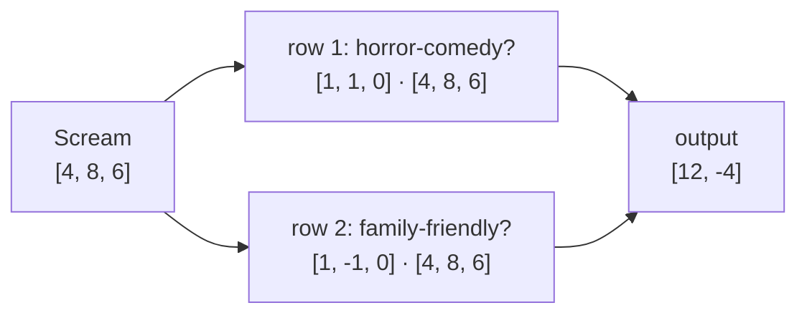
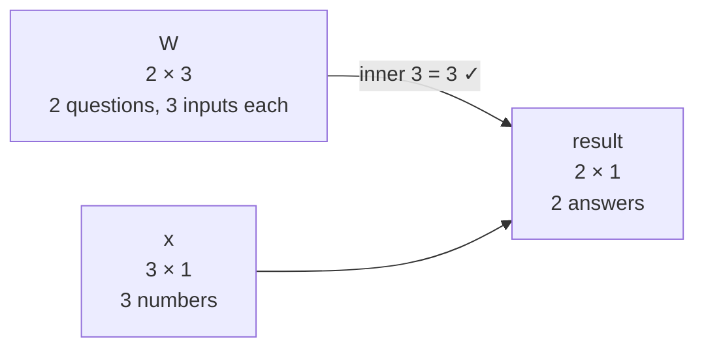
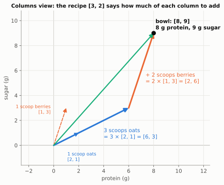
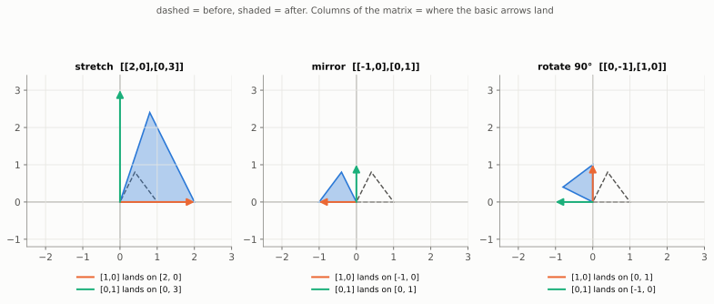
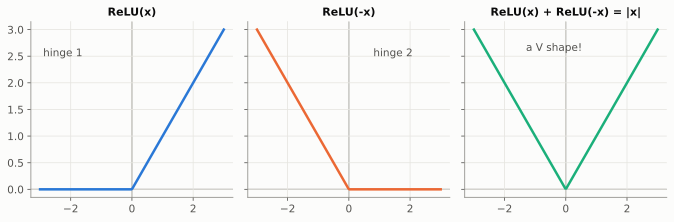
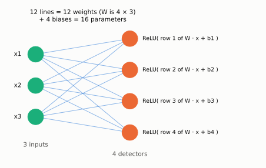
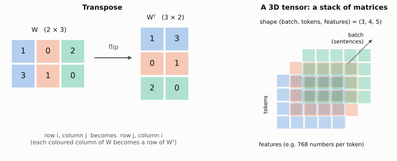

# Chapter 2: Machines That Reshape Space (Matrices)

> 🧭 **The question.** In Chapter 1 *we* chose the numbers for every movie. A neural network can't wait for someone to hand-score everything. It has to *compute* useful new numbers from raw ones: turn 784 pixel values into "this is probably a 7", or turn a word's vector into something more useful for predicting the next word.
>
> What kind of machine turns one list of numbers into another? And what exactly is a "layer" in a neural network?

*Where this fits in the book:* every word of *"The cat sat on the …"* passes through dozens of these machines before the model makes its guess.

**The big idea:** a matrix is a stack of dot-product questions. Put a vector in, ask it every question, and the answers form a new vector. A neural network layer is exactly this, plus one small twist.

## Step 1: One question is one dot product

Start with something you already know. In Chapter 1 each movie became a vector `[how funny, how scary, how long]`, and the dot product multiplied matching entries and added them up.

Now suppose you want a single new number for each movie: **"how much of a horror-comedy is this?"** A horror-comedy should be both funny *and* scary, and length doesn't matter. So write down one weight per score, saying how much each one counts:

| | funny | scary | long |
| --- | --- | --- | --- |
| weights for "horror-comedy?" | 1 | 1 | 0 |

The answer for a movie is the dot product of these weights with the movie's scores. For *Scream* `[4, 8, 6]`:

`[1, 1, 0] · [4, 8, 6] = 1×4 + 1×8 + 0×6 = 12`

*Shaun of the Dead* `[8, 6, 6]` scores `8 + 6 + 0 = 14`, the highest of our four films, which is fair for a film literally sold as a horror comedy.

The weights `[1, 1, 0]` act as a **detector**: they turn three raw scores into one answer to one question. Change the weights and you ask a different question.

## Step 2: Several questions at once is a matrix

Let's ask a second question as well: **"how family-friendly is this?"** Funny is good, scary is bad, length doesn't matter, so the weights are `[1, -1, 0]`. For *Scream*: `1×4 - 1×8 + 0×6 = -4`. Not one for the children.

Now write the two rows of weights one above the other. A grid of numbers like this is a **matrix**:

$$
W = \begin{bmatrix} 1 & 1 & 0 \\ 1 & -1 & 0 \end{bmatrix}
\quad
\begin{matrix} \leftarrow \text{horror-comedy?} \\ \leftarrow \text{family-friendly?} \end{matrix}
$$

**"Feeding a vector into a matrix" means asking every row its question.** Take the dot product of each row with the vector, and stack the answers:

$$
\begin{bmatrix} 1 & 1 & 0 \\ 1 & -1 & 0 \end{bmatrix}
\begin{bmatrix} 4 \\ 8 \\ 6 \end{bmatrix}
=
\begin{bmatrix} 1\times4 + 1\times8 + 0\times6 \\ 1\times4 - 1\times8 + 0\times6 \end{bmatrix}
=
\begin{bmatrix} 12 \\ -4 \end{bmatrix}
$$



That is all "multiplying a matrix by a vector" means. It is also written `W x`, or `W @ x` in Python.

> 🤔 **Pause and predict.** Feed *Paddington* `[9, 0, 5]` into the same matrix. What comes out?
>
> <details markdown="1"><summary>Answer</summary>
>
> Row 1: `9 + 0 + 0 = 9`. Row 2: `9 - 0 + 0 = 9`. The output is `[9, 9]`: a little bit horror-comedy (it is very funny), and very family-friendly.
>
> </details>

Here are all four films after going through the matrix:

| Movie | In: `[funny, scary, long]` | Out: `[horror-comedy, family-friendly]` |
| --- | --- | --- |
| *Scream* | `[4, 8, 6]` | `[12, -4]` |
| *Shaun of the Dead* | `[8, 6, 6]` | `[14, 2]` |
| *Paddington* | `[9, 0, 5]` | `[9, 9]` |
| *The Conjuring* | `[1, 10, 7]` | `[11, -9]` |

Notice what happened. Three raw scores went in, and two new, more *useful* numbers came out: answers to the questions we actually care about. **That is exactly what a layer in a neural network does.** The only difference is that a network learns its own questions (the weights) from data, instead of us writing them down. A layer might turn 784 pixel values into 128 answers, each one detecting some pattern, like "is there a loop at the top?" or "is there a straight stroke on the right?".

## Step 3: Shapes: what goes in and what comes out

Every row is dotted with the input, so **each row needs exactly one weight per input number**. Our matrix has 2 rows (2 questions, so 2 outputs) and 3 columns (3 inputs). It is called a **2 × 3 matrix** ("2 by 3"), and its **shape** is (2, 3). The entry in row `i`, column `j` is written `Wᵢⱼ`.

The rule, writing the input as a column of 3 numbers (a 3 × 1 matrix):

> The inner numbers must match, and the outer numbers give the answer's shape. (2 × **3**) times (**3** × 1) gives (2 × 1).



> 🤔 **Pause and predict.** Feed `[1, 2, 3]` into `[[1, 0, 2], [3, 1, 0]]`. What comes out, and what shape is it?
>
> <details markdown="1"><summary>Answer</summary>
>
> Row 1: `1×1 + 0×2 + 2×3 = 7`. Row 2: `3×1 + 1×2 + 0×3 = 5`. The output is `[7, 5]`: 2 numbers, because the matrix has 2 rows.
>
> </details>

If the shapes don't match, say a matrix with 3 columns and an input of 4 numbers, the dot products simply can't be done. A practical tip: **shape mistakes are the most common bug in AI code.** When something breaks, print `.shape` on everything.

## Step 4: A second way to read the same calculation

Step 2 read a matrix **one row at a time**: each row is a question. You can also read the very same grid **one column at a time**, and it tells a different, equally useful story. An everyday example shows both.

You are making a breakfast bowl from two ingredients. Here is what one scoop of each contains (made-up numbers):

| per scoop | oats | berries |
| --- | --- | --- |
| protein (g) | 2 | 1 |
| sugar (g) | 1 | 3 |

That table *is* a matrix, `[[2, 1], [1, 3]]`. Each **column** describes one ingredient, and each **row** is one nutrient. Your recipe is 3 scoops of oats and 2 scoops of berries, the input vector `[3, 2]`. What is in the bowl?

**Reading by rows (Step 2's way): ask one question per row.**

- Total protein = row 1 · recipe = `2×3 + 1×2 = 8`
- Total sugar = row 2 · recipe = `1×3 + 3×2 = 9`

**Reading by columns: add up the ingredients.**

- 3 scoops of oats bring `3 × [2, 1] = [6, 3]`
- 2 scoops of berries bring `2 × [1, 3] = [2, 6]`
- The bowl holds `[6, 3] + [2, 6] = [8, 9]`

Same answer, of course. And here is *why* both ways must agree. Both use the very same four multiplications; they just add them up in a different order:

| | oats column, × 3 | berries column, × 2 | **add across = row view** |
| --- | --- | --- | --- |
| protein | 2 × 3 = 6 | 1 × 2 = 2 | **8** |
| sugar | 1 × 3 = 3 | 3 × 2 = 6 | **9** |
| **read down = column view** | `[6, 3]` | `[2, 6]` | |

Adding **across** each row gives the row view. Reading **down** each column gives one scaled column per ingredient, and adding those two arrows gives the column view.

So in the column view, **the input numbers say how much of each column to mix in**. The output is "3 lots of column 1, plus 2 lots of column 2". In the picture, that is just Chapter 1's arrow addition: walk along 3 copies of the oats arrow, then 2 copies of the berries arrow.



Why bother with a second view? Because it makes one fact obvious that the row view hides. Feed in `[1, 0]`, "1 scoop of oats and no berries", and out comes exactly column 1, `[2, 1]`: the oats arrow. **Each column of a matrix is where one basic arrow lands.** That is the key to the pictures in the next step.

> 🤔 **Pause and predict.** Work out `[[2, 0], [1, 1]]` times `[3, 4]`, either way.
>
> <details markdown="1"><summary>Answer</summary>
>
> By rows: `2×3 + 0×4 = 6` and `1×3 + 1×4 = 7`. By columns: `3 × [2, 1] + 4 × [0, 1] = [6, 7]`. The answer is `[6, 7]` both ways.
>
> </details>

## Step 5: Watching a matrix reshape space

With two inputs and two outputs, you can do something even better than calculate: *see* what a matrix does to the whole plane. Take

$$
\begin{bmatrix} 2 & 0 \\ 0 & 3 \end{bmatrix}
\begin{bmatrix} 1 \\ 1 \end{bmatrix}
=
\begin{bmatrix} 2\times1 + 0\times1 \\ 0\times1 + 3\times1 \end{bmatrix}
=
\begin{bmatrix} 2 \\ 3 \end{bmatrix}
$$

Feed in the point `[1, 1]` and out comes `[2, 3]`: the first number got doubled and the second tripled. Do that to *every* point and the whole plane gets **stretched**, twice as wide and three times as tall. Other matrices rotate, flip or squash the plane instead. It is the same grid-of-numbers shape each time, with different behaviour.

### A few more 2D examples

Here are three matrices, each fed the point `[1, 2]`:

| Matrix | What it does | Result on `[1, 2]` |
| --- | --- | --- |
| `[[2, 0], [0, 3]]` | stretches x by 2 and y by 3 | `[2, 6]` |
| `[[-1, 0], [0, 1]]` | mirrors left-right | `[-1, 2]` |
| `[[0, -1], [1, 0]]` | rotates 90° anticlockwise | `[-2, 1]` |

The columns view from Step 4 gives a neat way to read any matrix. Feeding in `[1, 0]` means "one lot of the first column, none of the second", so **the first column is exactly where the arrow `[1, 0]` lands, and the second column is where `[0, 1]` lands.** In the rotation matrix, the first column is `[0, 1]`, so the arrow pointing east is sent to point north, exactly what a quarter turn does. A matrix is fully described by where it sends the basic arrows.



Watch what each matrix does to a small triangle. The dashed outline is the triangle before and the shaded one is where it lands. Whatever the matrix does to the two basic arrows, it does to every point in between.

A network applies one layer, then another, then another. So what happens when you run one matrix machine and then a second?

## Matrix times matrix

What if you apply one transformation after another? Say we double everything (matrix `A`) and then rotate (matrix `B`):

$$
A = \begin{bmatrix} 2 & 0 \\ 0 & 2 \end{bmatrix} \qquad
B = \begin{bmatrix} 0 & -1 \\ 1 & 0 \end{bmatrix} \qquad
BA = \begin{bmatrix} 0 & -2 \\ 2 & 0 \end{bmatrix}
$$

To get `B×A`, take the dot product of each row of `B` with each column of `A`. Check it on `[1, 2]`: doubling gives `[2, 4]`, rotating gives `[-4, 2]`. And `B×A` applied to `[1, 2]` gives `[0×1 + (-2)×2, 2×1 + 0×2] = [-4, 2]`. The same.

Note the order: `B×A` means "do `A` first, then `B`", read right to left like function notation `B(A(x))`. Order usually matters. For most pairs of matrices `B×A` and `A×B` are different (try putting on socks and shoes in the other order).

The lesson: **a chain of matrices collapses into a single matrix.** Ten matrix layers in a row would be no more powerful than one. So stacking plain matrices gets us nowhere new. Something has to break the straightness.

## Why we need the bend

A matrix can only do straight-line things: stretch, rotate, mirror, shear. It can never make a V-shape. But a little ReLU bend can. Take one input `x`. Use a matrix to make `[x, -x]`, apply ReLU to both entries, then add them up:

- `x = 2`: `[2, -2]` becomes `[2, 0]`, and the sum is `2`.
- `x = -3`: `[-3, 3]` becomes `[0, 3]`, and the sum is `3`.

That is the absolute value function, `|x|`, a V shape that no matrix alone can produce. Stack many such bends and you can approximate nearly any shape. This is the intuition behind the claim that neural networks can learn almost anything.



<details markdown="1">
<summary>💡 <b>Going deeper:</b> can a network really learn <i>any</i> shape?</summary>

In 1989 George Cybenko proved (and Kurt Hornik and colleagues extended) a precise version of this intuition. A network with just one hidden layer of bends can approximate any continuous function on a bounded range as closely as you like, given enough hidden units. Note what it does *not* promise: it says nothing about how many units you need, or whether training will actually find the right weights. Those practical questions are why depth and good optimisers matter.

</details>

Each bend alone is a simple hinge. Added together they make a shape with a corner, which no stack of plain matrices can produce.

So a bend is the missing ingredient. Put a matrix and a bend together and you have a neural network layer.

## From matrix to neural network layer

A layer does three things:

1. **Multiply** the input by a weight matrix `W` (the detectors).
2. **Add** a bias vector `b` (a built-in nudge for each detector).
3. **Squash** the result with a simple non-linear function. The most popular, *ReLU*, just replaces negatives with 0.

That is `output = ReLU(W · input + b)`.



Here is the same layer as a picture. Each of the 12 lines carries one weight from `W`, each detector adds its own bias, and the ReLU bend is applied last.

Why the squash? Without it, stacking many layers collapses into a single matrix, however deep you go. The bend in ReLU is what lets networks learn curvy, complicated patterns.

**The numbers inside `W` and `b` are the "parameters". When people say a model has 70 billion parameters, they mean 70 billion of these numbers.** Learning (Chapters 3 to 5) is finding good values for them.

<details markdown="1">
<summary>📜 <b>History:</b> the first artificial neuron (1943)</summary>

The first mathematical neuron was Warren McCulloch and Walter Pitts' 1943 model: add up weighted inputs, and "fire" if the total passes a threshold. Frank Rosenblatt's **perceptron** (1958) added a rule for *learning* the weights, and the US Navy demonstrated it on a room-sized computer. ReLU, the simple bend used here, became the default much later, around 2010 to 2012, after researchers found that it made deep networks far easier to train than the older S-shaped squashes.

</details>

The numbers inside `W` and `b` are what training will tune. How many of them are there?

## Counting parameters

A layer that maps 3 numbers to 4 numbers has a weight matrix of shape 4 × 3 (that is 12 weights) plus a bias of 4 numbers. That is **16 parameters**.

> 🤔 **Pause and predict.** How many parameters does a layer from 4 inputs to 3 outputs have?
>
> <details markdown="1"><summary>Answer</summary>
>
> `4 × 3 = 12` weights plus 3 biases: 15 parameters.
>
> </details>

Scale it up. A network for 28×28-pixel images (784 numbers) with a hidden layer of 128 detectors and 10 outputs has:

- Layer 1: `784 × 128 + 128 = 100,480`
- Layer 2: `128 × 10 + 10 = 1,290`
- Total: **101,770 parameters**

A large language model has the same ingredients, just wider, deeper and with attention (Chapter 10), reaching tens or hundreds of billions of parameters. There is no new kind of math at that scale, only more of it.

Enough counting. Let's build one.

## Build it: one layer from scratch

```python
import numpy as np

rng = np.random.default_rng(0)

def relu(x):
    return np.maximum(0, x)

class Layer:
    def __init__(self, n_in, n_out):
        self.W = rng.normal(0, 1, (n_out, n_in))  # n_out detectors
        self.b = np.zeros(n_out)

    def __call__(self, x):
        return relu(self.W @ x + self.b)

layer = Layer(3, 4)          # 3 numbers in, 4 detectors
movie = np.array([4, 8, 6])  # Scream from Chapter 1
print(layer(movie))
```

You just built the basic unit of every deep network. Stack a few and you have a deep network; you will make one learn in Chapter 9.

**Try this:** print `layer.W` next to the output. Pick one output number and verify by hand that it equals a row of `W` dotted with the movie, plus the bias, with negatives clipped to 0.

Our layer handles one input at a time. Real code processes thousands at once and shuffles shapes around constantly. Three practical tools make that possible.

## Transpose, batches and tensors

Three practical ideas that every piece of AI code relies on, and that the later chapters use without stopping to explain.

### Transpose: flip a matrix over

The **transpose** of a matrix swaps its rows and columns: row 1 becomes column 1, row 2 becomes column 2, and so on. It is written `Wᵀ` on paper and `W.T` in numpy. A 2 × 3 matrix becomes 3 × 2.



You will meet it in three places:

- **Dot products as matrix products.** If vectors are treated as columns, the dot product is "row times column", written `aᵀb`. That is why papers write `qᵀk` where this book writes `q · k`.
- **Going backwards through a layer.** A layer with `W` of shape 4 × 3 sends 3 numbers forward to 4 detectors. To send blame backwards from the 4 detectors to the 3 inputs, you use the same weights flipped: `Wᵀ`, shape 3 × 4. Each input collects blame from every detector it fed, weighted by the connection between them. That is the `.T` you will see in Chapter 9's backward pass.
- **Reordering products.** `(AB)ᵀ = BᵀAᵀ`. The order flips, like taking off your shoes before your socks.

### Batches: many inputs at once

Our layer took one input vector at a time. Graphics chips are fastest when given lots of work at once, so real code stacks many inputs as the **rows** of one matrix `X`, with shape (batch size, inputs). A single multiplication then processes the whole batch:

$$
\underbrace{X}_{(\text{batch} \times 3)} \; \underbrace{W^{\top}}_{(3 \times 4)} + b \;=\; \underbrace{\text{outputs}}_{(\text{batch} \times 4)}
$$

Each row of the result is one example's output. The bias `b` (4 numbers) is added to every row automatically, which numpy calls **broadcasting**. Many libraries store the weights already flipped, with shape (inputs, outputs), so the line becomes plain `X @ W + b`. That is the convention Chapter 9 uses. Neither is more correct: when in doubt, print the shapes.

### Tensors: beyond rows and columns

A single number has 0 dimensions, a vector 1, a matrix 2. Keep stacking and you get a **tensor**, the deep-learning word for an array with any number of dimensions.

| Data | Typical shape | Read it as |
| --- | --- | --- |
| a loss | `()` | one number |
| one token's embedding | `(768,)` | 768 features |
| a batch of embeddings | `(32, 768)` | 32 examples × 768 features |
| a batch of sentences | `(32, 128, 768)` | batch × tokens × features |
| a batch of colour images | `(32, 3, 224, 224)` | batch × colour channels × height × width |

Matrix multiplication extends naturally: the leading dimensions are treated as "do this for each one". Multiplying a `(32, 128, 768)` tensor by a `(768, 3072)` weight matrix applies the same layer to every token of every sentence and gives `(32, 128, 3072)`. This is why the shape-matching rule from earlier in this chapter is the most useful debugging tool in AI.

```python
import numpy as np

rng = np.random.default_rng(0)
W = rng.normal(0, 1, (4, 3))        # 4 detectors, 3 inputs
print(W.shape, W.T.shape)           # (4, 3) (3, 4)

X = rng.normal(0, 1, (5, 3))        # a batch of 5 inputs, one per row
b = np.zeros(4)
out = X @ W.T + b                   # (5, 3) @ (3, 4) -> (5, 4); b is added to every row
print(out.shape)

T = rng.normal(0, 1, (2, 6, 3))     # 2 sentences, 6 tokens each, 3 features per token
print((T @ W.T).shape)              # (2, 6, 4): the same layer applied to every token
```

## Back to the question

We asked what kind of machine turns one list of numbers into another. The answer is a **matrix**: each row is a detector that scores the input with a dot product, and together the rows produce a new vector, possibly of a different size. And a neural network **layer** is a matrix, plus a bias, plus a bend. The bend matters: without it, any number of layers would collapse into a single matrix.

In the code above, our layer turned *Scream* into 4 detector outputs. But its numbers are random, so those outputs mean nothing yet.

## Check yourself

Try each question on paper before opening the answer.

1. A 4 × 3 matrix multiplies a vector of 3 numbers. How many numbers come out?
    <details markdown="1"><summary>Answer</summary>4.</details>
2. Compute `[[1, 2], [3, 4]]` times `[1, -1]`.
    <details markdown="1"><summary>Answer</summary>`[1 - 2, 3 - 4] = [-1, -1]`.</details>
3. What is ReLU applied to `[-2, 0.5, 3]`?
    <details markdown="1"><summary>Answer</summary>`[0, 0.5, 3]`.</details>
4. How many parameters (weights plus biases) in a layer from 10 inputs to 5 outputs?
    <details markdown="1"><summary>Answer</summary>`10 × 5 + 5 = 55`.</details>
5. `X` has shape (32, 10) and `W` has shape (10, 4). What is the shape of `X @ W`? And of `X.T`?
    <details markdown="1"><summary>Answer</summary>(32, 4), and (10, 32).</details>
6. A batch of sentences has shape (8, 50, 512) and goes through a layer with weights of shape (512, 256). What comes out?
    <details markdown="1"><summary>Answer</summary>(8, 50, 256): the same layer applied to each of the 50 tokens in each of the 8 sentences.</details>

## Chapter 2 in one breath

A matrix is a machine that turns vectors into vectors, with each row acting as a pattern detector. A neural layer is a matrix, a bias and a bend.

---

**Next:** [Chapter 3: How Steep Is It?](03-derivatives.md). Our layer is full of random numbers, so it produces nonsense. If you nudge one of those numbers, does the output get better or worse, and by how much? That question is called a derivative, and it is much friendlier than its reputation.

*Curious about determinants, eigenvectors, SVD or convolutions? Take the optional side trip to [Chapter 2½: More Ways to See a Matrix](02b-matrix-views.md) first.*
