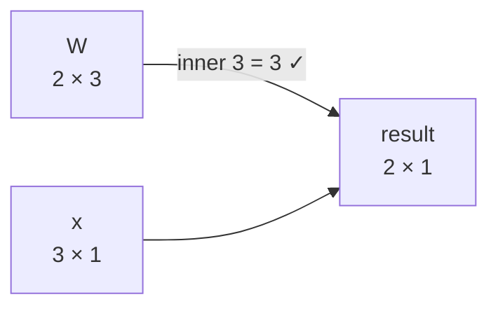

# Chapter 2: Machines That Reshape Space (Matrices)

**The big idea:** a matrix is a machine that takes a vector in and gives a new vector out. A neural network layer is exactly this, plus one small twist.

## A matrix is a grid, and also a verb

$$
\begin{bmatrix} 2 & 0 \\ 0 & 3 \end{bmatrix}
$$

Feed it the vector `[1, 1]`. Out comes `[2, 3]`: this matrix **stretches** the x-direction by 2 and the y-direction by 3. Other matrices rotate, flip or squash space. Same grid-of-numbers shape, different behaviour.

## Shapes and notation

A matrix with `m` rows and `n` columns is called an **m × n matrix** ("m by n"). The entry in row `i`, column `j` is written `Wᵢⱼ`. Here is a 2 × 3 matrix:

$$
W = \begin{bmatrix} 1 & 0 & 2 \\ 3 & 1 & 0 \end{bmatrix}
$$

Its **shape** is (2, 3). A list of 3 numbers is treated as a column of height 3, a 3 × 1 matrix. The rule for multiplying is:

> The inner numbers must match, and the outer numbers give the answer's shape. (2 × **3**) times (**3** × 1) gives (2 × 1).



So this matrix takes **3 numbers in and gives 2 numbers out**. Try it on `[1, 2, 3]`:

- Row 1: `1×1 + 0×2 + 2×3 = 7`
- Row 2: `3×1 + 1×2 + 0×3 = 5`

The output is `[7, 5]`. Notice that the matrix changed the *size* of the data, from 3 numbers to 2. That is how networks compress or expand information: a layer might turn 784 pixel values into 128 features.

A practical tip: **shape mistakes are the most common bug in AI code.** When something breaks, print `.shape` on everything.

## How the multiplication works

To multiply a matrix by a vector, take the **dot product of each row with the vector**:

$$
\begin{bmatrix} 1 & 2 \\ 3 & 4 \end{bmatrix}
\begin{bmatrix} 5 \\ 6 \end{bmatrix}
=
\begin{bmatrix} 1\times5 + 2\times6 \\ 3\times5 + 4\times6 \end{bmatrix}
=
\begin{bmatrix} 17 \\ 39 \end{bmatrix}
$$

That is all it is. Each output number answers one question: "how much does the input align with this row?" So **each row is a detector**. A row that is large where the input is large is detecting that pattern.

There is a second, equally useful way to read the same product: **the output is a mix of the matrix's columns**, using the input numbers as the amounts. Here `5 × [1, 3] + 6 × [2, 4] = [5 + 12, 15 + 24] = [17, 39]`. Rows-as-detectors and columns-as-ingredients are two views of one calculation. Use whichever makes the picture clearer.

## Matrices began as a shortcut for equations

Long before neural networks, matrices were invented to solve **systems of equations**. Take

$$
\begin{aligned} 2x + 3y &= 6 \\ -x + y &= 1 \end{aligned}
\quad\Longleftrightarrow\quad
\begin{bmatrix} 2 & 3 \\ -1 & 1 \end{bmatrix}
\begin{bmatrix} x \\ y \end{bmatrix}
=
\begin{bmatrix} 6 \\ 1 \end{bmatrix}
$$

The matrix holds the coefficients, the vector holds the unknowns, and one line stands for the whole system. The solution is `x = 0.6, y = 1.6` (check it: `1.2 + 4.8 = 6` and `-0.6 + 1.6 = 1`). In numpy, `np.linalg.solve(A, b)` does this for thousands of equations at once.

> 📜 **History.** Chinese mathematicians solved systems like this by arranging coefficients in a grid of counting rods. The method appears in *The Nine Chapters on the Mathematical Art*, compiled around 2,000 years ago, and it is essentially what we now call Gaussian elimination. The word *matrix* (Latin for "womb", the thing other things grow from) was coined by James Joseph Sylvester in 1850, and Arthur Cayley worked out the rules for multiplying matrices in 1858. Cayley could not have guessed that his rule would one day run trillions of times a second on graphics chips.

## Reshaping space: a few 2D examples

In two dimensions you can *see* what a matrix does. Apply each of these to the point `[1, 2]`:

| Matrix | What it does | Result on `[1, 2]` |
| --- | --- | --- |
| `[[2, 0], [0, 3]]` | stretches x by 2 and y by 3 | `[2, 6]` |
| `[[-1, 0], [0, 1]]` | mirrors left-right | `[-1, 2]` |
| `[[0, -1], [1, 0]]` | rotates 90° anticlockwise | `[-2, 1]` |

There is a neat way to read any matrix: **its first column is where the arrow `[1, 0]` lands, and its second column is where `[0, 1]` lands.** In the rotation matrix, the first column is `[0, 1]`, so the arrow pointing east is sent to point north, exactly what a quarter turn does. A matrix is fully described by where it sends the basic arrows.


Watch what each matrix does to a small triangle. The dashed outline is the triangle before and the shaded one is where it lands. Whatever the matrix does to the two basic arrows, it does to every point in between.

## Matrix times matrix

What if you apply one transformation after another? Say we double everything (matrix `A`) and then rotate (matrix `B`):

$$
A = \begin{bmatrix} 2 & 0 \\ 0 & 2 \end{bmatrix} \qquad
B = \begin{bmatrix} 0 & -1 \\ 1 & 0 \end{bmatrix} \qquad
BA = \begin{bmatrix} 0 & -2 \\ 2 & 0 \end{bmatrix}
$$

To get `B×A`, take the dot product of each row of `B` with each column of `A`. Check it on `[1, 2]`: doubling gives `[2, 4]`, rotating gives `[-4, 2]`. And `B×A` applied to `[1, 2]` gives `[0×1 + (-2)×2, 2×1 + 0×2] = [-4, 2]`. The same.

Note the order: `B×A` means "do `A` first, then `B`", read right to left like function notation `B(A(x))`. Order usually matters. For most pairs of matrices `B×A` and `A×B` are different (try putting on socks and shoes in the other order).

The lesson: **a chain of matrices collapses into a single matrix.** Ten matrix layers in a row would be no more powerful than one. That is exactly why the "bend" in step 3 below is essential.

## Why we need the bend

A matrix can only do straight-line things: stretch, rotate, mirror, shear. It can never make a V-shape. But a little ReLU bend can. Take one input `x`. Use a matrix to make `[x, -x]`, apply ReLU to both entries, then add them up:

- `x = 2`: `[2, -2]` becomes `[2, 0]`, and the sum is `2`.
- `x = -3`: `[-3, 3]` becomes `[0, 3]`, and the sum is `3`.

That is the absolute value function, `|x|`, a V shape that no matrix alone can produce. Stack many such bends and you can approximate nearly any shape. This is the intuition behind the claim that neural networks can learn almost anything.


> 📜 **The universal approximation theorem.** In 1989 George Cybenko proved (and Kurt Hornik and colleagues extended) a precise version of this intuition. A network with just one hidden layer of bends can approximate any continuous function on a bounded range as closely as you like, given enough hidden units. Note what it does *not* promise: it says nothing about how many units you need, or whether training will actually find the right weights. Those practical questions are why depth and good optimisers matter.

Each bend alone is a simple hinge. Added together they make a shape with a corner, which no stack of plain matrices can produce.

## From matrix to neural network layer

A layer does three things:

1. **Multiply** the input by a weight matrix `W` (the detectors).
2. **Add** a bias vector `b` (a built-in nudge for each detector).
3. **Squash** the result with a simple non-linear function. The most popular, *ReLU*, just replaces negatives with 0.

That is `output = ReLU(W · input + b)`.


Here is the same layer as a picture. Each of the 12 lines carries one weight from `W`, each detector adds its own bias, and the ReLU bend is applied last.

Why the squash? Without it, stacking many layers collapses into a single matrix, however deep you go. The bend in ReLU is what lets networks learn curvy, complicated patterns.

**The numbers inside `W` and `b` are the "parameters". When people say a model has 70 billion parameters, they mean 70 billion of these numbers.** Learning (Chapters 3 to 5) is finding good values for them.

> 📜 **History.** The first mathematical neuron was Warren McCulloch and Walter Pitts' 1943 model: add up weighted inputs, and "fire" if the total passes a threshold. Frank Rosenblatt's **perceptron** (1958) added a rule for *learning* the weights, and the US Navy demonstrated it on a room-sized computer. ReLU, the simple bend used here, became the default much later, around 2010 to 2012, after researchers found that it made deep networks far easier to train than the older S-shaped squashes.

## Counting parameters

A layer that maps 3 numbers to 4 numbers has a weight matrix of shape 4 × 3 (that is 12 weights) plus a bias of 4 numbers. That is **16 parameters**.

Scale it up. A network for 28×28-pixel images (784 numbers) with a hidden layer of 128 detectors and 10 outputs has:

- Layer 1: `784 × 128 + 128 = 100,480`
- Layer 2: `128 × 10 + 10 = 1,290`
- Total: **101,770 parameters**

A large language model has the same ingredients, just wider, deeper and with attention (Chapter 10), reaching tens or hundreds of billions of parameters. There is no new kind of math at that scale, only more of it.

## Build it: one layer from scratch

```python
import numpy as np

rng = np.random.default_rng(0)

def relu(x):
    return np.maximum(0, x)

class Layer:
    def __init__(self, n_in, n_out):
        self.W = rng.normal(0, 1, (n_out, n_in))  # n_out detectors
        self.b = np.zeros(n_out)

    def __call__(self, x):
        return relu(self.W @ x + self.b)

layer = Layer(3, 4)          # 3 numbers in, 4 detectors
movie = np.array([4, 8, 6])  # Scream from Chapter 1
print(layer(movie))
```

You just built the basic unit of every deep network. Stack a few and you have a deep network; you will make one learn in Chapter 9.

**Try this:** print `layer.W` next to the output. Pick one output number and verify by hand that it equals a row of `W` dotted with the movie, plus the bias, with negatives clipped to 0.

## Transpose, batches and tensors

Three practical ideas that every piece of AI code relies on, and that the later chapters use without stopping to explain.

### Transpose: flip a matrix over

The **transpose** of a matrix swaps its rows and columns: row 1 becomes column 1, row 2 becomes column 2, and so on. It is written `Wᵀ` on paper and `W.T` in numpy. A 2 × 3 matrix becomes 3 × 2.


You will meet it in three places:

- **Dot products as matrix products.** If vectors are treated as columns, the dot product is "row times column", written `aᵀb`. That is why papers write `qᵀk` where this book writes `q · k`.
- **Going backwards through a layer.** A layer with `W` of shape 4 × 3 sends 3 numbers forward to 4 detectors. To send blame backwards from the 4 detectors to the 3 inputs, you use the same weights flipped: `Wᵀ`, shape 3 × 4. Each input collects blame from every detector it fed, weighted by the connection between them. That is the `.T` you will see in Chapter 9's backward pass.
- **Reordering products.** `(AB)ᵀ = BᵀAᵀ`. The order flips, like taking off your shoes before your socks.

### Batches: many inputs at once

Our layer took one input vector at a time. Graphics chips are fastest when given lots of work at once, so real code stacks many inputs as the **rows** of one matrix `X`, with shape (batch size, inputs). A single multiplication then processes the whole batch:

$$
\underbrace{X}_{(\text{batch} \times 3)} \; \underbrace{W^{\top}}_{(3 \times 4)} + b \;=\; \underbrace{\text{outputs}}_{(\text{batch} \times 4)}
$$

Each row of the result is one example's output. The bias `b` (4 numbers) is added to every row automatically, which numpy calls **broadcasting**. Many libraries store the weights already flipped, with shape (inputs, outputs), so the line becomes plain `X @ W + b`. That is the convention Chapter 9 uses. Neither is more correct: when in doubt, print the shapes.

### Tensors: beyond rows and columns

A single number has 0 dimensions, a vector 1, a matrix 2. Keep stacking and you get a **tensor**, the deep-learning word for an array with any number of dimensions.

| Data | Typical shape | Read it as |
| --- | --- | --- |
| a loss | `()` | one number |
| one token's embedding | `(768,)` | 768 features |
| a batch of embeddings | `(32, 768)` | 32 examples × 768 features |
| a batch of sentences | `(32, 128, 768)` | batch × tokens × features |
| a batch of colour images | `(32, 3, 224, 224)` | batch × colour channels × height × width |

Matrix multiplication extends naturally: the leading dimensions are treated as "do this for each one". Multiplying a `(32, 128, 768)` tensor by a `(768, 3072)` weight matrix applies the same layer to every token of every sentence and gives `(32, 128, 3072)`. This is why the shape-matching rule from earlier in this chapter is the most useful debugging tool in AI.

```python
import numpy as np

rng = np.random.default_rng(0)
W = rng.normal(0, 1, (4, 3))        # 4 detectors, 3 inputs
print(W.shape, W.T.shape)           # (4, 3) (3, 4)

X = rng.normal(0, 1, (5, 3))        # a batch of 5 inputs, one per row
b = np.zeros(4)
out = X @ W.T + b                   # (5, 3) @ (3, 4) -> (5, 4); b is added to every row
print(out.shape)

T = rng.normal(0, 1, (2, 6, 3))     # 2 sentences, 6 tokens each, 3 features per token
print((T @ W.T).shape)              # (2, 6, 4): the same layer applied to every token
```

## Going deeper: more ways to read a matrix

These ideas are not needed for the rest of the book, but they show up constantly in AI papers, and each has a clear picture.

### The determinant: how much does area stretch?

Apply a 2 × 2 matrix to the unit square (side 1, area 1) and it becomes a parallelogram. The **determinant** is the area of that parallelogram, with a minus sign if the shape got flipped over. For a 2 × 2 matrix there is a short formula:

$$
\det \begin{bmatrix} a & b \\ c & d \end{bmatrix} = ad - bc
$$


- `[[2, 1], [0, 1.5]]`: `2 × 1.5 - 1 × 0 = 3`. Every shape gets 3 times bigger.
- `[[1, 2], [0.5, 1]]`: `1 × 1 - 2 × 0.5 = 0`. The square is **squashed flat onto a line**. The second column `[2, 1]` is just twice the first `[1, 0.5]`, so the two arrows point the same way and cannot span an area.

A determinant of zero is a warning sign: the matrix throws information away. Many different inputs land on the same output, so you cannot run it backwards. (There is no inverse matrix, and a system of equations with this matrix has either no solution or infinitely many.) In 3D the determinant measures how volume scales, and in higher dimensions "hyper-volume", but the picture is the same.

### Rank: how many directions survive?

The **rank** of a matrix counts how many truly independent directions its output can point in. Our collapsing matrix has rank 1, because everything lands on one line. A 1000 × 1000 matrix might have rank 1000 (it keeps every direction) or far less.

This matters in modern AI. **LoRA** (low-rank adaptation, 2021) fine-tunes a huge language model by learning a *low-rank* change to each weight matrix: the product of a tall thin matrix and a short wide one. For a 4096 × 4096 layer (about 16.8 million numbers), a rank-8 update needs only `4096×8 + 8×4096 ≈ 65,500` numbers, roughly 0.4% as many. Fine-tuning becomes cheap enough to run on a single graphics card.

### Eigenvectors: the directions a matrix does not turn

Most arrows get knocked off their line when a matrix acts on them. A few special arrows only get stretched or shrunk, staying on the line they started on. These are **eigenvectors** (German *eigen*, "own" or "characteristic"), and the stretch factor is the **eigenvalue**:

$$
A\,v = \lambda\,v
$$


For `A = [[2, 1], [1, 2]]`: `A × [1, 1] = [3, 3] = 3 × [1, 1]` (eigenvalue 3), and `A × [1, -1] = [1, -1]` (eigenvalue 1). Along these two directions the matrix is a pure stretch, so they are the matrix's natural "grain".

Where AI uses them:

- **PCA (principal component analysis)** finds the eigenvectors of a dataset's covariance matrix. The ones with the biggest eigenvalues are the directions in which the data varies most, so you can keep a handful of them and drop the rest, compressing 100 features down to 10 while losing little. Karl Pearson invented the idea in 1901.
- **Google's original PageRank** (1998) ranked web pages by the top eigenvector of a giant matrix of links.
- **Training stability**: when a signal passes through many layers, the stretch factors multiply. Factors above 1 blow up and factors below 1 fade away, which is the "exploding and vanishing gradients" problem you will meet in Chapter 4.

### SVD: every matrix is rotate, stretch, rotate

Eigenvectors only behave nicely for some square matrices. The **singular value decomposition (SVD)** works for *every* matrix, of any shape, and says something remarkable: any matrix does just three simple things in a row.

$$
A = U \, \Sigma \, V^{\top}
$$

1. `Vᵀ` **rotates** (or reflects) the input.
2. `Σ` (capital sigma) **stretches** along perpendicular axes. The stretch factors are the **singular values**, listed biggest first.
3. `U` **rotates** again.


For `A = [[1.5, 1], [0, 1]]` the singular values are 1.91 and 0.79: the circle becomes an ellipse with those half-widths. Their product, `1.91 × 0.79 = 1.5`, is the determinant: total stretching is area scaling. The number of non-zero singular values is the rank.

**The best way to compress a matrix.** SVD writes any matrix as a sum of simple "rank-1" layers, ordered from most to least important. Keep only the first few and you get the best possible approximation of that rank (a result proved by Carl Eckart and Gale Young in 1936). Treat a greyscale photo as a 600 × 512 matrix of brightness values:


With 20 of the 512 layers, using about 7% of the numbers, the photo is clearly recognisable. The big singular values hold the structure; the small ones hold fine detail and noise.

Where it shows up in AI:

- **PCA** (above) is computed in practice as an SVD of the centred data.
- **LoRA** (above) learns exactly such a low-rank update.
- **Recommendation systems.** The Netflix Prize (2006 to 2009) offered a prize of 1 million US dollars for better movie recommendations. A key ingredient of the winning approaches was factorising the huge, mostly empty users × movies ratings matrix into a small number of "taste" directions, SVD-style. Each user and each movie became a short vector, an *embedding* learned from data, just like the hand-made movie vectors of Chapter 1.

> 📜 **History.** Eugenio Beltrami (1873) and Camille Jordan (1874) discovered the SVD independently. Practical algorithms for computing it, by Gene Golub and William Kahan in the 1960s, turned it into one of the most used tools in scientific computing.

```python
import numpy as np

A = np.array([[1.5, 1.0], [0.0, 1.0]])
U, S, Vt = np.linalg.svd(A)
print(S)                                     # [1.905 0.787]: the two stretch factors
print(np.allclose(U @ np.diag(S) @ Vt, A))   # True: rotate, stretch, rotate rebuilds A
print(S.prod(), np.linalg.det(A))            # both 1.5: total stretch = area scaling
```

### Convolution: one small detector, slid everywhere

Images break the plain layer. A tiny 28 × 28 image is 784 numbers, and a layer with 784 detectors needs `784 × 784 = 614,656` weights. Worse, a detector that learns to spot an edge in the top-left corner learns nothing about edges in the bottom-right.

A **convolution** fixes both problems with one small detector, called a **kernel** or filter (say 3 × 3, just 9 weights), slid across the whole image. At each position it takes the dot product of the kernel with the patch underneath. The same 9 weights are reused everywhere, which is called **weight sharing**.

Start in 1D. Slide the kernel `[-1, 1]` along the signal `[1, 1, 1, 5, 5, 5]`, two numbers at a time:

| Window | `[1, 1]` | `[1, 1]` | `[1, 5]` | `[5, 5]` | `[5, 5]` |
| --- | --- | --- | --- | --- | --- |
| `-1×left + 1×right` | 0 | 0 | **4** | 0 | 0 |

The output is zero wherever the signal is flat and lights up where it jumps: a **jump detector** made of two numbers. In 2D the same idea finds edges:


The output, called a **feature map**, is 0 over flat regions and -27 along the edge. (The sign says which way the brightness changes; a flipped kernel would give +27.) A convolutional network stacks many such layers. The first learn edges and blobs, the next combine them into textures and corners, and later ones into eyes, wheels and faces. Underneath it is still the Chapter 2 layer: a matrix multiplication whose matrix happens to repeat the same few weights in a sliding pattern.

> 💡 **Small print.** What deep learning calls "convolution" is, strictly, *cross-correlation*: textbook convolution flips the kernel first. Since the kernel's weights are learned anyway, the difference doesn't matter.

> 📜 **History.** In 1959 to 1962, David Hubel and Torsten Wiesel found neurons in the cat visual cortex that respond to edges at particular angles and positions (work that earned a 1981 Nobel Prize). Kunihiko Fukushima's *neocognitron* (1980) copied that layered design, and Yann LeCun's convolutional networks (1989) learned it with backpropagation, reading handwritten ZIP codes for the US Postal Service and later cheques. AlexNet, the 2012 network that started the deep learning boom, was a convolutional network.

```python
import numpy as np

img = np.zeros((6, 6)); img[:, 3:] = 9          # dark left half, bright right half
kernel = np.array([[1, 0, -1]] * 3)              # vertical-edge detector

out = np.zeros((4, 4))
for i in range(4):
    for j in range(4):
        out[i, j] = np.sum(img[i:i+3, j:j+3] * kernel)   # dot product of window and kernel
print(out)                                       # -27 along the edge, 0 elsewhere
```

## Check yourself

1. A 4 × 3 matrix multiplies a vector of 3 numbers. How many numbers come out? *Answer: 4.*
2. Compute `[[1, 2], [3, 4]]` times `[1, -1]`. *Answer: `[1 - 2, 3 - 4] = [-1, -1]`.*
3. What is ReLU applied to `[-2, 0.5, 3]`? *Answer: `[0, 0.5, 3]`.*
4. How many parameters (weights plus biases) in a layer from 10 inputs to 5 outputs? *Answer: `10 × 5 + 5 = 55`.*
5. What is the determinant of `[[3, 0], [0, 2]]`, and what does it do to area? *Answer: `3 × 2 - 0 = 6`, so every area becomes 6 times bigger.*
6. Why does `[[2, 4], [1, 2]]` have no inverse? *Answer: its determinant is `4 - 4 = 0`. The second column is twice the first, so the plane is squashed onto a line and information is lost.*
7. `X` has shape (32, 10) and `W` has shape (10, 4). What is the shape of `X @ W`? And of `X.T`? *Answer: (32, 4), and (10, 32).*
8. A batch of sentences has shape (8, 50, 512) and goes through a layer with weights of shape (512, 256). What comes out? *Answer: (8, 50, 256): the same layer applied to each of the 50 tokens in each of the 8 sentences.*
9. A matrix has singular values 5, 2 and 0. What is its rank, and what is its best rank-1 approximation built from? *Answer: rank 2. The best rank-1 approximation keeps only the layer with singular value 5.*
10. A 3 × 3 kernel slides over a 5 × 5 image without going past the edges. How big is the output, and how many weights does the kernel have? *Answer: 3 × 3 outputs (3 positions across, 3 down), and just 9 weights, shared across all positions.*

## Chapter 2 in one breath

A matrix is a machine that turns vectors into vectors, with each row acting as a pattern detector. A neural layer is a matrix, a bias and a bend.

## What Comes Next

We have a layer with random numbers in it, so it currently produces nonsense. Chapter 3 asks the key question: *if I nudge one of those numbers, does the output get better or worse?* That question is called a derivative, and it is much friendlier than its reputation.

---

**Next:** [Chapter 3: How Steep Is It?](03-derivatives.md): the question of which way to nudge a number.
