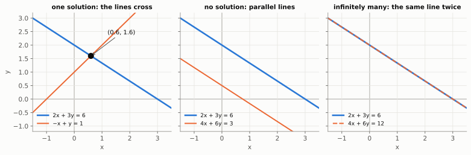
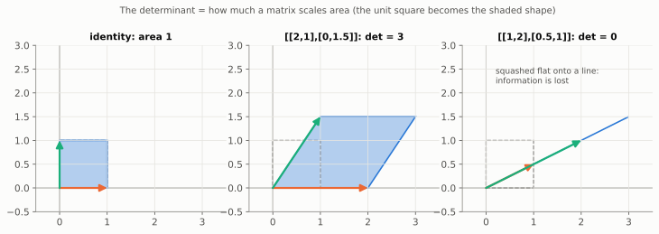
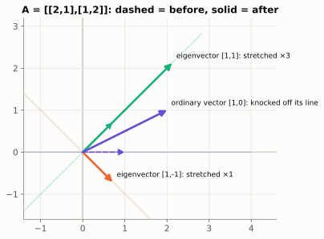
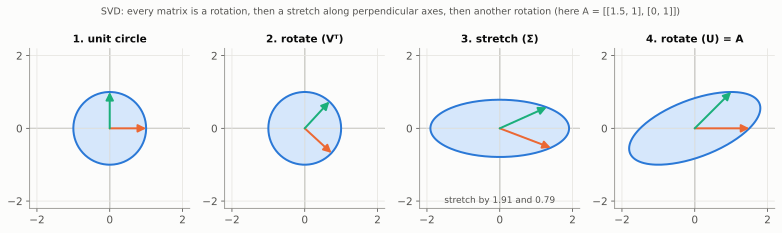
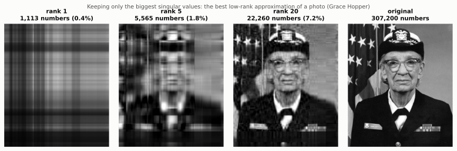
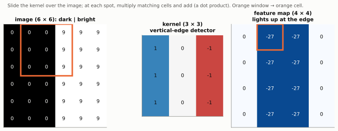

# Chapter 2½ (Optional): More Ways to See a Matrix

> 🧭 **The question.** In Chapter 2 a matrix was a machine that turns one arrow into another. But a matrix hides much more than that. Does it lose information along the way? Are there directions it leaves alone? Can a matrix with 16 million numbers be squeezed into 65 thousand? And how do image models scan a photo?
>
> This chapter answers those four questions, one picture at a time.

*This chapter is optional.* Nothing later depends on it, so you can go straight to [Chapter 3](03-derivatives.md) and come back whenever a paper or tutorial mentions determinants, eigenvectors, SVD, LoRA or convolutions. They appear constantly in AI writing, and each has a clear picture.

## Step 1: Where matrices came from: solving equations

Long before neural networks, matrices were invented to solve puzzles like this one: **find two numbers `x` and `y` such that**

$$
\begin{aligned} 2x + 3y &= 6 \\ -x + y &= 1 \end{aligned}
$$

Look at the left-hand sides with Chapter 2 eyes. `2x + 3y` is the dot product of the row `[2, 3]` with the input `[x, y]`, and `-x + y` is the row `[-1, 1]` dotted with the same input. So the whole puzzle is one matrix being fed one vector:

$$
\begin{bmatrix} 2 & 3 \\ -1 & 1 \end{bmatrix}
\begin{bmatrix} x \\ y \end{bmatrix}
=
\begin{bmatrix} 6 \\ 1 \end{bmatrix}
$$

In Chapter 2 we knew the input and worked out the output. Here it is the other way round: **we know the output `[6, 1]`, and want the input that produced it.** We need to run the machine backwards. There are three ways to see how.

### View 1: the picture

Each equation, on its own, is satisfied by a whole line of points. (`2x + 3y = 6` holds at `(3, 0)`, at `(0, 2)`, and everywhere on the straight line between and beyond them.) We need a point that is on **both** lines at once: the place where they cross.



The left panel shows our puzzle: the lines cross at exactly one point, `(0.6, 1.6)`. The other two panels show how a puzzle can go wrong. We will come back to them.

### View 2: elimination, step by step

The picture shows *where* the answer is. To get it exactly, combine the equations so that one unknown disappears. Write each equation as a row of the grid, with its answer on the right:

| | `x` | `y` | `=` |
| --- | --- | --- | --- |
| row 1 | 2 | 3 | 6 |
| row 2 | -1 | 1 | 1 |

1. **Get rid of `x` in row 2.** Row 2 has `-1` where row 1 has `2`. Add half of row 1 to row 2: `-1 + ½×2 = 0` for `x`, `1 + ½×3 = 2.5` for `y`, and `1 + ½×6 = 4` on the right. Row 2 is now `0x + 2.5y = 4`. Adding equations keeps them true, because you add the same amount to both sides.
2. **Solve row 2.** `2.5y = 4`, so `y = 4 / 2.5 = 1.6`.
3. **Work backwards into row 1.** `2x + 3×1.6 = 6`, so `2x = 6 - 4.8 = 1.2`, and `x = 0.6`.

Check: `2×0.6 + 3×1.6 = 1.2 + 4.8 = 6` ✓ and `-0.6 + 1.6 = 1` ✓.

Notice that we never needed the letters `x` and `y` while combining rows. We only did arithmetic on the grid of numbers. That is the point of the matrix: it is the bookkeeping, and the same steps work for 3 equations or 3,000. This method is called **Gaussian elimination**, and it is what `np.linalg.solve(A, b)` does inside, very fast.

### View 3: run the machine backwards with the inverse matrix

Chapter 0 met **inverse functions**: machines that undo other machines. Many matrices have one too, the **inverse matrix**, written `A⁻¹`. Feed it the output and it hands back the input:

$$
\begin{bmatrix} x \\ y \end{bmatrix} = A^{-1} \begin{bmatrix} 6 \\ 1 \end{bmatrix}
$$

For a 2 × 2 matrix there is a short recipe. **Swap** the two numbers on the main diagonal, **flip the signs** of the other two, and **divide everything** by `ad - bc`:

$$
A = \begin{bmatrix} a & b \\ c & d \end{bmatrix}
\quad\Longrightarrow\quad
A^{-1} = \frac{1}{ad - bc}\begin{bmatrix} d & -b \\ -c & a \end{bmatrix}
$$

For our `A = [[2, 3], [-1, 1]]`: `ad - bc = 2×1 - 3×(-1) = 2 + 3 = 5`, so

$$
A^{-1} = \frac{1}{5}\begin{bmatrix} 1 & -3 \\ 1 & 2 \end{bmatrix},
\qquad
A^{-1}\begin{bmatrix} 6 \\ 1 \end{bmatrix} = \frac{1}{5}\begin{bmatrix} 1\times6 - 3\times1 \\ 1\times6 + 2\times1 \end{bmatrix} = \frac{1}{5}\begin{bmatrix} 3 \\ 8 \end{bmatrix} = \begin{bmatrix} 0.6 \\ 1.6 \end{bmatrix}
$$

It is the same answer, found by literally running the machine in reverse.

> 🤔 **Pause and predict.** Check the recipe: multiply `A⁻¹` by `A`. What should you get, and why?
>
> <details markdown="1"><summary>Answer</summary>
>
> The **identity matrix** `[[1, 0], [0, 1]]`, the machine that changes nothing. "Do `A`, then undo it" must leave every input exactly as it was. Row 1 of `A⁻¹`, `[1, -3]/5`, times column 1 of `A`, `[2, -1]`, gives `(2 + 3)/5 = 1`, and the other entries work out the same way.
>
> </details>

In practice, computers prefer elimination: it is faster and less sensitive to rounding than computing the inverse. But the inverse is the clearest *picture* of what solving means.

```python
import numpy as np

A = np.array([[2.0, 3.0], [-1.0, 1.0]])
b = np.array([6.0, 1.0])
print(np.linalg.solve(A, b))         # [0.6 1.6]  elimination, done for you
print(np.linalg.inv(A) * 5)          # [[ 1. -3.] [ 1.  2.]]  the inverse, times 5
print(np.linalg.inv(A) @ b)          # [0.6 1.6]  running the machine backwards
```

<details markdown="1">
<summary>📜 <b>History:</b> matrices are 2,000 years old</summary>

Chinese mathematicians solved systems like this by arranging coefficients in a grid of counting rods. The method appears in *The Nine Chapters on the Mathematical Art*, compiled around 2,000 years ago, and it is essentially what we now call Gaussian elimination. The word *matrix* (Latin for "womb", the thing other things grow from) was coined by James Joseph Sylvester in 1850, and Arthur Cayley worked out the rules for multiplying matrices in 1858. Cayley could not have guessed that his rule would one day run trillions of times a second on graphics chips.

</details>

**Now look back at that division by 5.** The whole recipe divides by `ad - bc`. What if that number were **0**? You can't divide by zero, so there would be no inverse, and the machine could not be run backwards. That is exactly what happens in the middle and right panels of the picture. In `4x + 6y = 3` and `2x + 3y = 6`, for instance, `ad - bc = 4×3 - 6×2 = 0`: the lines are parallel and there is no solution at all, or they are the same line and there are infinitely many.

So one number, `ad - bc`, tells you whether a system of equations has exactly one answer. It has a name, and a lovely picture of its own.

## Step 2: Does the matrix lose information? The determinant

That number is called the **determinant**. Here is its picture. Apply a 2 × 2 matrix to the unit square (side 1, area 1) and it becomes a parallelogram. The determinant is the area of that parallelogram, with a minus sign if the shape got flipped over. For a 2 × 2 matrix it is exactly the `ad - bc` from Step 1:

$$
\det \begin{bmatrix} a & b \\ c & d \end{bmatrix} = ad - bc
$$



- Our equation matrix `[[2, 3], [-1, 1]]` has determinant 5: it makes every area 5 times bigger, and nothing is squashed, so it can be undone.
- `[[2, 1], [0, 1.5]]`: `2 × 1.5 - 1 × 0 = 3`. Every shape gets 3 times bigger.
- `[[1, 2], [0.5, 1]]`: `1 × 1 - 2 × 0.5 = 0`. The square is **squashed flat onto a line**. The second column `[2, 1]` is just twice the first `[1, 0.5]`, so the two arrows point the same way and cannot span an area.

> 🤔 **Pause and predict.** `[[2, 0], [0, 0.5]]` stretches one direction by 2 and squashes the other to half. What is its determinant, and what happens to area?
>
> <details markdown="1"><summary>Answer</summary>
>
> `2 × 0.5 - 0 × 0 = 1`. The square becomes a long thin rectangle, but its area is unchanged.
>
> </details>

A determinant of zero is a warning sign: the matrix throws information away. Many different inputs land on the same output, so you cannot run it backwards. (There is no inverse matrix, and a system of equations with this matrix has either no solution or infinitely many.) In 3D the determinant measures how volume scales, and in higher dimensions "hyper-volume", but the picture is the same.

A determinant of zero means some direction got flattened away. But how many directions survive? That has its own name.

## Step 3: How many directions survive? Rank

The **rank** of a matrix counts how many truly independent directions its output can point in. Our collapsing matrix has rank 1, because everything lands on one line. A 1000 × 1000 matrix might have rank 1000 (it keeps every direction) or far less.

This matters in modern AI. **LoRA** (low-rank adaptation, 2021) fine-tunes a huge language model by learning a *low-rank* change to each weight matrix: the product of a tall thin matrix and a short wide one. For a 4096 × 4096 layer (about 16.8 million numbers), a rank-8 update needs only `4096×8 + 8×4096 ≈ 65,500` numbers, roughly 0.4% as many. Fine-tuning becomes cheap enough to run on a single graphics card.

Rank counts the directions that survive. The next question is subtler: are there directions the matrix leaves *pointing the same way*?

## Step 4: Which directions stay put? Eigenvectors

Most arrows get knocked off their line when a matrix acts on them. A few special arrows only get stretched or shrunk, staying on the line they started on. These are **eigenvectors** (German *eigen*, "own" or "characteristic"), and the stretch factor is the **eigenvalue**:

$$
A\,v = \lambda\,v
$$



For `A = [[2, 1], [1, 2]]`: `A × [1, 1] = [3, 3] = 3 × [1, 1]` (eigenvalue 3), and `A × [1, -1] = [1, -1]` (eigenvalue 1). Along these two directions the matrix is a pure stretch, so they are the matrix's natural "grain".

> 🤔 **Pause and predict.** Is `[1, 0]` an eigenvector of `[[2, 0], [0, 3]]`? If so, what is its eigenvalue?
>
> <details markdown="1"><summary>Answer</summary>
>
> Yes. `[[2, 0], [0, 3]] × [1, 0] = [2, 0] = 2 × [1, 0]`: it stays on its line and stretches by 2.
>
> </details>

Where AI uses them:

- **PCA (principal component analysis)** finds the eigenvectors of a dataset's covariance matrix. The ones with the biggest eigenvalues are the directions in which the data varies most, so you can keep a handful of them and drop the rest, compressing 100 features down to 10 while losing little. Karl Pearson invented the idea in 1901.
- **Google's original PageRank** (1998) ranked web pages by the top eigenvector of a giant matrix of links.
- **Training stability**: when a signal passes through many layers, the stretch factors multiply. Factors above 1 blow up and factors below 1 fade away, which is the "exploding and vanishing gradients" problem you will meet in Chapter 4.

Eigenvectors are a beautiful idea with a catch: they only behave nicely for some square matrices. Is there a version that works for *every* matrix? Yes, and it also answers our compression question.

## Step 5: Every matrix is rotate, stretch, rotate (SVD)

Eigenvectors only behave nicely for some square matrices. The **singular value decomposition (SVD)** works for *every* matrix, of any shape, and says something remarkable: any matrix does just three simple things in a row.

$$
A = U \, \Sigma \, V^{\top}
$$

1. `Vᵀ` **rotates** (or reflects) the input.
2. `Σ` (capital sigma) **stretches** along perpendicular axes. The stretch factors are the **singular values**, listed biggest first.
3. `U` **rotates** again.



For `A = [[1.5, 1], [0, 1]]` the singular values are 1.91 and 0.79: the circle becomes an ellipse with those half-widths. Their product, `1.91 × 0.79 = 1.5`, is the determinant: total stretching is area scaling. The number of non-zero singular values is the rank.

**The best way to compress a matrix.** SVD writes any matrix as a sum of simple "rank-1" layers, ordered from most to least important. Keep only the first few and you get the best possible approximation of that rank (a result proved by Carl Eckart and Gale Young in 1936). Treat a greyscale photo as a 600 × 512 matrix of brightness values:



With 20 of the 512 layers, using about 7% of the numbers, the photo is clearly recognisable. The big singular values hold the structure; the small ones hold fine detail and noise.

Where it shows up in AI:

- **PCA** (above) is computed in practice as an SVD of the centred data.
- **LoRA** (above) learns exactly such a low-rank update.
- **Recommendation systems.** The Netflix Prize (2006 to 2009) offered a prize of 1 million US dollars for better movie recommendations. A key ingredient of the winning approaches was factorising the huge, mostly empty users × movies ratings matrix into a small number of "taste" directions, SVD-style. Each user and each movie became a short vector, an *embedding* learned from data, just like the hand-made movie vectors of Chapter 1.

<details markdown="1">
<summary>📜 <b>History:</b> who discovered the SVD?</summary>

Eugenio Beltrami (1873) and Camille Jordan (1874) discovered the SVD independently. Practical algorithms for computing it, by Gene Golub and William Kahan in the 1960s, turned it into one of the most used tools in scientific computing.

</details>

```python
import numpy as np

A = np.array([[1.5, 1.0], [0.0, 1.0]])
U, S, Vt = np.linalg.svd(A)
print(S)                                     # [1.905 0.787]: the two stretch factors
print(np.allclose(U @ np.diag(S) @ Vt, A))   # True: rotate, stretch, rotate rebuilds A
print(S.prod(), np.linalg.det(A))            # both 1.5: total stretch = area scaling
```

SVD is about understanding one big matrix. The last idea goes the other way: a tiny matrix, reused everywhere, which is how computers see images.

## Step 6: How image models scan a photo: convolution

Images break the plain layer. A tiny 28 × 28 image is 784 numbers, and a layer with 784 detectors needs `784 × 784 = 614,656` weights. Worse, a detector that learns to spot an edge in the top-left corner learns nothing about edges in the bottom-right.

A **convolution** fixes both problems with one small detector, called a **kernel** or filter (say 3 × 3, just 9 weights), slid across the whole image. At each position it takes the dot product of the kernel with the patch underneath. The same 9 weights are reused everywhere, which is called **weight sharing**.

Start in 1D. Slide the kernel `[-1, 1]` along the signal `[1, 1, 1, 5, 5, 5]`, two numbers at a time:

| Window | `[1, 1]` | `[1, 1]` | `[1, 5]` | `[5, 5]` | `[5, 5]` |
| --- | --- | --- | --- | --- | --- |
| `-1×left + 1×right` | 0 | 0 | **4** | 0 | 0 |

The output is zero wherever the signal is flat and lights up where it jumps: a **jump detector** made of two numbers. In 2D the same idea finds edges:



The output, called a **feature map**, is 0 over flat regions and -27 along the edge. (The sign says which way the brightness changes; a flipped kernel would give +27.) A convolutional network stacks many such layers. The first learn edges and blobs, the next combine them into textures and corners, and later ones into eyes, wheels and faces. Underneath it is still the Chapter 2 layer: a matrix multiplication whose matrix happens to repeat the same few weights in a sliding pattern.

> 💡 **Small print.** What deep learning calls "convolution" is, strictly, *cross-correlation*: textbook convolution flips the kernel first. Since the kernel's weights are learned anyway, the difference doesn't matter.

<details markdown="1">
<summary>📜 <b>History:</b> from cat brains to ZIP codes</summary>

In 1959 to 1962, David Hubel and Torsten Wiesel found neurons in the cat visual cortex that respond to edges at particular angles and positions (work that earned a 1981 Nobel Prize). Kunihiko Fukushima's *neocognitron* (1980) copied that layered design, and Yann LeCun's convolutional networks (1989) learned it with backpropagation, reading handwritten ZIP codes for the US Postal Service and later cheques. AlexNet, the 2012 network that started the deep learning boom, was a convolutional network.

</details>

```python
import numpy as np

img = np.zeros((6, 6)); img[:, 3:] = 9          # dark left half, bright right half
kernel = np.array([[1, 0, -1]] * 3)              # vertical-edge detector

out = np.zeros((4, 4))
for i in range(4):
    for j in range(4):
        out[i, j] = np.sum(img[i:i+3, j:j+3] * kernel)   # dot product of window and kernel
print(out)                                       # -27 along the edge, 0 elsewhere
```

## Back to the question

We asked four things about matrices, and each has a one-line answer and a picture:

| Question | Tool | The picture |
| --- | --- | --- |
| Does it lose information? | **determinant** | how much area stretches; 0 means squashed flat |
| How many directions survive? | **rank** | the number of independent directions in the output |
| Which directions stay put? | **eigenvectors** | arrows that only stretch, never turn |
| Can a huge matrix be compressed? | **SVD** | rotate, stretch, rotate; keep only the biggest stretches |

And the image question: a **convolution** slides one small matrix over the whole picture, so a 9-number detector can find edges anywhere.

## Check yourself

Try each question on paper before opening the answer.

1. What is the determinant of `[[3, 0], [0, 2]]`, and what does it do to area?
    <details markdown="1"><summary>Answer</summary>`3 × 2 - 0 = 6`, so every area becomes 6 times bigger.</details>
2. Why does `[[2, 4], [1, 2]]` have no inverse?
    <details markdown="1"><summary>Answer</summary>its determinant is `4 - 4 = 0`. The second column is twice the first, so the plane is squashed onto a line and information is lost.</details>
3. A matrix has singular values 5, 2 and 0. What is its rank, and what is its best rank-1 approximation built from?
    <details markdown="1"><summary>Answer</summary>rank 2. The best rank-1 approximation keeps only the layer with singular value 5.</details>
4. A 3 × 3 kernel slides over a 5 × 5 image without going past the edges. How big is the output, and how many weights does the kernel have?
    <details markdown="1"><summary>Answer</summary>3 × 3 outputs (3 positions across, 3 down), and just 9 weights, shared across all positions.</details>

## Chapter 2½ in one breath

A matrix's determinant says how much it stretches space, its rank how many directions survive, its eigenvectors which directions stay put, and its SVD breaks it into rotate, stretch, rotate. A convolution is one small matrix slid across an image.

---

**Next:** [Chapter 3: How Steep Is It?](03-derivatives.md). Back on the main road, with a layer full of random numbers that produces nonsense. If you nudge one of those numbers, does the answer get better or worse? Answering that is the first step to making a network learn.
