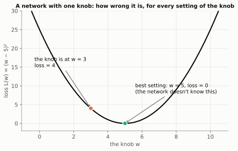
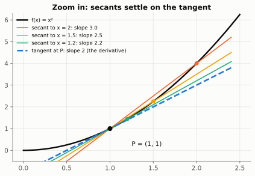
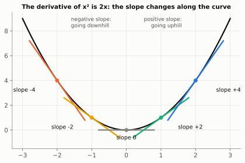
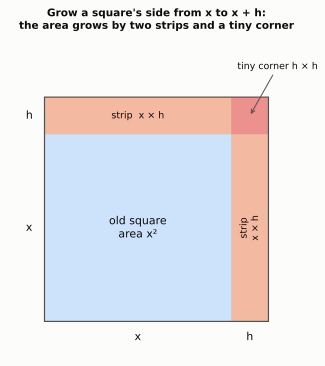
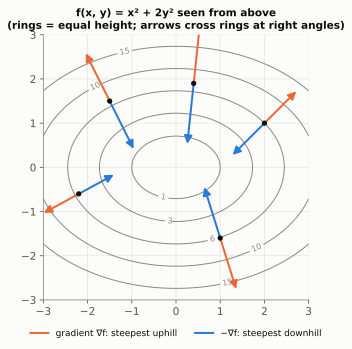
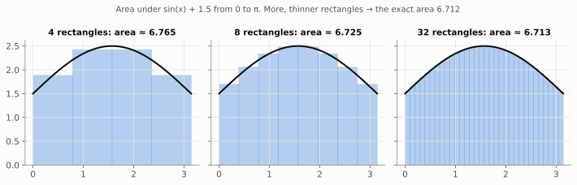

# Chapter 3: How Steep Is It? (Derivatives)

> 🧭 **The question.** The layer from Chapter 2 is full of random numbers, so it produces nonsense. A real network has millions of these numbers. Suppose you nudge just *one* of them a tiny bit. Does the network's answer get better or worse, and by how much?
>
> If we can answer that for every number at once, we know how to fix the whole network. This chapter answers it.

*Where this fits in the book:* this is the first half of how a model learns to say "mat" instead of nonsense.

**The big idea:** a derivative answers one question: *if I nudge a number a tiny bit, how much does the result move?*

## Step 1: Shrink the network to a single knob

Millions of numbers is too many to picture, so let's shrink the problem. Imagine a network with just **one** adjustable number. Call it a knob, `w`. For every setting of the knob, the network is wrong by some amount, its **loss** (Chapter 0's mean squared error is one example). For our toy network the loss happens to be

$$
L(w) = (w - 5)^2
$$



The best setting is `w = 5`, where the loss is 0. But the network can't see this picture. All it can do is try a setting and measure the loss. Right now the knob is at `w = 3`, and the loss is `(3 - 5)² = 4`.

So here is the opening question, made tiny: **if we nudge the knob a little, does the loss go up or down, and by how much?** Let's just try it.

## Step 2: Nudge it and measure

Turn the knob up by 0.1, from 3 to 3.1. The loss becomes `(3.1 - 5)² = (-1.9)² = 3.61`. It **fell** by 0.39. (Turning it *down* to 2.9 instead gives 4.41: worse.) So turning the knob up helps.

How strongly does the loss respond? Divide the change in loss by the size of the nudge: `-0.39 / 0.1 = -3.9`. That ratio, **"change in loss per unit of nudge"**, is the number we are after. Its **sign** says which way to turn the knob, and its **size** says how much the loss cares about this knob.

One problem: the answer depends a little on the size of the nudge. So try smaller and smaller nudges:

> 🤔 **Pause and predict.** Before reading the table: as the nudge shrinks, what number do you think "change in loss ÷ nudge" will settle on?
>
> <details markdown="1"><summary>Answer</summary>
>
> -4. Watch the last column close in on it.
>
> </details>

| Nudge from `w = 3` | New loss | Change in loss | Change ÷ nudge |
| --- | --- | --- | --- |
| 1 | 1 | -3 | -3 |
| 0.1 | 3.61 | -0.39 | -3.9 |
| 0.01 | 3.9601 | -0.0399 | -3.99 |
| 0.001 | 3.996001 | -0.003999 | -3.999 |

As the nudge shrinks, the ratio settles on **-4**. That settled value is called the **derivative** of the loss at `w = 3`. It answers the opening question for this knob: turning it up lowers the loss, at a rate of 4 units of loss per unit of turn.

## Step 3: The picture: zoom in until the curve looks straight

What *is* that -4, in the picture? For a straight line you already know the answer: its steepness, **rise over run**. A road that climbs 3 metres over 100 metres of ground has slope `3 / 100 = 0.03`. A line has the same slope everywhere.

A curve is trickier, because its steepness keeps changing. The trick is to **zoom in until the curve looks straight**, then measure that.



Each row of the table drew a line from our point to a nudged point (the coloured lines on the left). As the nudge shrinks, those lines close in on one line, which just touches the curve at `w = 3`. Zoom in (right) and the curve and that line are almost the same. **The derivative is the slope of the curve at that point: the steepness you would feel if you stood there.**

Picture standing on a hillside in thick fog. You can't see the valley, but you can feel the ground under your feet sloping down in one direction. That feeling is the derivative.

Written as a recipe, with `h` for the size of the nudge:

`derivative ≈ (L(w + h) - L(w)) / h`, for a very small `h`.

Nudge, measure the change, divide by the nudge. Mathematicians write "make `h` smaller and smaller and see where the answer heads" with the word *lim*, short for **limit**, and give the derivative two common names, `L'(w)` ("L prime") and `dL/dw` ("a tiny change in L per tiny change in w"). They mean the same thing:

$$
\frac{dL}{dw} = L'(w) = \lim_{h \to 0} \frac{L(w+h) - L(w)}{h}
$$

<details markdown="1">
<summary>💡 <b>Going deeper:</b> limits and continuity, in one paragraph each</summary>

A **limit** asks what value something is *heading towards* as the input approaches a point, even if you are not allowed to land exactly on it. In the table we never set the nudge to zero (that would be `0/0`, which is meaningless). We only watched where the ratios were heading as the nudge shrank, and they headed to -4.

A function is **continuous** if you can draw its graph without lifting your pencil: no jumps or holes. Derivatives need a little more, a graph with no sharp corners. ReLU has one corner at 0, where the slope jumps from 0 to 1. In practice code simply picks one of the two values there, and nothing breaks.

</details>

<details markdown="1">
<summary>📜 <b>History:</b> Newton, Leibniz and a bitter fight over who invented calculus</summary>

Isaac Newton (in the 1660s, calling derivatives "fluxions") and Gottfried Wilhelm Leibniz (publishing in 1684) invented calculus independently, and spent years in a bitter dispute over who came first. We use Leibniz's notation `dy/dx` because it is so practical: it looks like a fraction and, as Chapter 4 shows, often behaves like one. The prime notation `f'(x)` is due to Joseph-Louis Lagrange (1797). Newton and Leibniz reasoned with "infinitely small" quantities that nobody could quite define. It took until the 19th century for Augustin-Louis Cauchy and Karl Weierstrass to make limits rigorous.

</details>

We found the slope at `w = 3`. But the knob could be anywhere. Is the slope the same everywhere?

## Step 4: The derivative is a slope-finding machine

No. Run the same nudge experiment at other knob positions and you get a different slope each time:



| Knob position `w` | 1 | 3 | 5 | 7 | 9 |
| --- | --- | --- | --- | --- | --- |
| Slope there | -8 | -4 | 0 | +4 | +8 |

Look for the pattern: every slope is `2 × (w - 5)`. At `w = 3` that gives `2 × (-2) = -4`, just as we measured.

So the derivative is not a single number. It is a **function**, a machine in the Chapter 0 sense: feed in a knob position, and out comes the slope there. That is what people mean when they say "the derivative of `(w - 5)²` is `2(w - 5)`". It saves you from nudging and measuring at every point: just plug in.

Where does a shortcut like that come from? Here is the reason, as a picture.

## Step 5: Why the shortcut works: a growing square

Take the simplest curved function, `x²`, and think of it literally: the **area of a square** with side `x`. Now nudge the side by a tiny amount `h`. How much does the area grow?



The new area is the old square, plus **two strips** (each `x × h`), plus a **tiny corner** (`h × h`). So the area grows by `2xh + h²`. Divide by the nudge `h`, as the recipe says:

`(2xh + h²) / h = 2x + h`

Now shrink the nudge. The `h` left over vanishes, and the answer settles on **`2x`**. That is why the derivative of `x²` is `2x`. With numbers: a square of side 3 nudged by 0.1 grows from 9 to 9.61, an increase of `0.6 + 0.6 + 0.01`. Divided by 0.1, that is 6.1, heading to `2 × 3 = 6` as the nudge shrinks.

Our loss `(w - 5)²` is the same square, with side `w - 5` instead of `x`, which is why its derivative is `2(w - 5)`.

Every other shortcut is found the same way, by nudging and simplifying. You never need to rederive them; this short table covers nearly everything in the book:

| Function | Derivative (its slope machine) | Example |
| --- | --- | --- |
| a constant `c` | `0` | flat ground has no slope |
| `x` | `1` | the line `y = x` rises 1 per step |
| `xⁿ` | `n × xⁿ⁻¹` | `x³` becomes `3x²` (the square argument, for a cube) |
| `c × f(x)` | `c × f'(x)` | `5x²` becomes `10x` |
| `f(x) + g(x)` | `f'(x) + g'(x)` | `x³ + 2x` becomes `3x² + 2` |
| `eˣ` | `eˣ` | the only function whose slope equals its own height |
| `ln(x)` | `1/x` | steep near 0, flatter further out |

You can always check a rule by nudging. For `x³` at `x = 2` the rule says `3 × 2² = 12`. Nudging gives `(2.001³ - 8) / 0.001 = (8.012006 - 8) / 0.001 ≈ 12.006`. Close enough. And ReLU, from Chapter 2, is the easiest of all: its slope is 0 for negative inputs (flat) and 1 for positive inputs.

> 🤔 **Pause and predict.** What is the derivative of `5x²`, and what is the slope at `x = 2`?
>
> <details markdown="1"><summary>Answer</summary>
>
> `10x`, using the `c × f(x)` rule with the square's `2x`. At `x = 2` the slope is 20.
>
> </details>

Now we can read the slope anywhere. Which spot on the curve is the one the network actually wants?

## Step 6: Flat spots: where learning is heading

Look again at the slopes: -8, -4, **0**, +4, +8. The slope is zero exactly at `w = 5`, the bottom of the valley, the best setting. **At the very bottom, the ground is flat.**

That gives the derivative its job in AI:

- **Negative slope** (like -4 at `w = 3`): turning the knob up lowers the loss, so turn it up.
- **Positive slope** (like +4 at `w = 7`): turning it up raises the loss, so turn it down.
- **Zero slope**: you are on flat ground, which is where training is trying to get.

In short, **move the knob against the sign of the slope**, and you head downhill towards the flat spot. (Pierre de Fermat found minimums by looking for flat spots in the 1630s, before calculus even had a name.) For our toy loss you could simply solve `2(w - 5) = 0` and get `w = 5`. A real network's loss is far too complicated to solve like that, which is why Chapter 5 creeps downhill step by step instead.

One knob was easy to picture. A real network has millions. What does "slope" even mean then?

## Step 7: Many knobs: partial derivatives and the gradient

Do exactly the same experiment, **one knob at a time**: nudge one knob, freeze all the others, and measure how the loss responds. That is a **partial derivative**, written with a curly d: `∂L/∂w₁` means "the slope of the loss when only knob `w₁` is nudged".

Take a function of two knobs, `f(x, y) = x² + 3y`.

- Freeze `y` and nudge `x`: the `3y` part doesn't move, so `∂f/∂x = 2x` (the square rule).
- Freeze `x` and nudge `y`: the `x²` part doesn't move, so `∂f/∂y = 3`.

> 🤔 **Pause and predict.** For `f(x, y) = x² + 3y`, if you nudge `y` up by 0.1 (keeping `x` fixed), how much does `f` change?
>
> <details markdown="1"><summary>Answer</summary>
>
> It goes up by `3 × 0.1 = 0.3`, because `∂f/∂y = 3`.
>
> </details>

Put the partial derivatives into a list, one per knob, and you get the **gradient**, written `∇f` ("nabla f" or "grad f"):

$$
\nabla f = \left[\frac{\partial f}{\partial x},\ \frac{\partial f}{\partial y}\right] = [\,2x,\ 3\,]
$$

At the point `(2, 5)` the gradient is `[4, 3]`. Check by nudging: `f(2, 5) = 4 + 15 = 19`. Nudging `x` by 0.1 gives `f(2.1, 5) = 19.41`, up by about 0.4 (that is `4 × 0.1`). Nudging `y` by 0.1 gives `f(2, 5.1) = 19.3`, up by 0.3 (that is `3 × 0.1`).

The gradient is also an **arrow**, and it has a beautiful meaning: **it points in the direction of steepest uphill.** Picture a bowl-shaped loss over two knobs, seen from directly above like a contour map, where each ring joins points of equal height:



At every point the gradient arrow crosses the rings at a right angle, pointing straight uphill, and its length says how steep the ground is. To go downhill, step the opposite way. With a million knobs, the gradient is a list of a million slopes, and it gives every knob its own instruction at the same time.

Let's make the computer do the nudging.

## Build it: measure slopes by nudging

```python
def loss(w):
    return (w - 5) ** 2

def slope(f, w, h=1e-5):
    return (f(w + h) - f(w)) / h      # nudge, measure, divide

for w in [1, 3, 5, 7]:
    print(w, round(slope(loss, w), 5), 2 * (w - 5))   # by nudging vs the shortcut
```

The last two columns should agree: -8, -4, 0 and +4. Now swap in a different loss, say `w ** 3` (shortcut `3 * w ** 2`), and check again.

Look closely and the agreement is not perfect: at `w = 5` the code prints `1e-05` instead of `0`. A one-sided nudge measures the slope of a line that sits slightly to the right of the point, so it is off by a little. A better recipe nudges both ways and divides by the total gap:

$$
\frac{dL}{dw} \approx \frac{L(w+h) - L(w-h)}{2h}
$$

This **central difference** is centred on the point, so the errors on the two sides cancel. For `(w - 5)²` it gives the exact answer. Libraries use it for *gradient checking*: they compare the gradients from backpropagation (Chapter 4) against this slow-but-simple estimate to catch bugs.

> 💡 **Two ways to get an answer.** The shortcut "the derivative of `x²` is `2x`" is an **analytical** answer: exact, found with algebra. Nudging with a small `h` is a **numerical** answer: approximate, found by computing. AI leans heavily on numerical methods, because real losses are far too big to work out on paper. A rule of thumb: derive by hand to understand, and compute to get things done.

**Try this:** change `loss` to `(w - 2) ** 2`. Where is the slope 0 now? Is that the top or the bottom of the curve?

<details markdown="1">
<summary>🛤️ <b>Side road:</b> the other half of calculus, integrals (you'll meet them again in Chapter 7)</summary>

Derivatives cut a curve into tiny pieces to find its slope. **Integrals** do the opposite: they add up tiny pieces to find a total, most often the **area under a curve**. The recipe is to fill the area with thin rectangles, add up their areas, and use thinner rectangles until the total stops changing. It is another limit.



| Rectangles | 2 | 4 | 8 | 16 | 32 | exact |
| --- | --- | --- | --- | --- | --- | --- |
| Area estimate | 6.934 | 6.765 | 6.725 | 6.716 | 6.713 | 6.712 |

The symbol for it is a stretched S, for "sum":

$$
\int_0^{\pi} \big(\sin x + 1.5\big)\,dx \approx 6.712
$$

Read it as: "add up height × tiny width, for every sliver from 0 to π." In numpy, `np.trapezoid(y, x)` does the adding for you.

The **fundamental theorem of calculus**, discovered by Newton, Leibniz and Newton's teacher Isaac Barrow, says that integrating and differentiating undo each other, just as `exp` and `ln` do. In AI, integrals mostly appear in probability: the chance of a range of outcomes is an area under a curve (Chapter 7).

</details>

## Back to the question

We asked: if you nudge one number inside a network, does its answer get better or worse, and by how much? Shrinking the network to one knob showed the way. Nudge it, measure the change in loss, divide by the nudge, and shrink the nudge: the result is the **derivative**, the slope of the loss curve. Its **sign** says which way to turn the knob, and its **size** says how much the loss cares. At `w = 3` it was -4, so turn the knob up, towards the flat bottom at `w = 5`.

With millions of knobs, the **gradient** answers the question for all of them at once, and since it points uphill, we will step the other way.

There is a catch, though. In a real network a knob in the first layer reaches the loss only *through* every layer after it.

## Check yourself

Try each question on paper before opening the answer.

1. With the loss `L(w) = (w - 5)²`, what is the slope at `w = 6`, and which way should the knob turn?
    <details markdown="1"><summary>Answer</summary>`2 × (6 - 5) = +2`. The slope is positive, so turning the knob up raises the loss: turn it down.</details>
2. What is the derivative of `5x²`?
    <details markdown="1"><summary>Answer</summary>`10x`.</details>
3. What is the slope of `x²` at `x = -1.5`?
    <details markdown="1"><summary>Answer</summary>`2 × (-1.5) = -3`. Negative means the curve is going downhill as x increases.</details>
4. In the growing-square picture, why does the tiny corner `h × h` not matter in the end?
    <details markdown="1"><summary>Answer</summary>After dividing by the nudge it leaves just `h`, which shrinks to nothing as the nudge shrinks. Only the two strips, `2x`, survive.</details>
5. For `f(x, y) = 3x + y²`, what is the gradient at `(1, 2)`?
    <details markdown="1"><summary>Answer</summary>`[3, 2y] = [3, 4]`.</details>
6. If the derivative of the loss with respect to a knob `w` is `+6`, should `w` go up or down?
    <details markdown="1"><summary>Answer</summary>Down, because increasing `w` would increase the loss.</details>

## Chapter 3 in one breath

The derivative is the slope: nudge a number, measure the change, divide by the nudge. Its sign tells each knob which way to turn to lower the loss, and the gradient does this for every knob at once.

---

**Next:** [Chapter 4: Nudges Through a Chain](04-chain-rule.md). A derivative tells us how one step responds to a nudge. But how does a nudge travel down a long chain of steps, from a knob in layer 1 all the way to the loss? The answer is a single multiplication rule, and it is the secret behind every trained network.
