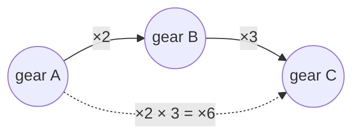
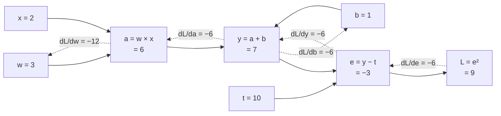
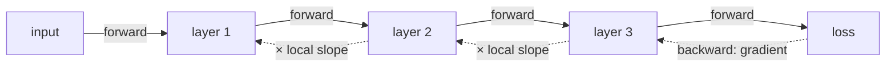

# Chapter 4: Nudges Through a Chain (The Chain Rule)

> 🧭 **The question.** A network is a chain: input → layer 1 → layer 2 → … → loss. Chapter 3 tells us how each *single* step responds to a nudge. But we need something harder. How does nudging a weight in the *first* layer change the loss at the very *end*? And with millions of weights, how do we get all those answers at once, fast enough to be useful?

*Where this fits in the book:* this is the machinery that tells every weight in a language model how to change after it guesses "sofa" when the answer was "mat".

**The big idea:** if A affects B and B affects C, then A affects C by *multiplying* the two effects. This one rule is the engine of backpropagation.

## The gear train

Three gears are linked in a row. Turn gear A once and gear B turns 2 times. Turn gear B once and gear C turns 3 times. How many times does C turn when you turn A once? `2 × 3 = 6`.

That is the chain rule: **multiply the rates along the chain.**



In symbols: if `y = f(g(x))`, then `dy/dx = f'(g(x)) × g'(x)`. In Leibniz's notation it looks like fractions cancelling, which makes it easy to remember:

$$
\frac{dy}{dx} = \frac{dy}{du} \cdot \frac{du}{dx}
$$

<details markdown="1">
<summary>📜 <b>History:</b> who invented backpropagation? (it took 300 years)</summary>

The chain rule appears in Leibniz's notes from 1676, so it is older than most of calculus' textbooks. Using it *backwards* through a long computation, which is what backpropagation does, was worked out much later. Seppo Linnainmaa described "reverse-mode automatic differentiation" in his 1970 master's thesis, Paul Werbos proposed using it to train neural networks in 1974, and David Rumelhart, Geoffrey Hinton and Ronald Williams made it famous in a 1986 *Nature* paper showing that it let hidden layers learn useful features. Hinton later shared the 2018 Turing Award (with Yoshua Bengio and Yann LeCun) and, with John Hopfield, the 2024 Nobel Prize in Physics for foundational work on neural networks.

</details>

Gears are a picture. Let's check the rule on an actual function.

## A worked example

Let `u = 3x` and `y = u²`. So `y = (3x)² = 9x²`.

- How fast does `u` change with `x`? `du/dx = 3`.
- How fast does `y` change with `u`? `dy/du = 2u = 6x`.
- Multiply: `dy/dx = 6x × 3 = 18x`.

Check against the direct route: the derivative of `9x²` is `18x`. It matches.

Two steps are easy. A network has many, and the gradients have to be passed backwards through all of them. Let's trace the smallest possible model by hand.

## A longer chain, with real numbers

Let us trace backpropagation by hand on the smallest possible model. It has one input `x = 2`, one weight `w = 3` and one bias `b = 1`, and it should output a target `t = 10`. The chain is:

1. `a = w × x` (multiply)
2. `y = a + b` (add the bias)
3. `e = y - t` (how far off are we?)
4. `L = e²` (the loss: squared error)

Drawn as a **computation graph**, with the forward values in the boxes and the backward gradients on the dashed arrows:



> 🤔 **Pause and predict.** The model below outputs 7 when the target is 10. Before calculating anything: should the weight `w` go up or down?
>
> <details markdown="1"><summary>Answer</summary>
>
> Up. The output is too small, and increasing `w` increases the output. The calculation below confirms it: `dL/dw` comes out negative, which means "increasing `w` lowers the loss".
>
> </details>

**Forward pass:** run the numbers left to right. `a = 6`, `y = 7`, `e = -3`, `L = 9`. The model said 7, we wanted 10, and the loss is 9.

**Backward pass:** now ask, at each step, "how much does the loss change if this value changes?" Start at the end, where `dL/dL = 1` (the loss changes exactly as much as itself), and move left. At each step multiply the **gradient arriving from the right** by the **local derivative** of that step:

| Step | Local derivative | Gradient of loss with respect to it |
| --- | --- | --- |
| `L = e²` | `dL/de = 2e = -6` | `dL/de = -6` |
| `e = y - t` | `de/dy = 1` | `dL/dy = -6 × 1 = -6` |
| `y = a + b` | `dy/da = 1`, `dy/db = 1` | `dL/da = -6`, `dL/db = -6` |
| `a = w × x` | `da/dw = x = 2`, `da/dx = w = 3` | `dL/dw = -6 × 2 =` **-12**, `dL/dx = -6 × 3 = -18` |

Read the key result: `dL/dw = -12`. The negative sign says "increasing `w` decreases the loss," and the size says "quite steeply." Check with a nudge: set `w = 3.001`, then `a = 6.002`, `y = 7.002`, `e = -2.998`, `L = 8.988004`. The loss fell by about `0.012`, which is `-12 × 0.001`. It works.

Now take a downhill step with learning rate 0.1: `w = 3 - 0.1 × (-12) = 4.2`. The new prediction is `4.2 × 2 + 1 = 9.4`, the error is `-0.6`, and the loss has dropped from **9 to 0.36** in a single step. That is the full learning loop in miniature: forward, backward, update.

The pattern to remember is this: **local derivative × incoming gradient, at every step.** A network with 100 layers is the same rule applied 100 times.

What we just did by hand has a famous name.

## Why this is backpropagation

A neural network is a long chain: input, layer 1, layer 2, ..., loss. To find how a parameter in layer 1 affects the loss, you multiply the effects of every step between them. **Backpropagation is the chain rule applied from the loss backwards, reusing work as it goes.** That is the whole trick. There is no further mystery.



Why go *backwards*? A network has one loss but millions of parameters. Going backwards from the single loss, one sweep delivers the gradient for every parameter at once, at roughly the cost of one extra forward pass. Going forwards would need one sweep per parameter, millions of times slower. That one design choice is what makes training large networks possible.

Multiplying along a chain has a dark side when the chain is long.

## When the chain gets long: vanishing and exploding gradients

The chain rule *multiplies* local slopes, and long products behave dramatically. If every one of 20 layers has a local slope of about 0.5, the gradient reaching the first layer is `0.5²⁰ ≈ 0.000001`: it has **vanished**, and the early layers barely learn. If every slope is about 1.5, the product is `1.5²⁰ ≈ 3,300`: it **explodes**, and training goes haywire.

> 🤔 **Pause and predict.** If each of 10 layers multiplies the gradient by 2, how big is the gradient that reaches the first layer, compared with the one at the end?
>
> <details markdown="1"><summary>Answer</summary>
>
> `2¹⁰ = 1,024` times bigger. It has exploded.
>
> </details>

This is one reason deep networks were so hard to train before around 2010. The fixes are a tour of modern deep learning: ReLU, whose slope is exactly 1 for positive inputs, instead of S-shaped squashes whose slopes are at most 0.25 (sigmoid) or 1 (tanh); careful random starting weights; normalisation layers; and **residual connections**, which add a layer's input back to its output so the gradient always has a direct path (Chapter 10).

Doing this by hand for a million weights is impossible. So let's teach the computer to do it, in about 30 lines.

## Build it: a tiny autograd engine

This is a miniature of what PyTorch does. Each number remembers how it was made, and can pass blame backwards.

```python
class Value:
    def __init__(self, data, parents=(), backward=lambda: None):
        self.data, self.grad = data, 0.0
        self.parents, self._backward = parents, backward

    def __add__(self, other):
        out = Value(self.data + other.data, (self, other))
        def backward():
            self.grad += out.grad
            other.grad += out.grad
        out._backward = backward
        return out

    def __mul__(self, other):
        out = Value(self.data * other.data, (self, other))
        def backward():
            self.grad += other.data * out.grad   # chain rule
            other.grad += self.data * out.grad
        out._backward = backward
        return out

    def backprop(self):
        order, seen = [], set()
        def visit(v):
            if v not in seen:
                seen.add(v)
                for p in v.parents:
                    visit(p)
                order.append(v)
        visit(self)
        self.grad = 1.0
        for v in reversed(order):
            v._backward()

x, w = Value(3.0), Value(2.0)
y = x * w + x          # y = x*w + x
y.backprop()
print(x.grad, w.grad)  # dy/dx = w + 1 = 3, dy/dw = x = 3
```

The printed gradients should both be 3. You have just built the core of deep learning in 30 lines.

**Try this:** change `y` to `x * x * w` and predict `x.grad` and `w.grad` by hand before running. (Hint: `x.grad` should be `2xw = 12`.)

The class is short but dense. Here is what each piece does.

## Reading the autograd code, line by line

The `Value` class looks dense, but it is only the table above turned into code.

- **`data` and `grad`:** each `Value` stores a number and, after the backward pass, the gradient of the final result with respect to it.
- **`parents`:** remembers which values it was built from, so we can walk backwards.
- **`__add__`:** for `a + b`, the local derivative with respect to each input is 1, so each parent simply receives `out.grad` unchanged.
- **`__mul__`:** for `a × b`, the derivative with respect to `a` is `b` (and vice versa), so `a` receives `b.data × out.grad`. That one line is the chain rule.
- **`+=` instead of `=`:** a value can be used more than once. In `x * w + x`, the variable `x` feeds two places, and the total effect is the **sum** of the effects along each path (`w` from the product, `1` from the plain addition, giving `w + 1 = 3`).
- **`backprop`:** visits values in an order where every value comes after the ones it depends on, then reverses it. That guarantees a value's gradient is complete before it is passed on. It starts by setting `self.grad = 1.0`, the `dL/dL = 1` from our hand calculation.

Libraries such as PyTorch and JAX do this same thing for huge arrays of numbers. When you see `loss.backward()` in someone's code, this is what happens.

## Back to the question

We asked how nudging a weight early in a chain changes the loss at the end. The answer is the **chain rule**: multiply the local slopes of every step along the way. **Backpropagation** applies it from the loss backwards, reusing work as it goes, so a single backward sweep delivers the gradient for *every* weight, at roughly the cost of one forward pass.

In our tiny model, `dL/dw = -12` told the weight to increase, and one step cut the loss from 9 to 0.36. That was a taste of learning.

## Check yourself

Try each question on paper before opening the answer.

1. Use the chain rule to find `dy/dx` at `x = 1` for `y = (2x + 1)²`.
    <details markdown="1"><summary>Answer</summary>let `u = 2x + 1 = 3`. Then `dy/du = 2u = 6` and `du/dx = 2`, so `dy/dx = 12`.</details>
2. In the numeric example, what is `dL/db`?
    <details markdown="1"><summary>Answer</summary>`-6`. Raising the bias also lowers the loss.</details>
3. If `a = w × x` with `x = 5`, and `dL/da = 3`, what is `dL/dw`?
    <details markdown="1"><summary>Answer</summary>`5 × 3 = 15`.</details>
4. Why does the code use `+=` for gradients?
    <details markdown="1"><summary>Answer</summary>a value used in several places collects a contribution from each path, and the contributions add.</details>
5. A gradient passes backwards through 10 layers, each multiplying it by 0.25. What fraction survives?
    <details markdown="1"><summary>Answer</summary>`0.25¹⁰ ≈ 0.000001`. It has vanished.</details>

## Chapter 4 in one breath

When effects are chained, multiply the rates. Backprop is that rule applied from the loss backwards.

---

**Next:** [Chapter 5: Rolling Downhill](05-gradient-descent.md). One step took the loss from 9 to 0.36. What happens if we repeat that step hundreds of times, starting from nothing? Can a model find the right answer entirely on its own?
