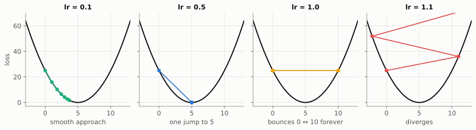
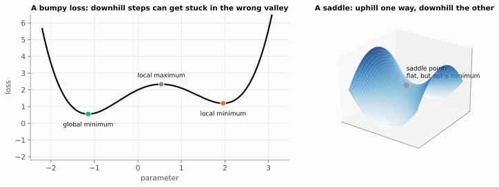
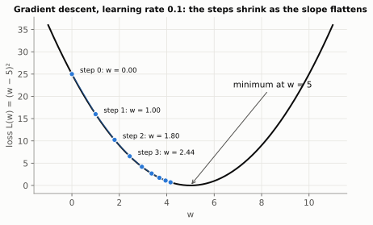
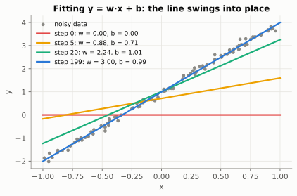
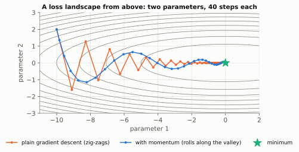
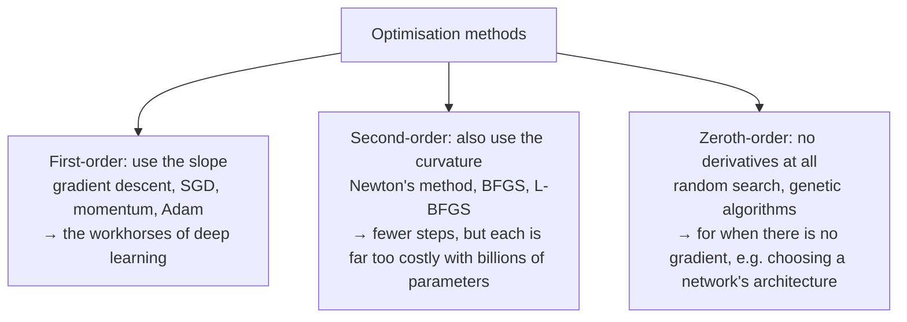

# Chapter 5: Rolling Downhill (Gradient Descent)

**The big idea:** learning is just repeating one tiny step: *nudge every parameter slightly in the direction that lowers the loss.*

## The loop

Back in the foggy hills. You cannot see the valley, but you can feel the slope. So:

1. Feel the slope under your feet (the gradient).
2. Take a small step downhill.
3. Repeat.

As a formula: `parameter = parameter - learning_rate × gradient`.

The **learning rate** is your step size. Too big and you overshoot the valley and bounce around. Too small and you crawl. Picking it is part art, part experiment.

> 📜 **History.** Augustin-Louis Cauchy described this method in 1847, while trying to compute the orbits of celestial bodies from systems of equations too messy to solve directly. The "stochastic" version that uses random samples of data (see mini-batches below) comes from Herbert Robbins and Sutton Monro in 1951. Every large AI model is trained with a direct descendant of Cauchy's 1847 idea.

## The loss landscape, and why there is a minus sign

Picture the loss as **altitude** and the parameters as **map coordinates**. Every combination of parameter values is a spot on the map, and the loss tells you how high the ground is there. A model with two parameters is a landscape you could draw as a 3D surface; a model with a billion parameters is the same thing in a billion dimensions, which we cannot picture but which behaves the same way. Training means finding a low spot.

The gradient points **uphill**, so to go down we subtract it. Written as a formula:

$$
w \leftarrow w - \eta \, \frac{\partial L}{\partial w}
$$

Read it as: "new w equals old w minus (a small number η) times (the slope of the loss with respect to w)." The Greek letter η (eta) is the **learning rate**. Programmers often call it `lr`.

With many parameters, the same rule is applied to all of them at once, using the gradient vector from Chapter 3:

$$
\mathbf{w} \leftarrow \mathbf{w} - \eta \, \nabla L(\mathbf{w})
$$

## The learning rate, tested

For the loss `L(w) = (w - 5)²`, one update multiplies the distance to the goal by `(1 - 2×lr)`. Starting from `w = 0`, five units from the minimum:

| Learning rate | Each step multiplies the distance by | What happens |
| --- | --- | --- |
| 0.1 | 0.8 | smooth, steady approach |
| 0.5 | 0 | lands on 5 in one step (a lucky case) |
| 1.0 | -1 | bounces forever between 0 and 10 |
| 1.1 | -1.2 | overshoots further each time and **diverges** |



This is why learning rate is the first knob people tune. Too small wastes time; too large makes training blow up. Real loss landscapes are also bumpier than a clean bowl, with flat plateaus and several valleys. Remarkably, simple downhill stepping still works very well for neural networks, though nobody has a fully satisfying proof of why.

## Bumpy landscapes: local minima, saddles and convexity

The bowl `(w - 5)²` has one bottom, and every downhill path leads there. Real loss landscapes are messier, and a few words describe what can go wrong:



- **Global minimum:** the lowest point anywhere. This is what we want.
- **Local minimum:** the bottom of a valley that is not the lowest one. Downhill steps get stuck there, because every direction nearby goes up.
- **Saddle point:** flat (gradient zero) but not a minimum. It curves up in some directions and down in others, like a horse's saddle or a mountain pass.
- **Plateau:** a wide, nearly flat region where the gradient is tiny, so progress crawls.

A landscape with only one valley is called **convex**: bowl-shaped everywhere. The test is that a straight line drawn between any two points on the curve never dips below it. Convex problems are the friendly ones: there is a single valley, and gradient descent with a small enough step always reaches its bottom. Fitting a line with squared error, as in the code below, is convex.

Neural networks are **not** convex. Even a simple symmetry shows this: swap two hidden units, with all their weights, and the network computes exactly the same function. So every good solution has many identical twins sitting in separate valleys. Why does downhill stepping still work so well? Three reasons, partly understood and partly still researched:

1. **In high dimensions, true local minima are rare.** To be a minimum, the ground must curve upwards in *every* direction. As a rough picture, if each of 10 directions were equally likely to curve up or down, the chance that all 10 curve up would be `0.5¹⁰ ≈ 0.001`. With millions of parameters, almost every flat spot is a saddle with some way down, a point made by Yann Dauphin and colleagues in 2014.
2. **Noise helps.** Near a saddle the gradient is small, so progress slows. But the randomness of mini-batches (below) and the inertia of momentum jiggle the parameters off the saddle and onto the downward slope.
3. **The valleys that are found tend to be about equally good.** For large networks, different random starting points usually end in different places with very similar loss.

Practitioners help things along with random starting weights, mini-batch noise, momentum, and **learning-rate schedules**: start with big steps to explore, then shrink them to settle into a valley.

## A worked example

Loss `L(w) = (w - 5)²`. Its derivative is `2(w - 5)`. Start at `w = 0` with learning rate 0.1:

- Gradient at 0 is `-10`, so `w = 0 - 0.1 × (-10) = 1`.
- Gradient at 1 is `-8`, so `w = 1 + 0.8 = 1.8`.
- Gradient at 1.8 is `-6.4`, so `w = 2.44`.

The steps shrink as the slope flattens, and `w` glides toward 5. No one told it the answer; it only followed the slope.



## Where do the code's gradient formulas come from?

In the line-fitting code below, `dw` and `db` were written without explanation. Here is the derivation, using only the chain rule from Chapter 4.

For one data point `(xᵢ, yᵢ)`, the model predicts `w·xᵢ + b`. Call the error `eᵢ = w·xᵢ + b - yᵢ`, so that point's loss is `eᵢ²`. Then:

$$
\frac{\partial (e_i^2)}{\partial w} = 2 e_i \cdot \frac{\partial e_i}{\partial w} = 2 e_i \, x_i
\qquad
\frac{\partial (e_i^2)}{\partial b} = 2 e_i \cdot 1 = 2 e_i
$$

The outer function is "square it" (derivative `2e`), and the inner function is the error (its derivative with respect to `w` is `xᵢ`, and with respect to `b` is 1). The overall loss is the *average* over all points, and the derivative of an average is the average of the derivatives. In numpy that is precisely:

- `dw = (2 * err * x).mean()`
- `db = (2 * err).mean()`

No magic, just the chain rule.

## Build it: fit a line to data

We will teach a machine to find `y = w·x + b` from noisy points. The loss is the average squared error.

```python
import numpy as np

rng = np.random.default_rng(1)
x = rng.uniform(-1, 1, 100)
y = 3 * x + 1 + rng.normal(0, 0.1, 100)   # true w=3, b=1, plus noise

w, b, lr = 0.0, 0.0, 0.1
for step in range(200):
    pred = w * x + b
    err = pred - y
    loss = (err ** 2).mean()
    dw = (2 * err * x).mean()    # slope of loss wrt w
    db = (2 * err).mean()        # slope of loss wrt b
    w -= lr * dw
    b -= lr * db
    if step % 40 == 0:
        print(step, round(loss, 4), round(w, 2), round(b, 2))

print("learned:", w, b)
```

You should see the loss fall and `w`, `b` land close to 3 and 1. **That is machine learning.** Everything else is bigger models, bigger data and cleverer tricks on the same loop.



> 📜 **History.** Fitting a line by minimising squared error, the **method of least squares**, was published by Adrien-Marie Legendre in 1805. Carl Friedrich Gauss said he had used it since 1795, and used it in 1801 to predict where the lost dwarf planet Ceres would reappear from a handful of telescope sightings. It did reappear where he said. The same idea runs in the loop above, two centuries later.

**Try this:** set `lr = 1.5` and watch it blow up. Then set `lr = 0.001` and see how slowly it learns.

## Beyond the basic loop

Real training uses small refinements of this same idea:

- **Mini-batches:** computing the gradient on millions of examples per step is slow, so we use a random handful (say 32 or 256) each time. The gradient is a bit noisy but far cheaper, and the noise even helps. One pass through all the data is called an **epoch**.
- **Momentum** (Boris Polyak, 1964): like a ball rolling downhill, keep some of the previous step's direction so progress is smoother and faster along consistent slopes.
- **Adam** (Diederik Kingma and Jimmy Ba, 2014): the most common optimiser. It keeps running averages of the gradient and of its size, and gives each parameter its own sensible step size. It is gradient descent with better bookkeeping. A variant called **AdamW** (2017), which handles weight decay more cleanly, is the usual choice for training large language models.

Here is why momentum helps. Real loss landscapes often have long, narrow valleys: steep across, gentle along. Plain gradient descent mostly sees the steep sides, so it zig-zags across the valley and makes slow progress along it. Momentum averages out the back-and-forth and builds up speed in the consistent direction.



> 💡 **Adam as a bicycle going downhill.** Momentum is the speed you build up from the slope behind you, so you are not stopped by every small bump. The second part of Adam (an idea from an earlier method called RMSProp) is the brakes: where the ground has been very steep and bumpy, it shortens the steps, and on gentle ground it lengthens them, separately for every parameter.

None of these change the core idea: nudge each parameter against its gradient.

## The family of optimisers



## Check yourself

1. For `L(w) = (w - 4)²` starting at `w = 0` with `lr = 0.25`, what is `w` after two steps? *Answer: the gradient is `2(w - 4)`. Step 1: `-8`, so `w = 0 + 2 = 2`. Step 2: `-4`, so `w = 2 + 1 = 3`.*
2. Why do we subtract the gradient rather than add it? *Answer: the gradient points uphill, and we want to reduce the loss.*
3. What does a gradient of exactly zero do to an update? *Answer: nothing moves. We are on flat ground, which could be a minimum (good), a maximum or a saddle.*
4. What goes wrong if the learning rate is too large? *Answer: steps overshoot the valley, the loss can grow instead of shrinking, and training diverges.*
5. Why does momentum help in a long, narrow valley? *Answer: the steep side-to-side gradients keep flipping sign and average out, while the gentle along-the-valley gradient keeps the same sign and accumulates speed.*
6. Why is fitting a line with squared error easier to optimise than training a neural network? *Answer: its loss is convex, a single bowl, so every downhill path leads to the one global minimum. A network's loss has many valleys and saddle points.*

## Chapter 5 in one breath

Learning means repeatedly stepping each parameter against its gradient. The learning rate sets the step size.

---

**Next:** [Chapter 6: Reasoning With Doubt](06-probability.md): a change of scene: how to think clearly when you are not sure.
