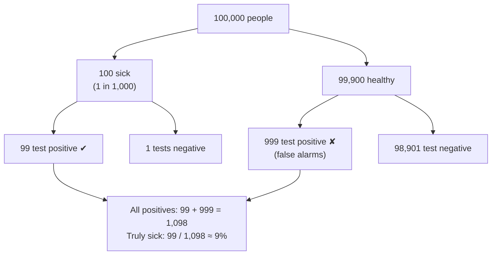
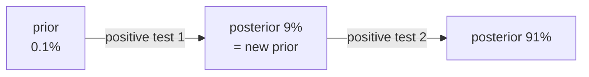
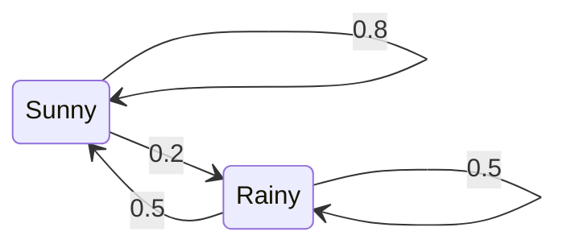

# Chapter 6: Reasoning With Doubt (Probability and Bayes)

**The big idea:** probability is a number between 0 and 1 for how likely something is, and Bayes' rule tells you how to *update* that number when you see evidence.

> 📜 **History.** Probability theory began with a gambling question. In 1654 the Chevalier de Méré asked Blaise Pascal how to split the stakes fairly when a game of dice is interrupted. Pascal and Pierre de Fermat worked out the answer in a famous exchange of letters, and invented the mathematics of chance along the way. Gambling, insurance and astronomy kept the subject growing for the next two centuries.

## The basics

- `P(rain) = 0.3` means it rains on about 3 of 10 days like this.
- `P(A and B)`: both happen. If they are independent, multiply: `0.5 × 0.5 = 0.25` for two heads in a row.
- `P(A | B)`, read "A given B": the chance of A once you know B happened.

## The rules of probability, with dice and cards

Four rules cover almost everything, and each is easy to check with a die or a deck of cards.

1. **Probabilities live between 0 and 1, and all possible outcomes add up to 1.** A fair die gives each face `1/6`, and six of them sum to 1.
2. **"Not" flips it:** `P(not A) = 1 - P(A)`. If rain has probability 0.3, no rain is 0.7.
3. **"Or" adds, for outcomes that cannot both happen:** `P(roll a 1 or a 2) = 1/6 + 1/6 = 1/3`.
4. **"And" multiplies, when the events do not affect each other (independent):** `P(two sixes in a row) = 1/6 × 1/6 = 1/36`.

When events *do* affect each other, the second probability changes after the first. Draw two cards from a deck without putting the first back. The chance the first is an ace is `4/52`. If it was, only 3 aces remain among 51 cards, so the chance the second is also an ace is `3/51`. Together: `4/52 × 3/51 = 12/2652 = 1/221 ≈ 0.0045`.

That second number, "the chance of one thing *given* another has happened," is called a **conditional probability**, written `P(A | B)` and read "probability of A given B":

$$
P(A \mid B) = \frac{P(A \text{ and } B)}{P(B)}
$$

Example: you roll a die and are told the result is even. What is the chance it is a 6? Among the three even faces (2, 4, 6), one is a 6. By the formula: `P(6 and even) = 1/6` and `P(even) = 3/6`, so `P(6 | even) = (1/6) / (3/6) = 1/3`. New information shrinks the world of possibilities, and the probabilities re-adjust.

One more idea you will meet again and again is the **expected value**, the average outcome weighted by how likely each is:

$$
\mathbb{E}[X] = \sum_i p_i \, x_i
$$

For a die: `(1 + 2 + 3 + 4 + 5 + 6) / 6 = 3.5`. You cannot roll a 3.5, but over many rolls the average heads there. A model's loss is an expected value: the average mistake over the data.

## Bayes' rule with a story

A test for a rare disease is 99% accurate, and 1 person in 1,000 has the disease. You test positive. What is the chance you have it?

Most people say 99%. Imagine 100,000 people instead (here "99% accurate" means it catches 99% of sick people, and wrongly flags 1% of healthy people):

- 100 are sick, and 99 of those test positive.
- 99,900 are healthy, and 1% of them (about 999) also test positive.
- Total positives: about 1,098. Only 99 are truly sick.



The picture makes the surprise obvious: the false alarms from the huge healthy group swamp the true positives from the tiny sick group. Counting people instead of juggling percentages is called the **natural frequencies** method, and studies have shown that it helps doctors get this question right far more often.

So the chance is `99 / 1,098 ≈ 9%`. Surprising, and it is the single most useful lesson in probability: **a strong signal and a rare event fight each other, and the prior matters.**

Bayes' rule writes it down: `P(A | B) = P(B | A) × P(A) / P(B)`. Start with a prior belief, multiply by how well the evidence fits, and you get an updated belief.

> 📜 **History.** Thomas Bayes, an English minister and amateur mathematician, worked out the rule in the 1740s and 1750s but never published it. After his death his friend Richard Price found the manuscript and published it in 1763 as *An Essay towards solving a Problem in the Doctrine of Chances*. Pierre-Simon Laplace independently discovered a more general form in 1774, and he was the one who turned it into a working tool for science. For much of the 20th century "Bayesian" reasoning was controversial among statisticians. Today it runs spam filters, medical diagnosis and robot navigation.

## Where Bayes' rule comes from

Bayes' rule is not a separate fact, it falls out of the conditional-probability formula. The chance of both A and B can be written in two ways: `P(A and B) = P(A | B) × P(B)`, or equally `P(A and B) = P(B | A) × P(A)`. Set the two equal and divide by `P(B)`:

$$
P(A \mid B) = \frac{P(B \mid A)\, P(A)}{P(B)}
$$

Each piece has a name, and the names are worth learning because every textbook uses them:

| Piece | Name | In the disease story |
| --- | --- | --- |
| `P(A)` | **prior**: belief before the evidence | 0.001 (1 in 1,000 are sick) |
| `P(B ∣ A)` | **likelihood**: how likely the evidence is if A is true | 0.99 (sick people test positive) |
| `P(B)` | **evidence**: how likely the evidence is overall | `0.99×0.001 + 0.01×0.999 = 0.01098` |
| `P(A ∣ B)` | **posterior**: belief after the evidence | `0.00099 / 0.01098 ≈ 0.09` |

The evidence line is the part people forget: a positive result comes from the sick *and* from the healthy-but-unlucky, and you must count both.

Here is the satisfying bit. **Yesterday's posterior becomes today's prior.** Suppose you take a second, independent test and it is also positive. Start from the new prior of 0.09: the evidence is `0.99×0.09 + 0.01×0.91 ≈ 0.098`, so the posterior is `0.0891 / 0.098 ≈ 0.91`. Two positives lift you from 9% to about 91%. Repeated evidence accumulates, which is how learning from data works in general.



> 💡 **Bayes in the sky.** The **Kalman filter** (Rudolf Kálmán, 1960) is Bayes' rule run continuously: predict where an aircraft is, take a noisy sensor reading, blend the two according to how much you trust each, repeat many times a second. It helped navigate the Apollo missions to the Moon, and it still runs inside autopilots, GPS receivers and self-driving cars.

## Why AI cares

A classifier's output is a probability: "87% cat, 13% dog". Language models output a probability for every possible next word. Training means making the model assign high probability to what really happened.

## Build it: a tiny spam filter

```python
import math
from collections import Counter

spam = ["win money now", "free money offer", "win a free prize"]
ham  = ["meeting at noon", "lunch tomorrow", "project meeting notes"]

def word_counts(msgs):
    return Counter(w for m in msgs for w in m.split())

s, h = word_counts(spam), word_counts(ham)
vocab = set(s) | set(h)

def log_prob(msg, counts, total):
    # add-one smoothing so unseen words don't give zero
    return sum(math.log((counts[w] + 1) / (total + len(vocab)))
               for w in msg.split())

def is_spam(msg):
    ls = log_prob(msg, s, sum(s.values())) + math.log(0.5)
    lh = log_prob(msg, h, sum(h.values())) + math.log(0.5)
    return ls > lh

print(is_spam("free money"), is_spam("project meeting"))
```

It should print `True False`. We used logs because multiplying many small probabilities underflows to zero; adding their logs does not. You will see logs again in Chapter 8.

**Try this:** add three more training messages of each kind and test a message that mixes both vocabularies.

## Reading the spam filter

The filter above is a **naive Bayes classifier**, one of the oldest tricks in machine learning. The idea:

1. Compare two stories: "this message is spam" and "this message is not spam."
2. For each story, work out how likely the message's words are, given that story. We pretend each word is independent of the others, which is false but surprisingly useful (that is the "naive" part). Independence lets us **multiply** the word probabilities.
3. Weight each story by its prior (here 50% each) and pick the larger.

Two practical details explain the odd-looking code:

- **Logs:** multiplying 30 probabilities of about 0.01 already gives `10⁻⁶⁰`. A long email with 200 words would give `10⁻⁴⁰⁰`, which is smaller than the tiniest number a standard computer float can hold (about `10⁻³⁰⁸`), so it **underflows** to exactly zero. Adding logs instead gives a manageable number (`200 × ln 0.01 ≈ -921`), thanks to `ln(a×b) = ln(a) + ln(b)` from Chapter 0.
- **Add-one smoothing:** if a word never appeared in spam during training, its probability would be 0, and one zero wipes out the whole product (and `ln(0)` is minus infinity). Adding 1 to every count means nothing is ever impossible. (This trick is due to Laplace, who used it to estimate the chance that the sun will rise tomorrow.)

> 📜 **History.** Naive Bayes spam filters were proposed by Mehran Sahami and colleagues in 1998 and popularised by Paul Graham's 2002 essay *A Plan for Spam*. They cut spam so effectively that spammers had to change tactics. The same few lines of probability are still a strong baseline for text classification.

## Judging a classifier: the confusion matrix, precision and recall

The disease test is a classifier: it labels each person "sick" or "healthy". How good is it? Lay out the four possible outcomes for our 100,000 people in a grid called a **confusion matrix**:


The obvious score is **accuracy**, the fraction labelled correctly: `(99 + 98,901) / 100,000 = 99.0%`. Sounds great. But a lazy "test" that declares *everyone* healthy is right about all 99,900 healthy people, an accuracy of **99.9%**, while catching nobody. When one class is rare, accuracy is nearly useless. Two sharper questions fix it:

| Measure | The question it answers | Formula | Disease test |
| --- | --- | --- | --- |
| **Precision** | When it says "sick", how often is it right? | TP / (TP + FP) | 99 / 1,098 ≈ **9%** |
| **Recall** (sensitivity) | Of the people really sick, how many did it find? | TP / (TP + FN) | 99 / 100 = **99%** |

(TP = true positives, FP = false positives, FN = false negatives.) Look at the precision: it is the same 9% that Bayes' rule gave earlier. Precision *is* the posterior "probability of being sick, given a positive test". The lazy test has a recall of 0, which exposes it immediately.

To combine the two into one number, people use the **F1 score**, `2 × P × R / (P + R)`, a kind of average that is dragged down by whichever one is weak. Here `2 × 0.09 × 0.99 / 1.08 ≈ 0.17`.

**The threshold trade-off.** Most classifiers output a score or probability, and *you* pick the threshold above which to say "yes" (right panel above). Raise it and you raise fewer false alarms (precision goes up) but miss more real cases (recall goes down). Lower it and the reverse happens. Which matters more depends on the cost of each mistake:

- **Spam filter: favour precision.** Losing an important email to the spam folder is worse than seeing an occasional spam message.
- **Cancer screening: favour recall.** Missing a case is far worse than a false alarm, which a second, more precise test can then check. That is the "second positive test" from the Bayes section above.

## Probability through time: Markov chains

So far each event stood alone. Often what happens next depends on what is happening now. A **Markov chain** is the simplest model of this: the next state depends **only on the current state**, not on the full history. Here is a toy weather model:



If today is sunny there is an 80% chance tomorrow is too. The arrows leaving each state add up to 1. Store the numbers in a **transition matrix** (one row per "today", one column per "tomorrow"):

$$
T = \begin{bmatrix} 0.8 & 0.2 \\ 0.5 & 0.5 \end{bmatrix}
$$

and Chapter 2 does the rest. If today's probabilities are the row vector `[1, 0]` (certainly sunny), tomorrow's are `[1, 0] @ T = [0.8, 0.2]`, the day after `[0.74, 0.26]`, and so on. Run it for a few weeks and it settles at about `[0.71, 0.29]` whatever you start from: in the long run it is sunny about 5 days in 7.

> 📜 **From Pushkin to ChatGPT.** Andrey Markov introduced these chains in 1906. In 1913 he applied them to the first 20,000 letters of Pushkin's poem *Eugene Onegin*, counting how often a vowel follows a consonant. That was arguably the first statistical language model. In 1948 Claude Shannon generated surprisingly English-looking gibberish by picking each word based on the one before it. A modern language model is the same idea with a vastly better memory: instead of looking only at the current word, it uses attention (Chapter 10) to look at thousands of previous words. **Markov decision processes**, chains where an agent's choices affect the next state and earn rewards, are the foundation of reinforcement learning.

## Check yourself

1. What is the probability of two heads in a row with a fair coin? *Answer: `0.5 × 0.5 = 0.25`.*
2. A bag holds 3 red and 2 blue marbles. You draw two without replacement. What is the chance both are red? *Answer: `3/5 × 2/4 = 6/20 = 0.3`.*
3. A game pays £10 on heads and £0 on tails. What is the expected payout? *Answer: `0.5 × 10 + 0.5 × 0 = £5`.*
4. Why does a positive result for a rare disease usually not mean you have it? *Answer: the healthy group is so much larger that its false positives outnumber the true positives from the small sick group.*
5. A spam filter flags 60 emails. 40 of them are really spam, and the inbox contained 50 spam emails in total. What are its precision and recall? *Answer: precision `40 / 60 ≈ 0.67` (a third of the flags are false alarms); recall `40 / 50 = 0.8` (it found 80% of the spam).*
6. Why is accuracy a poor score for detecting a rare disease? *Answer: a model that always says "healthy" scores very high accuracy while finding no sick people at all.*
7. In the weather chain, today is rainy. What is the chance it is sunny the day after tomorrow? *Answer: tomorrow is `[0.5, 0.5]`; then `0.5×0.8 + 0.5×0.5 = 0.65`.*

## Chapter 6 in one breath

Probability measures belief. Bayes' rule updates it with evidence, and rare events need very strong evidence.

---

**Next:** [Chapter 7: The Shape of Randomness](07-distributions.md): why the bell curve turns up everywhere, from noise in data to a network's starting weights.
