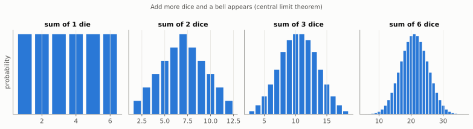
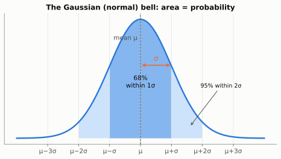
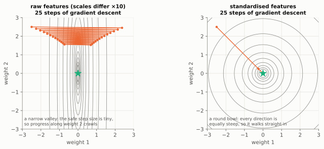
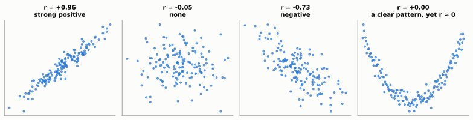
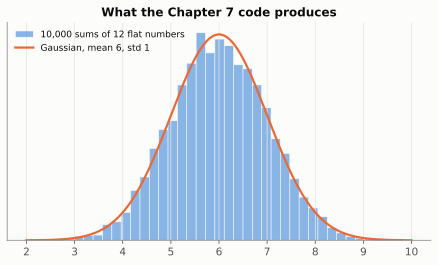

# Chapter 7: The Shape of Randomness (Distributions and the Gaussian)

**The big idea:** randomness has *shapes*. The most famous, the bell curve, explains why noise looks the way it does and how neural nets get their starting values.

## A distribution is a shape

Roll a die: each face has probability 1/6, a flat shape. Roll two dice and add them: 7 is the most likely, 2 and 12 are rare, and a hump appears in the middle. Add many random things together and the hump becomes a smooth bell. This is the **Gaussian** (or normal) distribution, and it shows up everywhere because of that adding-up effect.



Why does a hump form? There is only one way to roll a total of 2 (`1+1`), but six ways to roll a 7 (`1+6, 2+5, 3+4, 4+3, 5+2, 6+1`). Middle totals can be made in many ways and extreme totals in very few, and with more dice that imbalance grows into a bell.

Two numbers describe a Gaussian:

- the **mean** (where the centre sits)
- the **standard deviation** (how wide the bell is)

Rule of thumb: about 68% of values fall within one standard deviation of the mean, about 95% within two, and 99.7% within three.



## Describing data: mean, variance, standard deviation

To describe a pile of numbers, use two summaries: where is the centre, and how spread out is it? There are three common ways to measure the centre:

- **Mean:** add everything up and divide by the count.
- **Median:** sort the numbers and take the middle one (or the average of the two middle ones).
- **Mode:** the most common value.

They disagree when data is lopsided. In a room of nine teachers and one billionaire, the mean wealth is enormous and describes nobody, while the median still describes a typical person. That is why house prices and salaries are usually reported as medians.

Now for spread. Take the data `2, 4, 4, 4, 5, 5, 7, 9`.

- **Mean** (the average): `40 / 8 = 5`.
- **Deviations** from the mean: `-3, -1, -1, -1, 0, 0, 2, 4`.
- **Square** them, so negatives and positives cannot cancel: `9, 1, 1, 1, 0, 0, 4, 16`, which add to 32.
- **Variance** (the average squared deviation): `32 / 8 = 4`.
- **Standard deviation** (the square root of the variance, to get back to the original units): `√4 = 2`.

$$
\sigma^2 = \frac{1}{n}\sum_{i=1}^{n}(x_i - \mu)^2 \qquad\quad \sigma = \sqrt{\sigma^2}
$$

The Greek letters are standard: `μ` (mu) is the mean and `σ` (sigma) is the standard deviation. A small `σ` means values cluster tightly; a large one means they are scattered.

**A small print detail.** When your numbers are a *sample* from a bigger population, and you are using them to estimate the population's spread, statisticians divide by `n - 1` instead of `n`. The sample's own mean is pulled towards the sample, so the deviations come out slightly too small, and dividing by a slightly smaller number corrects for that. In numpy, `x.var()` divides by `n` and `x.var(ddof=1)` divides by `n - 1`. With large datasets the difference is negligible.

## Standardising: putting everything on the same scale

Once you know the mean and standard deviation, you can ask of any value: **how many standard deviations from the mean is it?** That number is its **z-score**:

$$
z = \frac{x - \mu}{\sigma}
$$

For our data `2, 4, 4, 4, 5, 5, 7, 9` (mean 5, standard deviation 2), the z-scores are `-1.5, -0.5, -0.5, -0.5, 0, 0, 1, 2`. The 9 is "two standard deviations above average". Converting a whole feature like this is called **standardising**, and the result always has mean 0 and standard deviation 1.

Why bother? Suppose a model predicts house prices from floor area (50 to 300 square metres) and number of bedrooms (1 to 5). The area weight multiplies big numbers and the bedroom weight multiplies small ones, so the loss is extremely sensitive to one weight and barely sensitive to the other. That makes a long, narrow valley, exactly the shape that made gradient descent zig-zag in Chapter 5:



After standardising, both features live on the same scale, the valley becomes a round bowl, a larger learning rate is safe, and training converges in a fraction of the steps. Two practical rules:

- **Compute the mean and standard deviation on the training data only**, and reuse those same numbers for validation, test and real-world data. Otherwise information from the test set leaks into training.
- **Deep networks standardise inside themselves too.** *Batch normalisation* (Sergey Ioffe and Christian Szegedy, 2015) standardises each feature across a mini-batch. *Layer normalisation* (Jimmy Ba, Jamie Kiros and Geoffrey Hinton, 2016) standardises each token's vector across its own features. It sits inside every transformer block in Chapter 10, followed by a learned rescale and shift so the network can undo it where useful.

```python
import numpy as np

# each row is a house: [floor area in m², number of bedrooms]
X = np.array([[120, 3], [80, 2], [200, 4], [150, 3], [60, 1]], dtype=float)
mu, sigma = X.mean(axis=0), X.std(axis=0)
Z = (X - mu) / sigma                       # standardise each column
print(np.round(Z, 2))
print(Z.mean(axis=0).round(6), Z.std(axis=0))   # each column: mean 0, std 1
```

## Covariance and correlation: do two things move together?

Variance describes one quantity. Often we want to know whether two quantities **move together**: do taller parents have taller children, do more study hours mean higher scores? The **covariance** averages the product of the two deviations:

$$
\mathrm{cov}(x, y) = \frac{1}{n}\sum_{i=1}^{n} (x_i - \mu_x)(y_i - \mu_y)
$$

If both are above average together (or below together), the product is positive. If one is up while the other is down, it is negative. Covariance's size depends on the units, so we divide by both standard deviations to get the **correlation coefficient** `r`, which always lies between -1 and 1:

$$
r = \frac{\mathrm{cov}(x, y)}{\sigma_x \, \sigma_y}
$$

Worked example: hours studied `x = [1, 2, 3, 4, 5]` and test scores `y = [2, 4, 5, 4, 5]`. The means are 3 and 4, so the deviations are `[-2, -1, 0, 1, 2]` and `[-2, 0, 1, 0, 1]`. Their products are `4, 0, 0, 0, 2`, averaging to `6 / 5 = 1.2`. With `σx = √2 ≈ 1.41` and `σy = √1.2 ≈ 1.10`, we get `r = 1.2 / (1.41 × 1.10) ≈ 0.77`: a fairly strong positive relationship.

> 💡 **A link back to Chapter 1.** Correlation is exactly the **cosine similarity** of the two deviation vectors. Check it: `[-2, -1, 0, 1, 2] · [-2, 0, 1, 0, 1] = 6`, the lengths are `√10` and `√6`, and `6 / √60 ≈ 0.77`. A correlation of 1 means the deviations point in the same direction.



Two warnings that save a lot of embarrassment:

1. **Correlation only measures straight-line relationships.** The U shape in the last panel is a perfect pattern, yet `r = 0`.
2. **Correlation is not causation.** Ice cream sales and drownings rise and fall together, but neither causes the other: hot weather drives both. Machine learning models happily learn such shortcuts. In a well-known 2016 demonstration, researchers trained a classifier to tell wolves from huskies on photos where the wolves were mostly standing on snow. It learned "snow means wolf".

With many features, the covariances of every pair form a **covariance matrix**. Its diagonal holds the variances, and its eigenvectors are exactly the principal directions that PCA finds (Chapter 2).

> 📜 **History.** Francis Galton coined "co-relation" in 1888 while studying how the heights of parents and children are related. The same line of research gave us the phrase "regression towards the mean", the origin of the word *regression* in machine learning. Karl Pearson gave the correlation coefficient its modern formula in 1896, which is why it is often called *Pearson's r*.

```python
import numpy as np

x = np.array([1, 2, 3, 4, 5]); y = np.array([2, 4, 5, 4, 5])
print(np.cov(x, y, bias=True)[0, 1])   # 1.2 (bias=True divides by n, as above)
print(np.corrcoef(x, y)[0, 1])         # 0.7746
```

## Discrete versus continuous

A die has a handful of separate outcomes, and each gets its own probability. That is a **discrete** distribution. A quantity like height can take any value in a range, so it is **continuous**. For those we draw a smooth curve called a **density**, where **area under the curve means probability**. The total area is 1, and the chance of landing in a range, say 170 to 180 cm, is the area over that range. (The chance of hitting one exact value is zero, since there are infinitely many possibilities.)

The Gaussian's density has this formula:

$$
p(x) = \frac{1}{\sigma\sqrt{2\pi}} \exp\!\left(-\frac{(x-\mu)^2}{2\sigma^2}\right)
$$

Do not memorise it, just read its anatomy. The core is `exp(-(x - μ)² / ...)`: the farther `x` is from the mean, the larger the squared distance, and the exponential of a big negative number is tiny. That is the bell falling away on both sides, symmetric and peaked at `μ`. The fraction in front only exists to make the total area exactly 1.

## A connection worth knowing

Take the logarithm of that density and the leading fraction becomes a constant, leaving `-(x - μ)² / (2σ²)`. So **making the data as probable as possible under a Gaussian is the same as making the squared error as small as possible.** That is the real reason squared error is so popular as a loss: it is what you get when you assume the noise is Gaussian.

## Why bells appear

The bell shows up because of the **central limit theorem**: add up (or average) many small, independent random effects and the total tends to a Gaussian, whatever the individual effects look like. Our experiment sums 12 flat random numbers. Each has variance `1/12`, so 12 of them have variance 1, and the sum has mean `12 × 0.5 = 6` and standard deviation 1. Run the code below and check that it prints values close to those.

> 💡 **Picture it: the Galton board.** Drop balls through rows of pegs. At every peg a ball bounces left or right at random, and at the bottom the balls pile up in a bell shape. Each ball's final position is the *sum* of many small random left-or-right nudges, which is the central limit theorem made of wood and marbles. Francis Galton built one in the 1870s to demonstrate the idea.

The theorem has a practical side, too. The *average* of `n` samples is also roughly Gaussian, with a spread that shrinks like `σ / √n`. That is why a poll of 1,000 people, or a mini-batch of 256 examples in Chapter 5, gives a usefully accurate estimate: four times as many samples halves the error.

> 📜 **History.** Abraham de Moivre found the bell curve in 1733 as an approximation to coin-flip counts. Carl Friedrich Gauss used it in 1809 to model errors in astronomical measurements, which is why it carries his name and why it is tied to least squares (Chapter 5). Pierre-Simon Laplace proved an early central limit theorem in 1810, explaining why the bell is everywhere.

## Other shapes you will meet

- **Uniform:** every value equally likely (our random numbers between 0 and 1).
- **Bernoulli:** a coin flip, described by one number `p`.
- **Categorical:** a die with any number of faces, described by a list of probabilities that sum to 1. A language model's output is exactly this: one probability for each of the tens of thousands of possible next words.

## Why AI cares

- **Starting weights** are drawn from a small Gaussian, as you did in Chapter 2.
- **Noise** in data is usually modelled as Gaussian, which is why squared error (Chapter 5) is a natural loss.
- **Image generators** start from pure Gaussian noise and learn to remove it step by step.

## Build it: watch the bell appear

```python
import numpy as np

rng = np.random.default_rng(2)

# Sum of 12 random dice-like numbers, repeated 10,000 times
samples = rng.uniform(0, 1, (10_000, 12)).sum(axis=1)

print("mean:", samples.mean(), "std:", samples.std())

# Crude text histogram
counts, edges = np.histogram(samples, bins=15)
for c, e in zip(counts, edges):
    print(f"{e:5.1f} | {'#' * (c // 40)}")
```

The printout should look like a bell, even though each ingredient was perfectly flat. Here is the same experiment drawn properly, with the predicted Gaussian on top:



**Try this:** use 2 numbers per sum instead of 12 and see how the shape changes. Then check what fraction of samples lies within one standard deviation of the mean (it should be near 0.68).

## Check yourself

1. What are the mean and standard deviation of `[1, 5]`? *Answer: mean 3, deviations `-2` and `2`, variance `(4 + 4) / 2 = 4`, standard deviation 2.*
2. Heights have mean 170 cm and standard deviation 10 cm. About what range holds 68% of people? *Answer: one standard deviation each way, so 160 to 180 cm.*
3. Roughly what fraction of a Gaussian lies within two standard deviations of the mean? *Answer: about 95%.*
4. Why is the probability of exactly 170.000... cm zero for a continuous variable? *Answer: there are infinitely many possible heights, so we ask about ranges (areas) instead.*
5. What are the mean and median of `[1, 2, 3, 4, 100]`? *Answer: mean 22, median 3. The single large value drags the mean but not the median.*
6. Heights have mean 170 cm and standard deviation 10 cm. What is the z-score of someone 185 cm tall? *Answer: `(185 - 170) / 10 = 1.5`.*
7. Two features have correlation 0. Can they still be related? *Answer: yes. Correlation only detects straight-line relationships; a U shape can have `r = 0`.*
8. Why must the test data be standardised with the *training* mean and standard deviation? *Answer: the model was trained on that scale, and using the test set's own statistics would leak information from data that is meant to be unseen.*

## Chapter 7 in one breath

A distribution is the shape of randomness. Add up lots of small random effects and you get a Gaussian, which is why it is everywhere in AI.

---

**Next:** [Chapter 8: Measuring Surprise](08-entropy.md): the idea behind the loss that trains every language model.
