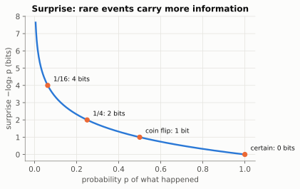
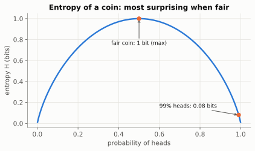
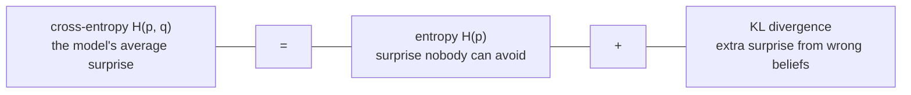
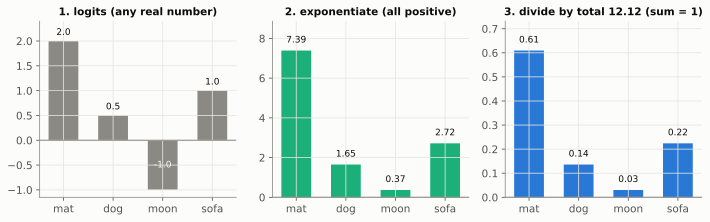
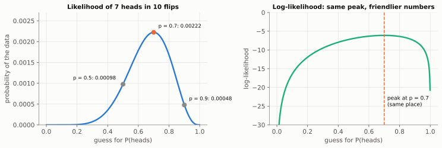

# Chapter 8: Measuring Surprise (Entropy and Cross-Entropy)

> 🧭 **The question.** A language model reads *"The cat sat on the"* and says: **mat 61%, sofa 22%, dog 14%, moon 3%.** The real next word was "mat". How good was that prediction? How much worse would it have been if the real word were "moon"?
>
> To train a model we need a single number that scores predictions made of probabilities: a number we can make smaller, step by step.

*Where this fits in the book:* that number is the loss that trains every language model.

**The big idea:** information is *surprise*. Rare events carry more of it, and the loss used to train language models is just "how surprised was the model by what actually happened?"

<details markdown="1">
<summary>📜 <b>History:</b> Claude Shannon invents information</summary>

In 1948 Claude Shannon, a 32-year-old engineer at Bell Labs, published *A Mathematical Theory of Communication*. He wanted to know how much information a telephone line or telegraph cable could carry, and to answer it he defined information itself as a number. The paper created the field of information theory, and the first use of the word **bit** in print, a contraction of "binary digit" credited by Shannon to his colleague John Tukey. Every file format, mobile network and, as this chapter shows, every language model's training loss rests on it.

</details>

## Surprise in one line

If I tell you the sun rose today, you learn almost nothing. If I tell you it did not, that is huge news. So surprise should be large when probability is small. The standard measure is:

`surprise = -log(p)`

- `p = 1` (certain): surprise `0`
- `p = 0.5`: surprise `0.69` (in natural log; 1 bit if you use log base 2)
- `p = 0.01`: surprise about `4.6`



Why `-log(p)`, and not something simpler like `1/p`?

## Why a logarithm?

Why `-log(p)` and not something simpler like `1/p`? Because we want surprise to **add up** for independent events. If one event has probability `1/2` and another independent one has probability `1/4`, both together have probability `1/8`. Using logs in base 2:

- surprise of the first: `-log₂(1/2) = 1`
- surprise of the second: `-log₂(1/4) = 2`
- surprise of both together: `-log₂(1/8) = 3`, which is `1 + 2`.

The logarithm is the function that turns "multiply the probabilities" into "add the surprises." When the base is 2 the unit is called a **bit**; with the natural log it is called a **nat** (1 nat ≈ 1.44 bits). Machine learning mostly uses nats, because they work nicely with derivatives.

| Probability | 1/2 | 1/4 | 1/8 | 1/1024 |
| --- | --- | --- | --- | --- |
| Surprise in bits | 1 | 2 | 3 | 10 |

> 🤔 **Pause and predict.** What is the surprise, in bits, of an event with probability 1/8?
>
> <details markdown="1"><summary>Answer</summary>
>
> 3 bits: `-log₂(1/8) = 3`, as unlikely as three fair coin flips all landing heads.
>
> </details>

A useful reading: a surprise of `k` bits is as unlikely as `k` fair coin flips all landing heads.

That scores one event. What about a whole *source* of events, like a coin, or a writer choosing words?

## Entropy: average surprise

**Entropy** is the average surprise of a source. A fair coin has maximum entropy for two outcomes (you can never guess it). A coin that lands heads 99% of the time has very low entropy (it is boring). Entropy is the smallest average number of yes/no questions you would need to learn the outcome, using the cleverest possible questioning strategy. That makes it a hard limit on how much the outcome can be compressed: Shannon proved no code can use fewer bits per outcome on average.



> 💡 **Twenty questions.** To guess one of 8 equally likely animals, ask "Is it in the first half?" each time. Three questions always suffice, and `log₂ 8 = 3` bits. If one animal is far more likely than the others, ask about it first, and on average you will need fewer questions. That reduced average is exactly what entropy measures.

<details markdown="1">
<summary>📜 <b>History:</b> why is it called "entropy"?</summary>

The word comes from 19th-century physics, where it measures disorder in a gas, and Shannon's formula has the same shape as Ludwig Boltzmann's. A well-known story, possibly polished in the retelling, has John von Neumann advising Shannon to use the name because "nobody knows what entropy really is, so in a debate you will always have the advantage."

</details>

Entropy assumes you know the true odds. A model doesn't: it has its own beliefs. How surprised is *it*?

## Cross-entropy: surprise under the wrong beliefs

Now suppose reality has one distribution, but your model believes another. **Cross-entropy** is how surprised your model is, on average, by what really happens. It is always at least as big as the true entropy, and equal only if your model is perfect. The extra gap is called **KL divergence** (after Solomon Kullback and Richard Leibler, 1951): the price you pay for having wrong beliefs.



Training can never push the loss below the entropy of the data itself, because some things (like which of two equally good words a writer picks) are genuinely unpredictable. What training removes is the KL part.

Let's put numbers on all three ideas.

## The formulas, with numbers

Entropy is the average surprise, weighting each outcome's surprise by how often it happens:

$$
H(p) = -\sum_i p_i \log p_i
$$

Using bits: a fair coin has `H = -(0.5 × log₂0.5 + 0.5 × log₂0.5) = 1` bit. A coin that lands heads 99% of the time has `H = 0.99 × 0.0145 + 0.01 × 6.64 ≈ 0.08` bits, nearly no surprise at all. A fair six-sided die has `log₂6 ≈ 2.58` bits.

Cross-entropy is the same sum, except the surprise is computed with the *model's* probabilities `q` while the weights come from the *true* probabilities `p`:

$$
H(p, q) = -\sum_i p_i \log q_i \qquad\qquad D_{\mathrm{KL}}(p \,\Vert\, q) = H(p, q) - H(p)
$$

Example: a fair coin (`p = [0.5, 0.5]`) described by two different models:

| Model `q` | Cross-entropy (bits) | Extra cost, KL (bits) |
| --- | --- | --- |
| `[0.5, 0.5]` (correct) | 1.00 | 0 |
| `[0.9, 0.1]` (overconfident in heads) | `0.5×0.15 + 0.5×3.32 ≈ 1.74` | 0.74 |

The correct model achieves the entropy floor of 1 bit, and being wrong costs extra. That extra is always zero or positive, never negative.

Now the link to training. When the truth is a single known word (probability 1 for "mat", 0 for every other), every term in the sum vanishes except one, and cross-entropy collapses to **`-log q(mat)`**. That is why the language-model loss is simply "minus the log of the probability you gave the right answer."

One practical gap remains. Networks don't output probabilities directly; they output raw scores. How do we turn scores into probabilities?

## Softmax, step by step

A network's last layer produces raw scores called **logits**, which can be any real numbers (negative, huge, anything). We need valid probabilities: positive, summing to 1. **Softmax** does it in two moves: exponentiate each score (so everything is positive, and bigger scores stay bigger), then divide by the total.

$$
\mathrm{softmax}(z)_i = \frac{e^{z_i}}{\sum_j e^{z_j}}
$$

For the logits `[2.0, 0.5, -1.0, 1.0]` from the code below:

- Exponentials: `e² = 7.39`, `e^0.5 = 1.65`, `e^-1 = 0.37`, `e¹ = 2.72`. Their sum is `12.12`.
- Probabilities: `7.39/12.12 = 0.61`, `1.65/12.12 = 0.14`, `0.37/12.12 = 0.03`, `2.72/12.12 = 0.22`.
- If the true word is the first, the loss is `-ln(0.61) ≈ 0.50`.



> 🤔 **Pause and predict.** If you add 10 to every logit, what happens to the probabilities?
>
> <details markdown="1"><summary>Answer</summary>
>
> Nothing. Every `eᶻ` gets multiplied by the same `e¹⁰`, which cancels between the top and bottom of the fraction. Only the *differences* between logits matter.
>
> </details>

The code subtracts the largest logit before exponentiating. That changes nothing mathematically (the same factor cancels top and bottom) but stops `e` to a large power from overflowing.

### Temperature: the creativity knob

Chatbots often have a **temperature** setting. It simply divides the logits by a number `T` before the softmax:

| Temperature | mat | dog | moon | sofa | Feel |
| --- | --- | --- | --- | --- | --- |
| `T = 0.5` | 0.84 | 0.04 | 0.00 | 0.11 | confident, repetitive |
| `T = 1` | 0.61 | 0.14 | 0.03 | 0.22 | the model as trained |
| `T = 2` | 0.43 | 0.21 | 0.10 | 0.26 | adventurous, more random |

Low temperature exaggerates the gaps between scores, so the top word dominates. High temperature flattens them, so unlikely words get picked more often. The name comes from physics: softmax has the same form as the **Boltzmann distribution**, which gives the probability of a gas molecule having a given energy at a given temperature. (The name *softmax* itself was coined by John Bridle in 1989: it is a "soft", differentiable version of picking the maximum.)

Now put the pieces together for a language model.

## Why AI cares

A language model sees "The cat sat on the" and outputs a probability for every word. The real next word was "mat". The loss is `-log(P(mat))`. If the model gave "mat" 90%, the loss is small (`0.1`). If it gave 1%, the loss is big (`4.6`). Train on trillions of words, nudging parameters to shrink this number (Chapter 5), and out comes a language model.

Let's compute it.

## Build it: cross-entropy loss

```python
import numpy as np

def softmax(logits):
    e = np.exp(logits - logits.max())   # subtract max for stability
    return e / e.sum()

words = ["mat", "dog", "moon", "sofa"]
logits = np.array([2.0, 0.5, -1.0, 1.0])   # model's raw scores
probs = softmax(logits)

true_index = 0   # the real next word was "mat"
loss = -np.log(probs[true_index])

for w, p in zip(words, probs):
    print(f"{w:5s} {p:.2f}")
print("loss:", loss)
```

`softmax` turns any list of scores into valid probabilities (positive, summing to 1). Change `true_index` to 2 ("moon") and watch the loss jump.

**Try this:** raise the first logit from 2.0 to 5.0 and see how the loss for "mat" shrinks, and how it gets *worse* for every other true word.

A loss like 2.3 is hard to feel. There is a friendlier way to report it.

## Perplexity: loss in plain English

People often report a language model's quality as **perplexity**, which is simply `e` raised to the average loss. A loss of 2.3 nats gives `e^2.3 ≈ 10`: the model is about as uncertain as if it were choosing between 10 equally likely words at each step. Lower is better, and 1 would mean perfect certainty. (Perplexity was introduced in 1977 by Frederick Jelinek's speech recognition group at IBM, whose statistical approach to language paved the way for today's models.)

One puzzle remains. Chapter 5 fitted a line with squared error, and this chapter trains classifiers with cross-entropy. Two different losses, or one idea in disguise?

## The idea behind every loss: maximum likelihood

So far the book has used two losses: squared error (Chapter 5) and cross-entropy (this chapter). They look unrelated, but they are the same idea in two outfits. Here is that idea.

You flip a coin 10 times and get 7 heads. What is your best guess for the coin's probability of heads, `p`? "0.7, obviously." But *why*? Try a few candidates and ask, for each, **how probable would this exact sequence of flips be?** That probability, `p⁷(1 - p)³`, is called the **likelihood** of `p`:

| Guess for `p` | 0.5 | **0.7** | 0.9 |
| --- | --- | --- | --- |
| Probability of the data | 0.00098 | **0.00222** | 0.00048 |



The guess that makes the observed data most probable is 0.7. Picking parameters this way is called **maximum likelihood**. In practice we maximise the *log*-likelihood, `7 ln p + 3 ln(1 - p)`. The peak is in the same place, products turn into sums (Chapter 0), and tiny numbers stop underflowing (Chapter 6). Setting its derivative to zero (Chapter 3), `7/p - 3/(1 - p) = 0`, gives exactly `p = 7/10`.

**Training a model is maximum likelihood.** A model with parameters assigns a probability to the training data, and training searches for the parameters that make that data most probable. Equivalently, it *minimises the negative log-likelihood*, and that quantity turns out to be the loss you already know:

| If you assume the data is… | the negative log-likelihood is… | used for |
| --- | --- | --- |
| the true value plus Gaussian noise (Ch. 7) | **squared error** (Ch. 5) | predicting numbers |
| a yes/no outcome (a Bernoulli coin) | **binary cross-entropy** (Ch. 9) | yes/no classification |
| one of many categories | **cross-entropy** (this chapter) | classifiers, and next-token prediction in language models |

So the losses in this book are not arbitrary choices. Each one asks "how improbable did the model find what really happened?", under a different assumption about what kind of data it is. Training a language model on trillions of words is maximum likelihood at enormous scale.

> 💡 **Where Bayes comes in.** Maximum likelihood uses only the evidence. Add a prior belief about the parameters (Chapter 6), such as "weights are probably small", and you get *maximum a posteriori* estimation. A Gaussian prior on the weights turns out to be exactly the *weight decay* you will meet in Chapter 9.

<details markdown="1">
<summary>📜 <b>History:</b> who named maximum likelihood?</summary>

Gauss and Laplace used versions of the idea around 1800, but Ronald Fisher developed it fully and named it "maximum likelihood" between 1912 and 1922. It became the backbone of modern statistics, and now of machine learning.

</details>

```python
import numpy as np

flips = np.array([1, 1, 0, 1, 1, 1, 0, 1, 0, 1])          # 7 heads (1), 3 tails (0)
ps = np.linspace(0.01, 0.99, 99)                            # candidate values of p
loglik = [np.sum(flips * np.log(p) + (1 - flips) * np.log(1 - p)) for p in ps]
print("best p:", round(ps[np.argmax(loglik)], 2))           # 0.7
```

Look at the summand: `y ln p + (1 - y) ln(1 - p)`. It is exactly minus the binary cross-entropy from Chapter 9.

## Back to the question

We asked how good *"mat 61%"* was, when the answer was "mat". Its surprise, the loss, is `-ln 0.61 ≈ 0.50`. Had the answer been "moon", which the model gave only 3%, the loss would have been `-ln 0.03 ≈ 3.5`, seven times bigger. **Cross-entropy** is this surprise, averaged over everything the model is asked to predict. Minimising it is the same as **maximum likelihood**: making what really happened as probable as possible.

That single number, pushed down by gradient descent over trillions of words, is how a language model is trained.

## Check yourself

Try each question on paper before opening the answer.

1. What is the surprise, in bits, of an event with probability `1/16`?
    <details markdown="1"><summary>Answer</summary>4 bits.</details>
2. What is the entropy of a coin that always lands heads?
    <details markdown="1"><summary>Answer</summary>0. There is no surprise.</details>
3. A model gives the true next word probability 0.25. What is the loss?
    <details markdown="1"><summary>Answer</summary>`-ln(0.25) ≈ 1.39` nats.</details>
4. Can a model's cross-entropy ever be lower than the true entropy?
    <details markdown="1"><summary>Answer</summary>no. It equals the entropy only if the model matches reality exactly.</details>
5. What does softmax output for the logits `[0, 0, 0]`?
    <details markdown="1"><summary>Answer</summary>`[1/3, 1/3, 1/3]`, since all scores are equal.</details>
6. What happens to softmax as temperature goes towards 0?
    <details markdown="1"><summary>Answer</summary>the highest logit gets probability close to 1 and the rest close to 0. It becomes "always pick the top word".</details>
7. You flip a coin 12 times and see 3 heads. What is the maximum-likelihood estimate of P(heads)?
    <details markdown="1"><summary>Answer</summary>`3/12 = 0.25`.</details>
8. Which assumption about the data turns maximum likelihood into squared error?
    <details markdown="1"><summary>Answer</summary>that each answer is the true value plus Gaussian noise.</details>

## Chapter 8 in one breath

Surprise is `-log(p)`. Cross-entropy is a model's average surprise at reality, and training minimises it.

---

**Next:** [Chapter 9: Putting It All Together](09-neural-network.md). You now own every ingredient: vectors, layers, slopes, the chain rule, gradient descent, probabilities and a loss. Can they learn something no straight line can, the puzzle that froze AI research for more than a decade?
