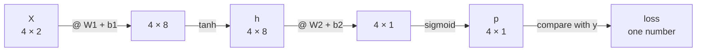
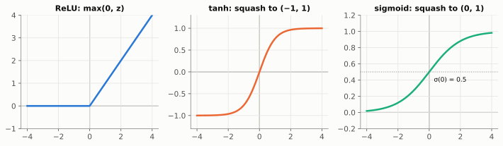
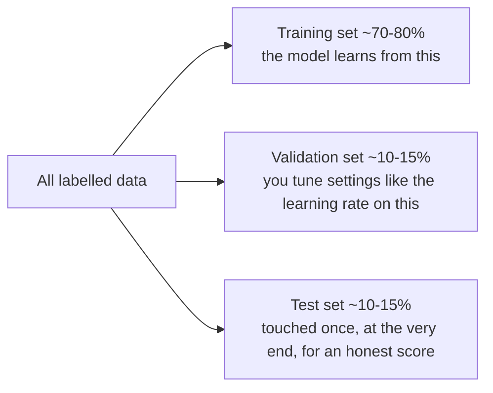
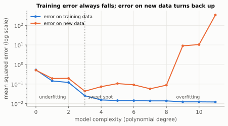

# Chapter 9: Putting It All Together (A Network That Learns)

> 🧭 **The question.** Here is a puzzle small enough to write on a napkin: *output 1 when exactly one of two switches is on.* In 1969 it was proved that a single artificial neuron can never learn it, and research into neural networks stalled for more than a decade.
>
> Can you build a network that learns it, using nothing but the ideas from Chapters 1 to 8?

*Where this fits in the book:* this is the first time every part of the book runs together. It is the same loop that trains language models, at toy size.

**The big idea:** you now own every ingredient. This chapter assembles them into a small neural network that learns a problem no straight line can solve.

## The problem

The classic XOR puzzle: output 1 when exactly one of two inputs is 1.

| x1 | x2 | answer |
| --- | --- | --- |
| 0 | 0 | 0 |
| 0 | 1 | 1 |
| 1 | 0 | 1 |
| 1 | 1 | 0 |

No single line separates the 1s from the 0s, so you need a hidden layer with a bend in it. This is why depth matters.

<details markdown="1">
<summary>📜 <b>History:</b> the puzzle that froze AI research for a decade</summary>

XOR has a famous place in AI history. In their 1969 book *Perceptrons*, Marvin Minsky and Seymour Papert proved that a single-layer perceptron cannot learn XOR, along with other limits. They knew that multi-layer networks could represent it, but nobody yet had a good way to *train* the hidden layers. Funding and enthusiasm for neural networks collapsed for more than a decade, a period now called the first **AI winter**. Backpropagation (Chapter 4), popularised in 1986, was exactly the missing training method, and the program in this chapter is the problem that stalled the field, solved in about 30 lines.

</details>

Four rows. Here is the plan of attack, using the five ideas you already own.

## The recipe

1. **Vectors** (Ch. 1) hold the data.
2. **Matrices** plus ReLU-style bends (Ch. 2) form two layers.
3. **A loss** measures wrongness (Ch. 5 and 8).
4. **The chain rule** (Ch. 4) finds each parameter's gradient.
5. **Gradient descent** (Ch. 5) updates them. Repeat.

First, though: why do we need a hidden layer at all? Can't a single neuron manage?

## Why no straight line works

> 🤔 **Pause and predict.** Picture the four points on a square: the two 1s at opposite corners, `(0, 1)` and `(1, 0)`, and the two 0s at the other corners. Can you draw one straight line with both 1s on one side and both 0s on the other?
>
> <details markdown="1"><summary>Answer</summary>
>
> No. Any line that separates one diagonal pair cuts between the other pair. The proof below makes this exact.
>
> </details>

Here is a short proof, because it shows *why* depth is needed. Suppose a single neuron (a straight-line classifier) says "output 1 when `w₁x₁ + w₂x₂ + b > 0`." For XOR we would need:

- `(0, 0)` gives 0, so `b ≤ 0`.
- `(0, 1)` gives 1, so `w₂ + b > 0`.
- `(1, 0)` gives 1, so `w₁ + b > 0`.
- `(1, 1)` gives 0, so `w₁ + w₂ + b ≤ 0`.

Add the middle two: `w₁ + w₂ + 2b > 0`. But since `b ≤ 0`, we have `w₁ + w₂ + 2b ≤ w₁ + w₂ + b ≤ 0`. That is a contradiction. No choice of weights can work, so a hidden layer with a bend is not optional here, it is essential.

So a hidden layer with a bend is required. Here is the network, and how the shapes flow through it.

## The network, with shapes



To process all four examples at once we stack them as the rows of a matrix `X`. Here is how the shapes flow through the code:

| Step | Computation | Shape |
| --- | --- | --- |
| input | `X` | 4 × 2 (4 examples, 2 numbers each) |
| hidden pre-activation | `X @ W1 + b1` | (4 × 2)(2 × 8) = 4 × 8 |
| hidden activation | `h = tanh(...)` | 4 × 8 |
| output pre-activation | `h @ W2 + b2` | (4 × 8)(8 × 1) = 4 × 1 |
| output probability | `p = sigmoid(...)` | 4 × 1 (one probability per example) |

Two functions here are new. **tanh** is a smooth S-shaped squash that maps any number into the range -1 to 1 (it plays the role ReLU played earlier). **Sigmoid** squashes any number into the range 0 to 1, so the result can be read as a probability:



$$
\sigma(z) = \frac{1}{1 + e^{-z}}
$$

Check its behaviour: `σ(0) = 1/(1 + 1) = 0.5`; for a large positive `z`, `e⁻ᶻ` is tiny so `σ ≈ 1`; for a large negative `z`, `e⁻ᶻ` is huge so `σ ≈ 0`.

The two are close relatives: `tanh(z) = 2σ(2z) - 1`, a sigmoid stretched to run from -1 to 1. Both have friendly derivatives written in terms of their own output, `σ' = σ(1 - σ)` and `tanh' = 1 - tanh²`, which keeps the backward pass short.

To learn, the network needs a score for its mistakes. Chapter 8 already gave us one.

## The loss: Chapter 8 for two classes

With two outcomes, cross-entropy takes the form

$$
L = -\frac{1}{n}\sum_i \big[\, y_i \ln p_i + (1 - y_i)\ln(1 - p_i) \,\big]
$$

where `yᵢ` is the true label (0 or 1) and `pᵢ` the model's probability that the label is 1. If `y = 1` only the first term survives and the loss is `-ln p`; if `y = 0` only the second survives, `-ln(1 - p)`. It is exactly "minus the log of the probability given to the right answer," averaged over examples.

That is the forward direction. Now the chain rule, run backwards through this network.

## The backward pass, line by line

Every line applies the rule from Chapter 4, **local derivative × incoming gradient**, working from the loss back to the inputs:

- `dz2 = (p - y) / len(X)`: the gradient at the output. There is a neat fact here: for sigmoid combined with cross-entropy, the derivatives simplify to just `p - y`, the prediction minus the truth. (The same happens with softmax, which is one reason this pairing is standard.) The division by 4 is the average over examples.
- `dW2 = h.T @ dz2` and `db2 = dz2.sum(...)`: how the loss changes with the output weights and bias. The transpose `.T` is there only so the shapes line up: (8 × 4)(4 × 1) gives 8 × 1, the shape of `W2`.
- `dh = dz2 @ W2.T`: pass the gradient back through the matrix to the hidden layer.
- `dz1 = dh * (1 - h ** 2)`: pass it back through tanh, whose derivative is `1 - tanh²`.
- `dW1 = X.T @ dz1` and `db1`: the gradients for the first layer.
- Finally each parameter takes a step against its gradient, exactly Chapter 5.

Every line is ready. Here is the whole thing, in about 30 lines.

## Build it: a two-layer net in plain numpy

```python
import numpy as np

rng = np.random.default_rng(0)
X = np.array([[0,0],[0,1],[1,0],[1,1]], dtype=float)
y = np.array([[0],[1],[1],[0]], dtype=float)

W1 = rng.normal(0, 1, (2, 8)); b1 = np.zeros((1, 8))
W2 = rng.normal(0, 1, (8, 1)); b2 = np.zeros((1, 1))
lr = 0.1

def sigmoid(z):
    return 1 / (1 + np.exp(-z))

for step in range(5000):
    # forward pass
    h = np.tanh(X @ W1 + b1)
    p = sigmoid(h @ W2 + b2)
    loss = -np.mean(y * np.log(p) + (1 - y) * np.log(1 - p))

    # backward pass (the chain rule, from the loss backwards)
    dz2 = (p - y) / len(X)
    dW2 = h.T @ dz2;  db2 = dz2.sum(0, keepdims=True)
    dh  = dz2 @ W2.T
    dz1 = dh * (1 - h ** 2)
    dW1 = X.T @ dz1;  db1 = dz1.sum(0, keepdims=True)

    # gradient descent
    W1 -= lr * dW1; b1 -= lr * db1
    W2 -= lr * dW2; b2 -= lr * db2

    if step % 1000 == 0:
        print(step, round(loss, 4))

print(np.round(p, 2))   # should approach [0, 1, 1, 0]
```

Watch the loss fall and the final predictions approach `0, 1, 1, 0`. You have built a network that learns, using only ideas from this book. (We used `tanh` rather than ReLU because it is smooth everywhere and its derivative, `1 - h²`, makes the backward pass a one-liner.)


The middle panel is the payoff. The hidden layer bends the space so that the final, plain linear-plus-sigmoid layer can separate the classes. Every deep network works this way: early layers reshape the data until the last layer's job becomes easy.

**Try this:** change the hidden size from 8 to 2, then to 1. What happens, and why does 1 fail?

Run it and watch the loss fall. Here is what happened inside.

## Reading the training loop

Each of the 5,000 iterations does the same four things:

1. **Forward pass:** compute predictions from the current parameters.
2. **Loss:** measure how wrong they are.
3. **Backward pass:** use the chain rule to get every parameter's gradient.
4. **Update:** nudge every parameter a little against its gradient.

Watch the printed loss: it starts around 0.7 or a little higher (0.7 is `-ln 0.5`, the loss of a model that is merely guessing 50/50) and slides towards zero as the network discovers the XOR pattern.

Two questions beginners often ask:

- **Why start with random weights instead of zeros?** If all the weights were identical, every hidden unit would compute the same thing and receive the same gradient, so they would stay identical forever, and 8 units would be no better than 1. Randomness breaks the symmetry.
- **How do we know it has really learned?** On XOR we can only check the four examples, but on real problems we hold back some data the model never trains on and test it there. A model that merely *memorises* its training set (called **overfitting**) scores well in training and poorly on the held-out data. Checking generalisation to new data is the most important habit in machine learning.

The standard practice is to split the data three ways:



> 💡 **The data matters more than the model.** If the inputs carry no information about the labels, no amount of math will help. Train a network on random inputs paired with random 0/1 labels and its loss will hover near `ln 2 ≈ 0.69`, the loss of a coin-flip guesser (the dotted line in the right-hand panel above). A big enough network may memorise its training examples and push the training loss lower, but on held-out data it stays at 0.69. When a real model's loss gets stuck there, suspect the data before the architecture. Experienced practitioners also try a simple model (a straight line, or naive Bayes from Chapter 6) first, and reach for a neural network only when it clearly beats that baseline.

XOR has only four examples, so there is nothing to generalise to. Real data is different, and its biggest danger is a model that memorises instead of learning.

## Learning versus memorising: generalisation and regularisation

A model is only useful if it works on data it has never seen. That is called **generalisation**, and its enemy is **overfitting**: fitting the training data so closely that the model memorises its noise. Here it is in pictures. Take 15 noisy points from a smooth wave and fit polynomials of increasing flexibility:


- **Degree 1 underfits.** A straight line is too simple to follow the wave. It is wrong on the training data and on new data alike.
- **Degree 3 is about right.** It captures the pattern and ignores the noise.
- **Degree 9 overfits.** It threads almost every training point (the lowest training error of all), but between the points it swings wildly. On new data its error is **200 times worse** than degree 3's.

Plot the two errors against model flexibility and you get one of the most important pictures in machine learning:



**Training error always falls as models get more flexible. Error on new data falls, then turns back up.** The two failure modes have names:

- **Bias** (underfitting): the model is too simple, so it is consistently wrong in the same way.
- **Variance** (overfitting): the model is so flexible that it changes wildly depending on which particular sample of data it saw.

The goal is the sweet spot between them, and the validation set (see the data split above) is how you find it.

### Regularisation: ways to keep a model honest

Techniques that fight overfitting are called **regularisation**. The main ones:

1. **More data.** The best cure of all. Noise averages out, and the real pattern is harder to ignore.
2. **Weight decay (L2 regularisation).** Add a penalty for large weights to the loss:

    $$
    L_{\text{total}} = L_{\text{data}} + \lambda \sum_i w_i^2
    $$

    The penalty's gradient is `2λw`, so every update also shrinks each weight a little towards zero. That is where the name *decay* comes from. Wild wiggles need huge weights: the overfit degree-9 curve's squared weights add up to about **189,000**. With `λ = 0.001` they add up to about **13**, the curve becomes smooth (last panel above), and the error on new data drops from 9.04 to 0.117. The knob `λ` sets how strongly simplicity is favoured.

3. **Dropout** (Nitish Srivastava, Geoffrey Hinton and colleagues, 2014). During training, randomly switch off each hidden unit with some probability, often 10% to 50%, on every step. The network cannot rely on any single unit, so it spreads knowledge around, like a team that has to cope with anyone being absent on any day. At test time all units are switched back on.

4. **Early stopping.** Watch the validation loss during training and stop when it starts to rise, even though the training loss is still falling.

5. **Data augmentation.** Make more training data for free by flipping, cropping or slightly recolouring images, or paraphrasing text.

> 💡 **A modern puzzle.** Today's largest networks have more parameters than they have training examples, which by the picture above should mean catastrophic overfitting. Yet they generalise well. Regularisation, huge datasets, and the gentle way gradient descent explores all play a part, but *why* very large models generalise so well is still an active research question, studied under names like "double descent".

```python
import numpy as np

rng = np.random.default_rng(7)
x_train = rng.uniform(0, 1, 15)
y_train = np.sin(2 * np.pi * x_train) + rng.normal(0, 0.2, 15)    # 15 noisy points
x_new = rng.uniform(0, 1, 100)
y_new = np.sin(2 * np.pi * x_new) + rng.normal(0, 0.2, 100)       # unseen data

def error(coeffs, x, y):
    return np.mean((np.polyval(coeffs, x) - y) ** 2)

for degree in [1, 3, 9]:
    coeffs = np.polyfit(x_train, y_train, degree)    # least-squares fit (Chapter 5)
    print(degree, "train:", round(error(coeffs, x_train, y_train), 3),
          "new data:", round(error(coeffs, x_new, y_new), 3))
```

The training error shrinks with every extra degree, and the error on new data is lowest at degree 3. (The exact numbers differ slightly from the pictures, which were drawn from a different shuffle of the same random points, but the pattern is the same.)

## Back to the question

We asked whether the ideas from Chapters 1 to 8 could learn the puzzle that stalled AI. They can. Vectors held the data, two layers with a bend reshaped the plane, cross-entropy scored the mistakes, the chain rule found every gradient, and gradient descent did the rest. The loss fell from about 0.74 to nearly zero, and the predictions became `0, 1, 1, 0`.

That loop, forward, loss, backward, update, is exactly how GPT-style models are trained. What separates them from this toy is mostly scale, plus one more idea.

## Check yourself

Try each question on paper before opening the answer.

1. For `X` of shape 4 × 2 and `W1` of shape 2 × 8, what is the shape of `X @ W1`?
    <details markdown="1"><summary>Answer</summary>4 × 8.</details>
2. What is `sigmoid(0)`?
    <details markdown="1"><summary>Answer</summary>0.5.</details>
3. The true label is 1 and the model says `p = 0.9`. What is the loss? What if it says `p = 0.1`?
    <details markdown="1"><summary>Answer</summary>`-ln 0.9 ≈ 0.11`, and `-ln 0.1 ≈ 2.30`. A confident wrong answer is punished hard.</details>
4. Why should we not initialise all weights to zero?
    <details markdown="1"><summary>Answer</summary>symmetry. Every hidden unit would get the same gradient and remain identical, so extra units would add nothing.</details>
5. Why test on data the model never trained on?
    <details markdown="1"><summary>Answer</summary>to check that it learned the pattern rather than memorising the examples.</details>
6. A binary classifier's loss is stuck at 0.69 from the start of training. What does that tell you?
    <details markdown="1"><summary>Answer</summary>`0.69 ≈ ln 2`, the loss of guessing 50/50. The model has learned nothing yet. Check the data, labels and learning rate.</details>
7. A model has training error 0.01 and validation error 0.50. What is happening, and name two fixes.
    <details markdown="1"><summary>Answer</summary>overfitting. Fixes include more data, weight decay, dropout, early stopping, data augmentation, or a smaller model.</details>
8. How does weight decay change each gradient-descent step?
    <details markdown="1"><summary>Answer</summary>the penalty `λΣw²` adds `2λw` to each weight's gradient, so every step also shrinks each weight slightly towards zero.</details>
9. Why is dropout switched off at test time?
    <details markdown="1"><summary>Answer</summary>it is a training trick to stop the network relying on any single unit. When making real predictions we want the full network, with no randomness.</details>

## Chapter 9 in one breath

A neural network is vectors and matrices in a chain, trained by gradient descent on a loss, with the chain rule supplying the gradients.

---

**Next:** [Chapter 10: Paying Attention](10-attention.md). Our network looks at one fixed pair of numbers. But to finish *"The cat sat on the …"*, a model has to look back over a whole sentence and decide which words matter. How can arithmetic decide what to pay attention to?
