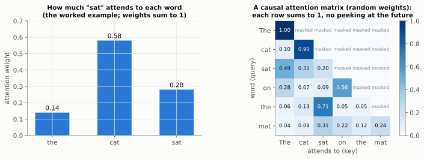
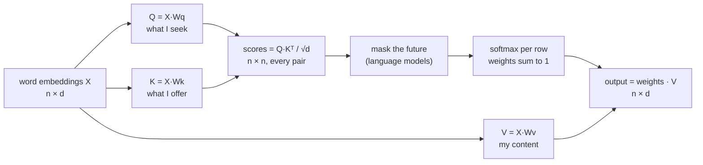
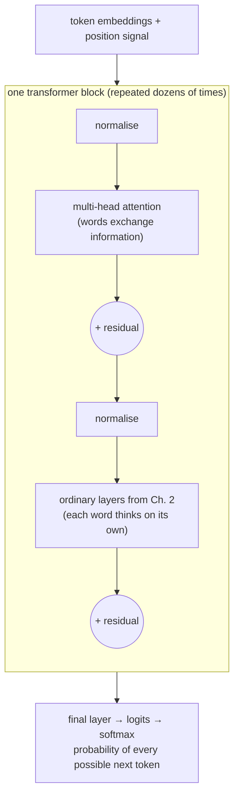
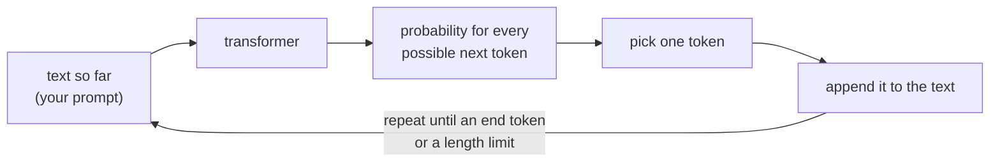
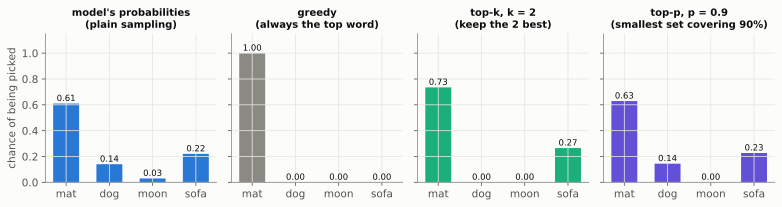

# Chapter 10: Attention in Two Pages (The Math of Transformers)

**The big idea:** attention lets each word look at every other word and decide *which ones matter*. It is dot products (Ch. 1), matrices (Ch. 2) and probabilities (Ch. 6 and 8), nothing new.

> 📜 **History.** Attention was introduced in 2014 by Dzmitry Bahdanau, Kyunghyun Cho and Yoshua Bengio to help translation networks look back at the relevant words of the source sentence, instead of squeezing a whole sentence into one vector. In 2017 a team of eight Google researchers (Ashish Vaswani and colleagues) published *Attention Is All You Need*, which dropped the older recurrent machinery entirely and built a network from attention alone: the **Transformer**. Its layers could process every word in parallel, which suited graphics chips perfectly. GPT-1 followed in 2018, and ChatGPT, launched in November 2022, made transformer language models a household technology. The "T" in GPT stands for Transformer.

## The intuition

In the sentence "The animal didn't cross the street because it was tired", what does "it" refer to? You look back at the other words and weigh them: "animal" matters a lot, "street" less. Attention does exactly this with numbers. (Change "tired" to "wide" and "it" now means the street. The right weighting depends on the whole sentence, which is why it must be computed, not looked up.)

## The three roles

Each word is a vector (an embedding, from Chapter 1). Three matrices turn it into three new vectors:

- **Query** `q`: "what am I looking for?"
- **Key** `k`: "what do I offer?"
- **Value** `v`: "here is my content, if you pick me."

> 💡 **A library analogy.** The query is your search phrase. Each book's key is the label on its spine. You compare your phrase with every spine (dot products), then instead of taking just one book you take a *blend* of all their contents (the values), weighted by how well each spine matched.

## Where the three vectors come from

A word starts as one embedding vector `x` (Chapter 1). Three learned matrices turn that **same** vector into three different ones: `q = x·Wq`, `k = x·Wk`, `v = x·Wv`. Why three? Because one word plays three different roles at once. As a *seeker* it asks a question (query), as a *candidate* it advertises what it is (key), and if chosen it *contributes* content (value). Separating the roles lets the model learn much more flexible relationships than one vector could. The numbers inside `Wq`, `Wk` and `Wv` are parameters, learned by the Chapter 5 loop like any others.

## A tiny example by hand

Let the sentence be "the cat sat" and let us compute what **"sat"** pays attention to, using 2-dimensional vectors so we can do all the arithmetic. Suppose the query of "sat" is `q = [1, 0]`, and the keys and values are:

| Word | Key `k` | Value `v` | Score `q·k` | Scaled (÷ √2) | Weight after softmax |
| --- | --- | --- | --- | --- | --- |
| the | `[0, 1]` | `[1, 0]` | 0 | 0 | 0.14 |
| cat | `[2, 0]` | `[0, 2]` | 2 | 1.41 | 0.58 |
| sat | `[1, 1]` | `[1, 1]` | 1 | 0.71 | 0.28 |

The scaled scores `[0, 1.41, 0.71]` become `e^0 = 1`, `e^1.41 = 4.11`, `e^0.71 = 2.03`, summing to `7.14`, so the weights are `[0.14, 0.58, 0.28]`. The output for "sat" is the weighted mix of the values:

`0.14×[1, 0] + 0.58×[0, 2] + 0.28×[1, 1] ≈ [0.42, 1.44]`

The word "sat" has gathered most of its new representation from "cat", because the key of "cat" lined up best with its query. That, in numbers, is what "paying attention" means.



**Why divide by √d?** The dot product of two vectors with `d` entries tends to grow in size with `d`. Big scores make softmax nearly one-hot (one weight almost 1, the rest almost 0), and in that regime gradients are tiny, so learning stalls. Dividing by `√d` keeps the scores in a comfortable range.

## The four steps

1. **Score** every word against the current one using a dot product: `q · k` (alignment, Ch. 1).
2. **Scale** by `√(dimension)` so scores don't grow huge.
3. **Softmax** the scores into weights that sum to 1 (probabilities, Ch. 8).
4. **Mix:** the output is the weighted average of the value vectors.

In one line:

$$
\mathrm{Attention}(Q, K, V) = \mathrm{softmax}\!\left(\frac{Q K^{\top}}{\sqrt{d}}\right) V
$$

Here `Kᵀ` is `K` **transposed** (rows turned into columns), so that `Q Kᵀ` computes the dot product of every query with every key in one matrix multiplication. As a flow:



A full transformer stacks many of these (with several "heads" in parallel, plus ordinary layers from Chapter 2), all trained with the gradient-descent loop from Chapter 5 on the cross-entropy loss from Chapter 8.

## Build it: a self-attention head

```python
import numpy as np

rng = np.random.default_rng(0)

def softmax(x):
    e = np.exp(x - x.max(axis=-1, keepdims=True))
    return e / e.sum(axis=-1, keepdims=True)

n_words, d = 4, 8
X = rng.normal(0, 1, (n_words, d))            # 4 word embeddings

Wq, Wk, Wv = (rng.normal(0, 1, (d, d)) for _ in range(3))
Q, K, V = X @ Wq, X @ Wk, X @ Wv

scores = Q @ K.T / np.sqrt(d)                  # who looks at whom
weights = softmax(scores)                      # each row sums to 1
out = weights @ V                              # blended information

print(np.round(weights, 2))
print(out.shape)
```

Each row of `weights` says how much one word attends to every word. With random matrices it is meaningless, but training (Chapter 5) would tune `Wq`, `Wk` and `Wv` until the weights pick out the right words.

**Try this:** make word 0 and word 1 identical vectors and check whether they attend to each other strongly.

## What a full transformer adds

Our single head is the heart of it, but a real model adds a few more ingredients, none needing new math:

- **Position information:** attention treats the sentence as a bag of words, with no sense of order. So we add a position signal to each embedding, letting the model tell "dog bites man" from "man bites dog".
- **Masking:** when training to predict the next word, a word must not peek at later words. We set the scores for future positions to minus infinity before softmax, so their weights become exactly 0.
- **Multiple heads:** run several attention heads in parallel, each with its own `Wq`, `Wk`, `Wv`, so different heads can track different relationships (who did what, what "it" refers to, and so on), then combine their outputs.
- **The rest of the block:** after attention comes a small ordinary layer from Chapter 2, with "residual" connections (add the input back to the output) and normalisation to keep numbers well behaved. Dozens of such blocks are stacked.



> 💡 **Why residual connections matter.** Each block only has to learn a *correction* to add to its input, not a whole new representation. And the `+` gives gradients a direct highway back to early layers, which is the cure for the vanishing gradients of Chapter 4.

**What about tokens?** Language models don't actually see words. They see **tokens**: common words, pieces of rarer words (`"un" + "believ" + "able"`), and punctuation, typically from a vocabulary of 50,000 to 200,000 entries. Each token ID is looked up in a big learned table to get its embedding vector. "Next word" in this book really means "next token".

## How a language model writes: one token at a time

Everything so far produces one thing: a probability for every possible **next** token. So how does a chatbot write a whole answer? With a simple loop:



This is called **autoregressive generation**: each new token is predicted from everything before it, including the tokens the model itself just wrote. Every token costs one pass through the network, which is why long answers take longer. (Real systems store each earlier token's keys and values in a "KV cache" so they don't have to be recomputed.)

The interesting step is **"pick one token"**. Take the probabilities from Chapter 8, `mat 0.61, sofa 0.22, dog 0.14, moon 0.03`:



- **Greedy:** always take the most likely token. The output is the same every time, but it is often bland and can get stuck repeating itself.
- **Plain sampling:** roll a weighted die using the probabilities. The output is varied, but rare bad tokens slip through. Over a long answer they add up: with a 3% chance of junk at each step, the chance of 100 tokens with no junk at all is only `0.97¹⁰⁰ ≈ 5%`.
- **Top-k:** keep only the `k` most likely tokens, rescale them to sum to 1, then sample. With `k = 2`: `0.61 / 0.83 ≈ 0.73` for mat and `0.22 / 0.83 ≈ 0.27` for sofa.
- **Top-p (nucleus sampling)** (Ari Holtzman and colleagues, 2019): keep the smallest set of top tokens whose probabilities add up to at least `p`, then rescale. With `p = 0.9`: mat (0.61), plus sofa (0.83 in total), plus dog (0.97), which passes 0.9, so moon is dropped. Unlike top-k, the set adapts: when the model is confident it is tiny, and when it is unsure it is wide.

**Temperature** (Chapter 8) is applied to the logits before any of these. Many chat systems combine a moderate temperature with top-p. This is why the same prompt can give different answers, and why setting the temperature to 0 (which amounts to greedy) makes the output nearly repeatable.

```python
import numpy as np

rng = np.random.default_rng(0)
words  = np.array(["mat", "dog", "moon", "sofa"])
logits = np.array([2.0, 0.5, -1.0, 1.0])

def pick(logits, temperature=1.0, top_k=None, top_p=None):
    z = logits / temperature
    p = np.exp(z - z.max()); p /= p.sum()                  # softmax (Chapter 8)
    order = np.argsort(-p)                                  # most likely first
    keep = order if top_k is None else order[:top_k]
    if top_p is not None:
        cumulative = np.cumsum(p[order])
        keep = order[:np.searchsorted(cumulative, top_p) + 1]
    mask = np.zeros_like(p); mask[keep] = p[keep]
    return rng.choice(len(p), p=mask / mask.sum())          # sample from what is left

for settings in [{}, {"top_k": 2}, {"top_p": 0.9}, {"temperature": 0.5}]:
    counts = np.bincount([pick(logits, **settings) for _ in range(1000)], minlength=4)
    print(settings, dict(zip(words.tolist(), counts.tolist())))
```

Each line shows how often each word was picked in 1,000 draws. Notice that "moon" vanishes under top-k and top-p, and becomes rare at low temperature.

## The whole picture, in one table

| Idea from this book | Where it appears in training a language model |
| --- | --- |
| Vectors (Ch. 1) | every token becomes an embedding vector |
| Matrices (Ch. 2) | the layers, and the `Wq`, `Wk`, `Wv` of attention |
| Derivatives and the chain rule (Ch. 3, 4) | backpropagation computes every parameter's gradient |
| Gradient descent (Ch. 5) | the optimiser (usually Adam) updates billions of parameters |
| Probability (Ch. 6, 7) | the output is a probability for each possible next word; weights start as Gaussian noise |
| Entropy (Ch. 8) | the loss is cross-entropy against the real next word |

That is the entire conceptual stack. Everything else is engineering at scale.

## Check yourself

1. Why do we divide attention scores by `√d`? *Answer: to keep scores from growing with the dimension, which would push softmax towards one-hot and starve learning of gradient.*
2. In the example, why does "sat" weigh "cat" most? *Answer: the key of "cat" has the largest dot product with the query of "sat".*
3. What do the weights in one row of the attention matrix add up to? *Answer: 1, since they come from softmax.*
4. What does masking prevent? *Answer: a word seeing future words, which would let the model cheat when predicting the next word.*
5. Why can the same prompt produce different answers? *Answer: the next token is usually sampled from the probabilities rather than always taking the top one. Greedy decoding (temperature 0) removes most of that randomness.*
6. With probabilities `[0.5, 0.3, 0.15, 0.05]`, which tokens does top-p with `p = 0.8` keep? *Answer: the first two. `0.5 + 0.3 = 0.8` reaches the threshold, so the set stops there, and they are rescaled to `0.625` and `0.375`.*

## Chapter 10 in one breath

Attention scores every pair of words with dot products, turns the scores into probabilities, and blends information accordingly. It is the same five ideas, wired together cleverly.

---

**Next:** [Where to Go Next](next-steps.md): how these ideas branch out into the rest of AI.
