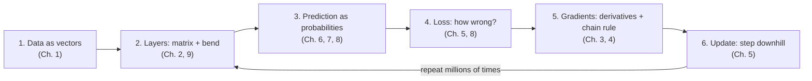
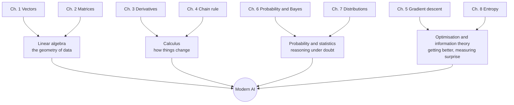

# Math for AI, From Scratch

*A toolkit chapter, then ten short chapters on five big ideas. Each ends with a tiny program and practice questions. Built for visual learners: every idea gets a picture first.*

> **How this book works.** Each chapter is one page and one sitting: pictures first, then a small worked example, then about 20 lines of Python you can run, then a few practice questions. When you finish a page, the link at the bottom takes you to the next one. (The `n` and `p` keys work too.) The logo at the top always brings you back here, and the contents button beside it (or the `t` key) shows every chapter and the sections of the page you are on.

## Before You Start

Here is a secret nobody tells beginners: the math behind modern AI is not a mountain. It is a small hill with a very good view.

You do not need to learn "all of calculus" or "all of linear algebra". You need five ideas:

1. **Vectors and matrices.** Data is lists of numbers, and a neural network layer is a matrix doing something to them.
2. **Derivatives.** How much does the output change if I nudge the input?
3. **The chain rule.** How nudges pass through many steps. This is the whole secret of backpropagation.
4. **Probability.** How to reason when you are not sure.
5. **Entropy.** How to measure surprise, which is how language models are trained.

That is it. Every chapter follows the same recipe: **a picture in your head, a small worked example, then about 20 lines of Python you can run.** No proofs. If you can follow a recipe and read a spreadsheet, you can follow this book.

This is the whole book on one page. Each box is something you will build in a later chapter, and the arrows show how they feed each other. When a chapter feels abstract, come back here and find its box.

## Four branches of math, one tree

Most of the math behind AI comes from four classic branches. Each chapter of this book is one branch seen from the AI side:

Chapters 9 and 10 sit at the top of the tree: they use every branch at once to build a network that learns, then the attention mechanism inside today's language models.

## A 2,300-year story in one picture

None of this math was invented for AI. Most of it is centuries old, made by people working on geometry, astronomy, gambling, telegraphs and artillery tables. AI is what happened when it all met cheap computers and huge amounts of data.

Two threads run through this history:

- **Symbolic AI** (the dominant approach from the 1950s to the 1980s) tried to write intelligence down as rules and logic: "if the patient has a fever and a rash, consider measles." It is precise, but it breaks on anything its authors did not foresee.
- **Non-symbolic, or learning-based, AI** (machine learning and deep learning) lets the rules be *learned from data* by adjusting numbers. That is the approach this book is about, and it is why the toolkit is vectors, slopes and probabilities rather than logic.

An older relative deserves a mention too. **Control theory**, the math of thermostats, autopilots and rockets, has steered machines automatically since the 1800s. It is sometimes called the "first AI": a feedback loop that measures error and corrects it, which is exactly what the training loop above does.

> 📜 **The founding sentence.** The 1956 Dartmouth proposal by John McCarthy, Marvin Minsky, Nathaniel Rochester and Claude Shannon claimed that "every aspect of learning or any other feature of intelligence can in principle be so precisely described that a machine can be made to simulate it." The phrase *artificial intelligence* comes from that proposal. Shannon will reappear in Chapter 8.

**How to use it:** read a chapter, run the code, then change one number and predict what happens. That last step is where learning actually occurs.

**What you need:** Python 3 and `numpy` (`pip install numpy`). A free Google Colab notebook works too.

## The chapters

0. [**The Math Toolkit**](00-toolkit.md): functions, graphs, exponents, logs and Σ. The notation everything else is written in.
1. [**Vectors**](01-vectors.md): lists of numbers as arrows, and similarity as geometry.
2. [**Matrices**](02-matrices.md): machines that reshape space, what a neural network layer really is, and how images are scanned with convolutions.
3. [**Derivatives**](03-derivatives.md): if I nudge the input, how much does the output move?
4. [**The Chain Rule**](04-chain-rule.md): nudges through many steps, and the secret of backpropagation.
5. [**Gradient Descent**](05-gradient-descent.md): learning as rolling downhill, even on bumpy ground.
6. [**Probability and Bayes**](06-probability.md): reasoning with doubt, updating beliefs, and judging a classifier fairly.
7. [**Distributions**](07-distributions.md): the shapes of randomness, why bells are everywhere, and how two things move together.
8. [**Entropy**](08-entropy.md): measuring surprise, and the single idea behind every loss.
9. [**A Network That Learns**](09-neural-network.md): everything assembled into a network that solves XOR, and how to tell learning from memorising.
10. [**Attention**](10-attention.md): the math inside transformers, and how a chatbot writes one token at a time.

Afterwards: [where to go next](next-steps.md), and a [glossary](glossary.md) for whenever a word slips your mind.

**Where to start:** [Chapter 0: The Math Toolkit](00-toolkit.md). There is no rush and no finish line. Each chapter stands on its own once you have read the ones before it.

**Pace:** go slowly. Chapter 0 is a toolkit of notation and basic functions; read it first even if parts feel familiar. After that, plan on one chapter per sitting. Every chapter ends with **Check yourself** questions and answers: cover the answer, try the question on paper, then check. If a step feels too fast, that is a signal to stop and redo the worked example with your own numbers, not to push on.
