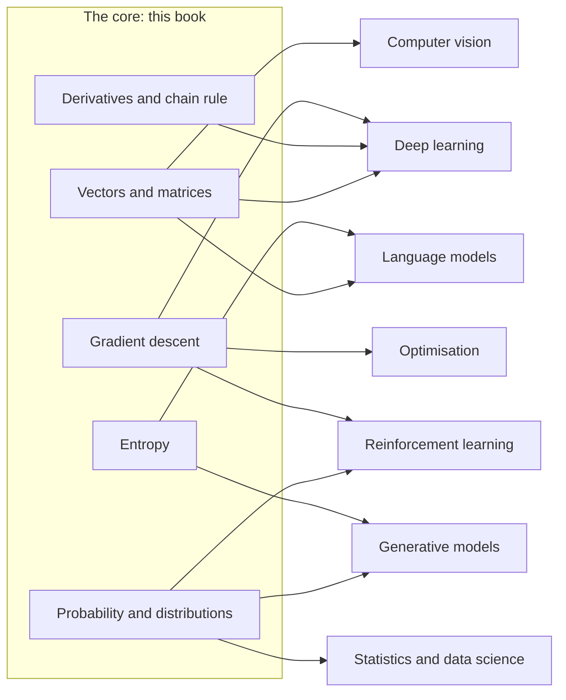

# Map of the Field: Where This Math Goes

The ten chapters are the shared core of modern AI. This table shows how the main areas build on it, and what to learn next in each.

| Field | What it does | Your chapters | Learn next |
| --- | --- | --- | --- |
| Classical machine learning | predicts from tabular data (prices, risk, churn) with linear models and decision trees | 1, 3, 5, 6 | regularisation, bias and variance, evaluation metrics |
| Deep learning | learns layered functions from data | 2, 4, 5, 9 | convolutions, normalisation, optimisers such as Adam |
| Language models and NLP | understands and generates text | 1, 8, 10 | tokenisation, fine-tuning, preference learning |
| Computer vision | works with images and video | 1, 2, 5 | convolutional networks, vision transformers |
| Generative models | creates new images, audio and text | 7, 8 | diffusion models, variational autoencoders |
| Reinforcement learning | learns by trial, error and reward | 3, 5, 6 | Markov decision processes, policy gradients |
| Control and robotics | steers physical systems in real time | 2, 3, 5, 6 | feedback (PID) control, Kalman filters, model predictive control |
| Statistics and data science | draws conclusions from data | 6, 7 | hypothesis testing, regression, Bayesian inference |
| Optimisation | finds the best parameters | 3, 5 | convexity, constraints, second-order methods |

## Four branches of math to deepen next

- **Linear algebra:** matrix inverses, eigenvalues and eigenvectors, and the singular value decomposition (which powers PCA and compression).
- **Calculus:** integrals, and matrices of derivatives (Jacobians and Hessians).
- **Probability and statistics:** joint and marginal distributions, covariance, maximum likelihood and Bayesian inference.
- **Optimisation:** convex problems, regularisation and constrained optimisation.

## Where to Go Next

You started from scratch and have now touched every core idea behind modern AI. Some good next steps:

- **Rewatch with fresh eyes:** 3Blue1Brown's *Essence of Linear Algebra* and *Neural Networks* series.
- **Build bigger:** Andrej Karpathy's *Neural Networks: Zero to Hero* (his micrograd is Chapter 4 on steroids, and his GPT build is Chapter 10 at full scale).
- **Go deeper when curious:** *Mathematics for Machine Learning* (free PDF) for matrix decompositions, optimisation and more probability.
- **See the same math from an engineer's side:** Tiago Capelo Monteiro's [*The Math Behind Artificial Intelligence*](https://www.freecodecamp.org/news/the-math-behind-artificial-intelligence-book/) (freeCodeCamp, 2026) covers the same four branches with more on determinants, eigenvalues, integrals, Markov models and control theory, with Python and PyTorch examples.
- **Keep the habit:** change one number, predict the result, run it. That loop is how real intuition forms.

The hill had a good view. Enjoy it.
